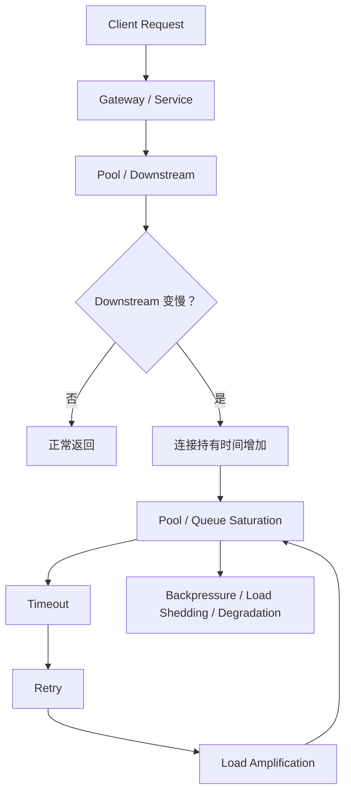
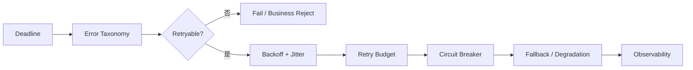
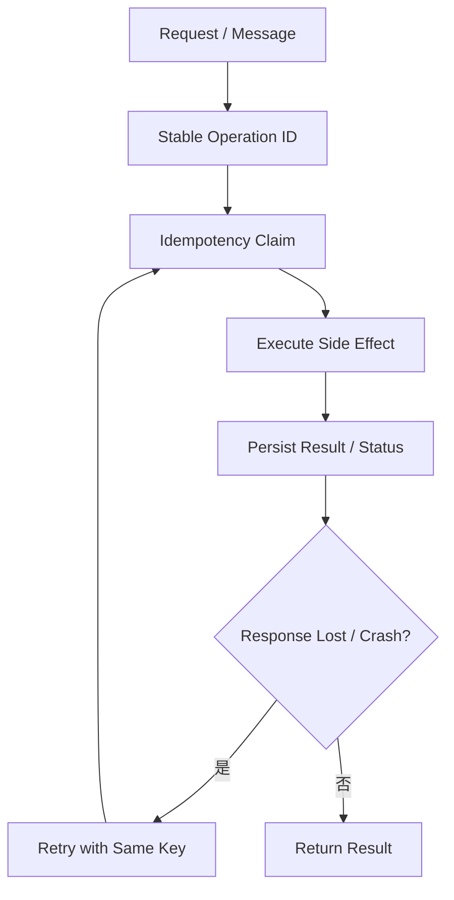
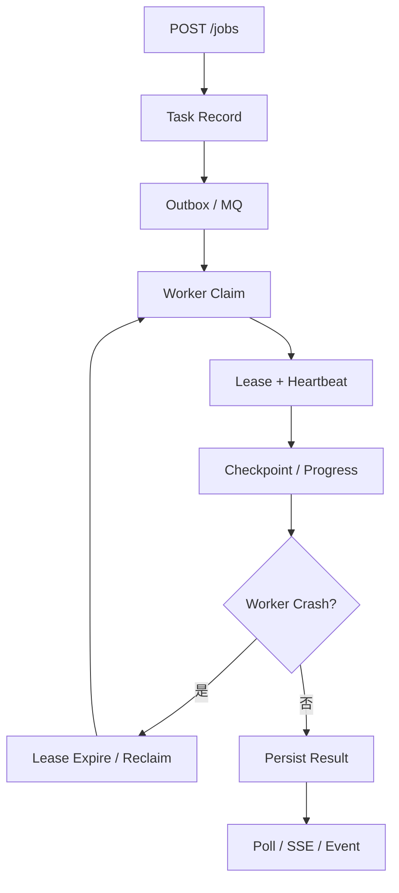
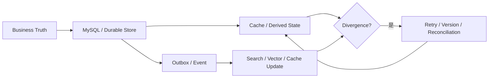
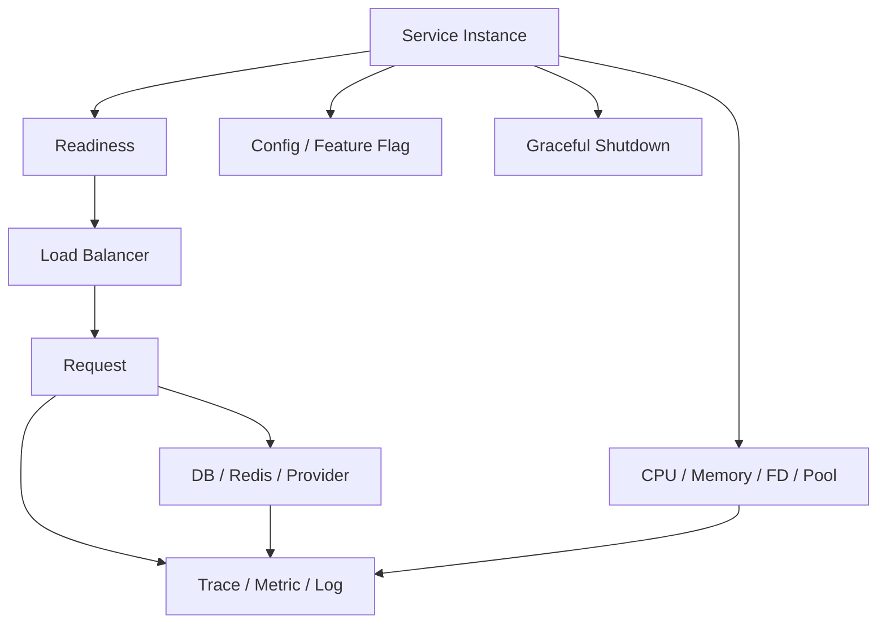
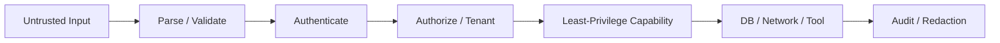

# AI Backend Engineering｜Review 与综合自测

[← 模块主页](../README.md) · [↑ Handbook 总目录](../../README.md) · [Learning Path](../../roadmap/learning-path.md) · [高频面试题 →](../interview/高频面试题.md)

> **用途：第二遍复习。** Review 不负责重新复制正文，而是要求从空白纸重建主线、机制、Failure / Trade-off 与面试表达。
>
> **学习路线是可选入口。** 如需整体安排，可参考 [Learning Path](../../roadmap/learning-path.md)；本 Review 也可以按个人节奏独立使用。

---

> Review 不是重新读 22 章，而是要求你从空白纸画出 Production Backend 的几条主线。

---

## 总图 1：一次请求怎样从正常路径走向雪崩

复习时必须能解释：为什么 Retry 不是 Timeout 的天然解药。

---

## 总图 2：Reliable Remote Call

---

## 总图 3：Side Effect Safety

要能继续回答：如果 Side Effect 成功但状态没写成功怎么办？

---

## 总图 4：Reliable Long-running Task

---

## 总图 5：State Ownership / Consistency

---

## 总图 6：Production Runtime

---

## 总图 7：Security Boundary

---

# 综合自测

### 1. 为什么 Pool 满了不能第一反应调大？

查看参考答案

Pool 满可能只是下游变慢、连接泄漏、事务太长的结果。先看 acquire wait、hold time 和 downstream latency；盲目调大可能把更多压力打到 DB/Provider。

### 2. Rate Limit 与 Concurrency Limit 的区别？

查看参考答案

Rate Limit 控制单位时间进入量；Concurrency Limit 控制同时在飞的任务数。AI Provider 经常同时有两种约束。

### 3. Deadline 为什么比层层独立 Timeout 更适合分布式链路？

查看参考答案

Deadline 表示全链路绝对预算，向下传播剩余时间，避免每层都重新获得完整 Timeout 导致总时延不断叠加。

### 4. 什么错误不应该 Retry？

查看参考答案

Schema/参数错误、权限拒绝、明确业务拒绝等永久错误。Retry 前必须先做 Error Taxonomy。

### 5. Jitter 为什么必要？

查看参考答案

只有指数退避时，大量 Client 仍会在相同时间点同步重试；Jitter 打散波峰，减少再次同时冲击下游。

### 6. Retry 为什么必须和 Idempotency 一起讨论？

查看参考答案

对有副作用操作，第一次可能已成功但响应丢失，Retry 会重复执行；稳定 Operation Key 和服务端幂等语义用于消除重复效果。

### 7. MQ 的 At-least-once 会带来什么工程要求？

查看参考答案

消息可能重复投递，因此 Consumer 必须幂等，且要设计 attempt、DLQ、Backoff、Ordering 与 Reconciliation。

### 8. Consumer Lag 高为什么不能直接“加 Consumer”？

查看参考答案

如果 Consumer 数已达到 Partition 数、存在 Hot Partition、下游变慢或 Poison Message，加 Consumer 未必有效；要先做瓶颈归因。

### 9. Outbox 解决了什么？

查看参考答案

把业务状态与待发送 Event 放在同一 DB Transaction 中，避免 DB 成功但 MQ publish 丢失。Relay 仍可能重复发送，所以 Consumer 继续需要幂等。

### 10. Lease 与 Heartbeat 为什么不能替代 Idempotency？

查看参考答案

Lease 解决执行权随时间过期；旧 Worker 可能已经产生副作用再失联，新 Worker Reclaim 后仍可能重复，因此还要 Idempotency/Fencing/Status Verification。

### 11. Cache 最终一致性靠什么“最终”？

查看参考答案

必须有明确收敛机制，例如 Retry、TTL、Outbox/CDC、Version、Reconciliation；不能只是希望它自己恢复。

### 12. Compensation 与 Rollback 的区别？

查看参考答案

Rollback 是事务内撤销；Compensation 是新的业务动作，例如退款、释放库存、发纠正通知，且补偿本身也可能失败。

### 13. Source of Truth 为什么必须提前定义？

查看参考答案

发生冲突或恢复时需要知道相信哪份状态；否则 Cache、DB、Runtime State 之间无法确定谁覆盖谁。

### 14. Authentication / Authorization / Approval 怎么区分？

查看参考答案

Authentication 确认身份；Authorization 判断是否有权限；Approval 是有权限后某次高风险动作是否仍需人工确认。

### 15. Stateless Service 是否真的没有状态？

查看参考答案

仍有 Pool、Local Cache、In-flight Request 等进程状态；“Stateless”主要指实例不是长期业务事实的唯一拥有者，任意副本可处理请求。

### 16. Readiness 与 Liveness 的区别？

查看参考答案

Readiness 判断是否接流量；Liveness 判断实例是否无法恢复需要重启。临时下游慢不应轻易触发 Liveness Restart。

### 17. 为什么增加 API Pod 可能让系统更差？

查看参考答案

更多 Pod 会增加 DB/Redis/Provider 并发；如果共享依赖已经饱和，会加速下游过载。

### 18. 为什么 P99 比平均延迟重要？

查看参考答案

平均值会掩盖尾部慢请求；用户体验和资源持有时间经常由 P95/P99 长尾决定。

### 19. Trace 为什么需要跨 MQ 传播 Context？

查看参考答案

异步 Worker 与原 HTTP Request 不在同一进程/时间，如果 Message Metadata 不带 Trace Context，链路会断开，无法归因一次业务操作的完整路径。

### 20. Dynamic Config 为什么需要 last-known-good？

查看参考答案

新配置可能非法或让服务退化；先验证再原子切换，并保留上一版本，可以在 Config Center/新配置故障时回退。

### 21. 为什么 Prompt 不能当 Authorization？

查看参考答案

Prompt 是模型行为约束，不是可信安全边界。真实 Tool/数据访问必须由服务器端身份、Policy、Scope 和最小权限执行。

### 22. SSRF 为什么在 Agent 场景风险更高？

查看参考答案

Agent 常有 URL Fetch/Browser Tool，模型还会处理不可信网页内容；攻击者可诱导服务端请求内网/metadata，所以需要目标验证与网络 Egress 隔离。

### 23. ThreadLocal 与 Python contextvars 为什么只能做概念映射？

查看参考答案

它们都可承载请求上下文，但生命周期、调度和传播机制不同。跨语言学习应该映射问题，而不是假设实现等价。

### 24. 一次 Production Incident 的最小排障链是什么？

查看参考答案

先限定范围和最近变更，再看 Rate/Error/Duration、Queue/Pool、CPU/Memory/FD、Downstream Latency，用 Trace 拆阶段并验证 Root Cause，最后观察修复后指标恢复。

