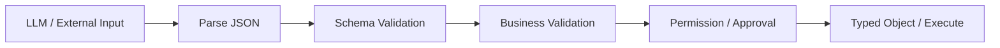
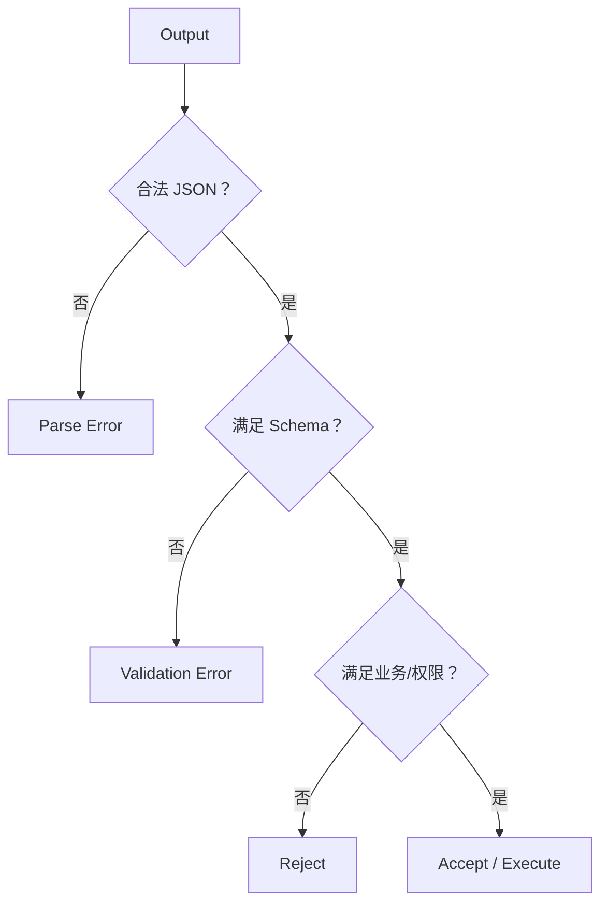

# 10. 结构化数据、JSON 与校验：图解与自测

对应正文：[10. 结构化数据、JSON 与校验](../docs/10-结构化数据-JSON与校验.md)

## 图解 1：从不可信文本到可信对象

## 图解 2：错误应该在哪一层处理

## 章节自测

1. `json.loads()` 成功为什么仍然不能直接执行 Tool？

因为它只验证 JSON 语法；字段类型、业务 invariant、权限和高风险动作仍需要独立校验。

2. `TypedDict` 与 Pydantic 最大的运行时差异是什么？

`TypedDict` 主要服务静态类型检查；Pydantic 等模型可以在运行时验证不可信输入并产生结构化错误。

3. Parse Error 与 Permission Error 为什么不能统一“让模型重试”？

Parse/Schema 问题可能通过有限 Repair 修复；Permission/Business Reject 是策略边界，不能允许模型通过反复重试绕过。

