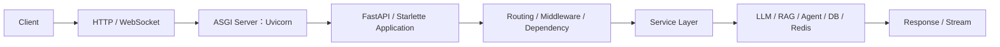
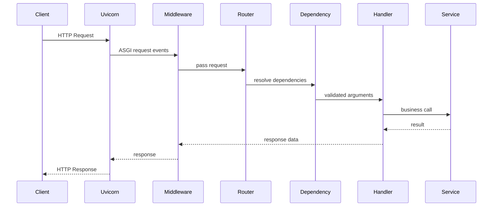

# 01｜FastAPI 的职责：从 HTTP 请求到 ASGI Application

FastAPI 的第一章不从 `@app.get()` 开始，而先回答一个更重要的问题：

> **一个请求真正进入 Python AI 服务时，到底经过了哪些层？FastAPI、Starlette、Uvicorn、Pydantic 分别在做什么？**

这是 `FASTAPI-001` 真人面试信号对应的核心心智模型。

---

## 1. FastAPI 在 AI Application 中负责什么

一个最小 AI Service 可以画成：



FastAPI 主要负责的是 **Web Application / API Layer**：

- 把 HTTP / WebSocket 请求映射到 Python Handler；
- 根据 Python Type Hint / Pydantic Model 提取和校验数据；
- 执行 Dependency Graph；
- 调用你的业务代码；
- 把返回值序列化成 Response；
- 生成 OpenAPI；
- 提供 Streaming / SSE / WebSocket 等接口能力。

它不负责把所有 Production 问题自动解决：

```text
Reliable MQ
Distributed Idempotency
Cross-service Retry Budget
Global Rate Limit
Durable Agent Checkpoint
RAG Evaluation
```

这些分别属于 AI Backend Engineering、Agent Harness、RAG 等模块。

---

## 2. HTTP Request / Response 先建立最小直觉

请求可以粗略理解成：

```text
Method + Path + Headers + Body
```

例如：

```http
POST /chat
Content-Type: application/json
Authorization: Bearer ...

{"message": "解释一下 RAG"}
```

响应则是：

```text
Status Code + Headers + Body / Stream
```

FastAPI 不发明 HTTP。它只是把 HTTP 世界映射成 Python 世界。

---

## 3. ASGI 是什么

ASGI 可以理解为 Python 异步 Web Application 与 Server 之间的一层协议边界。

从心智模型上看：

```text
Network
  ↓
ASGI Server
  ↓
ASGI Application
```

ASGI Application 接收的核心概念可以抽象为：

```python
async def app(scope, receive, send):
    ...
```

其中：

- `scope`：这条连接 / 请求的元信息；
- `receive`：接收客户端发来的事件；
- `send`：向客户端发送事件。

你平时写 FastAPI 时不会直接操作这三个参数，因为 FastAPI / Starlette 已经把它们封装成 Request、WebSocket、Response、Router 等更高层抽象。

---

## 4. Uvicorn、Starlette、FastAPI、Pydantic 怎么分层

一个非常实用的回答是：

| 组件 | 主要职责 |
|---|---|
| Uvicorn | ASGI Server，把网络协议事件交给 ASGI Application |
| Starlette | Web/ASGI 基础能力，如 Request、Response、Routing、Middleware、WebSocket |
| FastAPI | 在 Starlette 之上增加类型驱动 API、Dependency、OpenAPI 等开发体验 |
| Pydantic | 数据模型、解析、Runtime Validation、Serialization |

⚠️ 不要回答成：

> Uvicorn 就是 FastAPI。

也不要回答：

> Pydantic 是 Web Server。

---

## 5. 一个请求的完整链路

以：

```python
@app.post("/chat")
async def chat(req: ChatRequest):
    return {"answer": "..."}
```

为例，可以把正常路径画成：



这张图比“FastAPI 收到请求然后执行函数”更接近面试需要的深度。

---

## 6. Middleware / Dependency / Handler 不是一回事

先建立三个位置：

```text
Middleware
    ↓
Routing
    ↓
Dependency Graph
    ↓
Path Operation Handler
```

Middleware 更像对整个 Application 的外层包装；Dependency 更接近某个 Route 的输入、资源与业务前置条件；Handler 才是具体 Endpoint。

第四章会专门比较。

---

## 7. FastAPI 为什么特别适合 AI Service

不是因为“写 CRUD 少几行”，而是因为 AI Service 经常同时需要：

```text
Typed Request / Response
Async I/O
Long-lived HTTP Client
Streaming
SSE / WebSocket
Dependency / Auth Context
OpenAPI
External DB / Redis / Vector DB / Model Provider
```

FastAPI 把这些 Web 层能力和 Python Type System 比较自然地接起来。

但 Agent Loop、RAG Retrieval、DB Transaction 等核心业务能力仍然应该在独立 Service / Runtime 层，而不是全部写进 Router Function。

---

## 8. Failure：请求链路会坏在哪里

至少要知道这些层：

```text
Network / Proxy
↓
ASGI Server
↓
Middleware
↓
Validation
↓
Dependency
↓
Handler
↓
Downstream Provider / DB / Tool
↓
Serialization / Streaming
```

面试问“FastAPI 报 500 怎么排查”，不能只回答“看日志”。

应该先问：

- 请求有没有进入 Application？
- 是 422 Validation 还是业务异常？
- Dependency 是否失败？
- 下游是否超时？
- Response Model 是否不匹配？
- Streaming 是首包没发，还是发到一半失败？

---

## 9. 🎯 面试怎么回答 FASTAPI-001

> FastAPI 本身是 ASGI Application Framework。生产中通常由 Uvicorn 这类 ASGI Server 接收网络请求，然后把 ASGI 事件交给 FastAPI/Starlette Application。请求会经过 Middleware、Routing、Dependency Resolution 和数据校验，最后进入 Path Operation；返回值再经过序列化形成 HTTP Response 或 Streaming Response。FastAPI 负责 Web/API 层，不应该把分布式可靠性、Agent Runtime 或数据库内部机制都混成框架职责。

---

## 10. 易错点

- ❌ FastAPI = Uvicorn。
- ❌ ASGI = asyncio 的另一个名字。
- ❌ FastAPI 会自动让所有函数都非阻塞。
- ❌ Middleware、Dependency、Handler 都只是“前置函数”。
- ❌ 会写 `@app.post()` 就等于会设计 AI Service。

---

## 11. 本章自测

<details>
<summary>1. Uvicorn 和 FastAPI 的职责差异是什么？</summary>

Uvicorn 是 ASGI Server，负责网络协议与 ASGI Application 之间的连接；FastAPI 是 ASGI Application Framework，负责 Routing、Validation、Dependency、Response 等应用层能力。

</details>

<details>
<summary>2. 为什么说 FastAPI 不是 Agent Runtime？</summary>

FastAPI 管 Web/API 请求生命周期；Agent Runtime 管 Loop、Tool、Context、Memory、Checkpoint、Permission 等执行语义。FastAPI 可以承载 Agent API，但不能替代 Agent Harness。

</details>

<details>
<summary>3. 一个请求进入 Handler 前可能经过哪些层？</summary>

ASGI Server → Middleware → Router → 参数解析/Validation → Dependency Graph → Handler。具体实现细节可随版本变化，但这个分层心智模型稳定。

</details>
