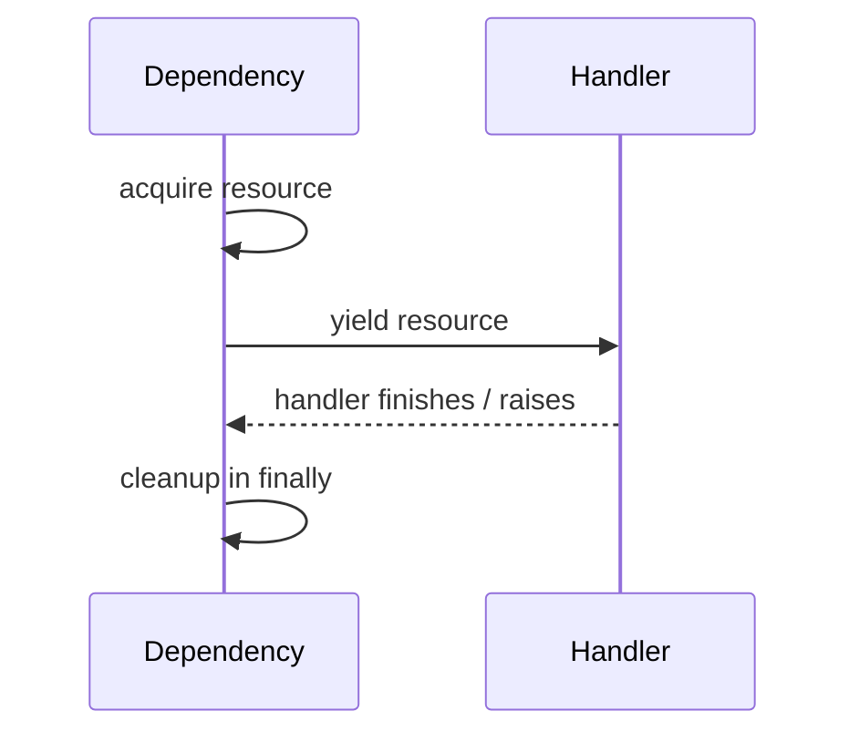

# 05｜Resource Lifecycle：yield Dependency、scope 与 Application Lifespan

FastAPI 的资源管理如果只会“在函数里 new 一个 client”，很快就会遇到：

- 连接池频繁创建；
- DB Session 泄漏；
- Streaming 时资源提前关闭或占用过久；
- Background Task 继续使用已经释放的资源；
- Shutdown 时连接没关干净。

这一章专门建立 **Request Lifecycle vs Application Lifecycle**。

---

## 1. 两种生命周期必须分清

```text
Application Lifecycle
startup ───────────────────────────── shutdown
          │ request A │ request B │

Request Lifecycle
request start ───────────── response end
```

典型资源：

### Application-scoped

- HTTP Client / Connection Pool；
- Redis Client / Pool；
- Model Provider Client；
- 大型模型 / Tokenizer；
- Metrics Exporter。

### Request-scoped

- DB Session；
- Transaction；
- Current User；
- Tenant Context；
- Request Trace Context。

---

## 2. `yield` Dependency 是什么

FastAPI 支持 Dependency 在 `yield` 前获取资源，在 `yield` 后释放资源。

```python
async def get_db():
    db = DBSession()
    try:
        yield db
    finally:
        db.close()
```

心智模型：



它和 Python Context Manager 思想是同一条知识链。

---

## 3. 为什么 `finally` 很重要

不要写：

```python
async def get_resource():
    resource = acquire()
    yield resource
    resource.close()
```

如果异常路径处理不当，清理语义可能不够明确。

更稳：

```python
async def get_resource():
    resource = acquire()
    try:
        yield resource
    finally:
        resource.close()
```

资源生命周期必须覆盖成功和失败路径。

---

## 4. 当前 FastAPI 的 `Depends(scope=...)`

现代 FastAPI 的带 `yield` Dependency 支持不同 scope：

```text
scope="function"
→ Path Operation 结束后、Response 发送前执行 cleanup

scope="request"（yield dependency 默认）
→ cleanup 围绕整个 request/response 生命周期
```

这件事非常重要，因为 Streaming Response 的“Handler 已经 return”并不等于“Response 已经发送完”。

⚠️ 这是版本演进过的行为，所以教材不要把某个历史版本 cleanup timing 写成永久不变规律。

---

## 5. Streaming 场景为什么要特别小心

假设：

```python
async def get_db():
    db = open_db()
    try:
        yield db
    finally:
        db.close()

@app.get("/stream")
async def stream(db = Depends(get_db)):
    return StreamingResponse(generate(db))
```

真正的问题是：

> Generator 在发送整个 Stream 的过程中还需不需要 `db`？

如果需要，那么过早 cleanup 会导致 Stream 中途访问已经关闭的资源。

如果不需要，就应该尽早把必要数据 materialize 出来，避免长期占用 DB Connection。

因此要设计：

```text
Resource Scope
+ Stream Lifetime
+ Cleanup Timing
```

而不是只会背 `yield`。

---

## 6. BackgroundTasks 不应该复用已结束 Request 的资源

一个常见错误：

```text
Request Dependency 获取 DB Session
→ Handler 把同一个 Session 传给 Background Task
→ Response 返回
→ Dependency cleanup
→ Background Task 继续用旧 Session
```

更合理：

> Background Task 如果需要数据库等资源，应在自己的执行逻辑里建立自己的资源生命周期，而不是偷偷依赖 Request-scoped Resource。

这也是 FastAPI 官方版本演进中特别强调的边界。

---

## 7. Application Lifespan 解决什么

应用启动时需要初始化昂贵共享资源：

```python
from contextlib import asynccontextmanager
from fastapi import FastAPI

clients = {}

@asynccontextmanager
async def lifespan(app: FastAPI):
    clients["llm"] = create_llm_client()
    clients["redis"] = create_redis_client()
    yield
    await clients["llm"].aclose()
    await clients["redis"].aclose()

app = FastAPI(lifespan=lifespan)
```

心智模型：

```text
startup
→ create shared client / pool
→ serve many requests
→ shutdown
→ close / flush / release
```

---

## 8. 为什么不能每个 Request 创建 HTTP Client

错误：

```python
@app.post("/chat")
async def chat(...):
    client = NewHttpClient()
    result = await client.post(...)
    await client.close()
```

问题可能包括：

- 连接无法有效复用；
- TLS / TCP 建连成本重复；
- Pool 优势消失；
- 高并发下资源抖动。

更常见做法是 Application-scoped Client + 内部 Connection Pool。

---

## 9. DB Session 为什么通常是 Request-scoped

DB Session / Transaction 需要和一个业务请求边界对齐：

```text
Request
→ open session
→ query / write
→ commit / rollback
→ close
```

但不要误解成：

> 一个 HTTP Request 必须只有一个数据库事务。

真实业务可能有更细 Transaction Boundary；关键是生命周期要明确。

---

## 10. Lifespan ≠ 全局可变状态随便放

`app.state` 或应用级容器可以保存 Client/Pool 等共享对象。

但不要把：

```text
current_user
current_tenant
current_agent_run
```

这种请求态信息塞到应用全局状态。

多并发时会串数据。

---

## 11. Graceful Shutdown 和 Lifespan 的关系

Shutdown 时常需要：

```text
停止接收新请求
→ 等待 / 取消 in-flight
→ flush telemetry
→ close client / pool
→ release resource
```

FastAPI Lifespan 提供 Application 内部初始化/清理入口，但完整 Graceful Shutdown 还依赖 ASGI Server、容器编排和任务系统。

---

## 12. Failure Timeline：资源生命周期错了会怎样

### Case A：每个请求建连接池

```text
QPS 上升
→ 大量 connect / TLS
→ FD / socket 压力
→ latency 上升
```

### Case B：Request DB Session 被长 Stream 持有

```text
用户慢速接收
→ Stream 60 秒
→ DB connection 60 秒不释放
→ Pool Exhaustion
```

### Case C：后台任务复用 Request Resource

```text
Response sent
→ request cleanup
→ background task accesses closed resource
→ intermittent failure
```

---

## 13. 🎯 面试怎么回答

> 我会先区分 Application-scoped 和 Request-scoped Resource。HTTP/Redis/LLM Client 和 Pool 通常在 Lifespan 初始化并在 shutdown 关闭；DB Session、Current User、Tenant Context 等更适合 Dependency 管理。带 `yield` 的 Dependency 能把 acquire/cleanup 绑定到结构化生命周期，但 Streaming 和 BackgroundTasks 要特别关注 cleanup timing，不能默认 Handler return 就等于整个 Response 完成。

---

## 14. 本章自测

<details>
<summary>1. Lifespan 和 yield Dependency 最核心的区别是什么？</summary>

Lifespan 管 Application startup/shutdown 级共享资源；yield Dependency 通常管理 Route/Request 级依赖和资源。

</details>

<details>
<summary>2. 为什么 Streaming 会让资源生命周期更难？</summary>

因为 Handler 返回 Response 对象后，真正的数据发送可能持续很久；如果 Generator 仍依赖某个资源，就必须让资源生命周期覆盖 Streaming 阶段，或者提前把需要的数据取出。

</details>

<details>
<summary>3. Background Task 为什么不应该直接拿 Request-scoped DB Session？</summary>

Response 返回后 Request Dependency 可能已经开始清理；后台任务应有自己的资源生命周期，避免使用已经关闭或事务语义不明确的 Session。

</details>
