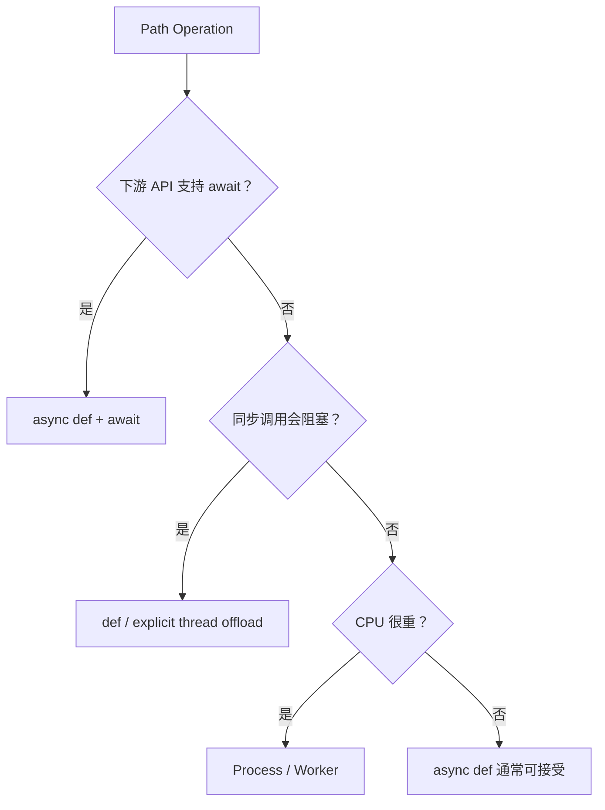

# 06｜Async Execution：`def` / `async def`、Blocking Boundary 与并发保护

FastAPI 的异步部分最容易出现两个极端误区：

```text
误区 A：async def 一定更快
误区 B：我用了 FastAPI，所以同步函数也自动不会阻塞
```

这一章建立真正的执行模型。

---

## 1. 先复习 Python 前置

Python Foundation 已经讲过：

```text
Coroutine
→ await
→ Event Loop
→ Thread / Process
→ Blocking I/O
```

FastAPI 这一章不重新发明 asyncio，而是回答：

> **当这些 Python 函数被 FastAPI 调用时，框架怎样执行它们？**

---

## 2. `async def` Path Operation

如果你的下游库本身提供 awaitable API：

```python
@app.post("/chat")
async def chat(req: ChatRequest):
    result = await llm_client.generate(req.message)
    return result
```

当协程等待网络 I/O 时，可以把执行机会交回 Event Loop，服务继续处理其他可运行任务。

适合：

- async HTTP client；
- async Redis；
- async DB driver；
- async Streaming；
- async Tool / Provider call。

---

## 3. 普通 `def` Path Operation

FastAPI 官方说明里，普通 `def` Path Operation 会被放到外部 Thread Pool 中执行并等待结果，而不是直接堵住 Event Loop。

```python
@app.get("/legacy")
def legacy_endpoint():
    return blocking_sdk_call()
```

同样，普通 `def` Dependency 也会按类似方式执行。

这是一条非常重要的框架语义。

---

## 4. 但“普通 Utility Function”不会被 FastAPI 自动 offload

这是常见坑。

```python
async def endpoint():
    return blocking_helper()
```

如果 `blocking_helper()` 是你在 `async def` 里直接调用的普通函数：

> **它就是当前线程里的普通函数调用。FastAPI 不会因为它出现在 Endpoint 里面就自动把它送去 Thread Pool。**

所以：

```text
FastAPI 调用的 def Path Operation / Dependency
≠
你在 async 函数里直接调用的任意 def helper
```

---

## 5. Blocking I/O 为什么危险

错误：

```python
import time

@app.get("/bad")
async def bad():
    time.sleep(5)
    return {"ok": True}
```

这 5 秒里 Event Loop 线程被阻塞，其它协程无法正常推进。

如果确实只能调用同步阻塞库，需要：

- 用普通 `def` Endpoint / Dependency；
- 或明确 offload 到合适 Thread Pool；
- 或改用异步 SDK。

---

## 6. CPU-bound 更危险

```python
@app.post("/parse")
async def parse():
    result = huge_cpu_loop()
    return result
```

即使没有 I/O，这种长时间 CPU 工作也会占住 Event Loop。

AI 场景常见：

- OCR 后处理；
- PDF 复杂解析；
- 大规模文本清洗；
- 本地 Embedding 预处理；
- 图像处理。

真正重 CPU 工作通常应该：

```text
Process Pool
或
Worker / Job System
```

而不是简单包一层 `async def`。

---

## 7. Thread Pool 也不是无限资源

假设有很多同步 Endpoint：

```text
1000 requests
→ all need blocking SDK
→ Thread Pool saturation
→ queueing
→ latency rises
```

所以“FastAPI 会放进 Thread Pool”并不等于问题消失。

你仍需考虑：

- Worker 数；
- Thread Capacity；
- 下游连接池；
- Timeout；
- Queueing；
- Backpressure。

完整容量控制在 AI Backend Engineering 深化。

---

## 8. 并发 ≠ 无限并发

例如：

```python
results = await asyncio.gather(
    *[call_tool(x) for x in items]
)
```

如果 `items` 有 5000 个，这可能瞬间向下游放出 5000 个请求。

更合理：

```python
semaphore = asyncio.Semaphore(20)

async def limited_call(x):
    async with semaphore:
        return await call_tool(x)
```

这是 FastAPI API 层常见的局部容量保护。

但全局/多实例限流不能靠进程内 Semaphore 完成。

---

## 9. Connection Pool 和 Concurrency 必须一起看

假设：

```text
API concurrency = 500
DB pool         = 20
```

那么真正能同时获得 DB Connection 的最多约 20 个请求，其余请求会：

```text
等待 Pool
→ Queueing
→ P99 增大
```

因此优化 FastAPI 不能只调 Worker 数。

应该看：

```text
Request Concurrency
→ Thread/Event Loop
→ Downstream Pool
→ Downstream QPS
→ Timeout Budget
```

---

## 10. `asyncio.gather` 在 API 中怎么用

例如 Chat API 同时取：

```text
user profile
knowledge context
feature config
```

如果三项彼此独立且都是异步 I/O，可以并发等待：

```python
profile, context, config = await asyncio.gather(
    get_profile(),
    get_context(),
    get_config(),
)
```

但要继续考虑：

- 其中一项失败怎么办？
- Timeout 是否统一？
- 是否可以 Partial Result？
- Cancel 是否传播？

这些会在第 12 章继续。

---

## 11. `def` vs `async def` 的决策框架



这个表是经验框架，不是语言定律。

---

## 12. FASTAPI-003 为什么被迁回 Python

历史面试问题：

> FastAPI 异步调用 LLM 时，`await` 等待期间 Event Loop、CPU 和 Thread 在做什么？

核心知识是 Python `asyncio` Runtime，因此 Primary Canonical 已归 `PY-012`。

FastAPI 这里只补：

> Framework 怎样调用 `def` / `async def` Path Operation 和 Dependency。

这体现模块边界审计，而不是重复建题。

---

## 13. 🎯 面试怎么回答

> 如果下游库提供 async API，我会用 `async def` 并 `await`，让等待 I/O 时 Event Loop 能继续调度其它任务。FastAPI 对普通 `def` Path Operation 和 Dependency 会使用外部 Thread Pool，但这不代表在 `async def` 内直接调用一个同步 helper 会自动 offload。CPU-heavy 工作和大量同步阻塞调用仍然可能拖垮服务，需要显式隔离、容量限制和 Pool 设计。

---

## 14. 易错点

- ❌ async def 一定更快。
- ❌ await 会创建新线程。
- ❌ FastAPI 会自动异步化你调用的所有同步 SDK。
- ❌ Thread Pool 是无限的。
- ❌ `gather` 等于并发限流。
- ❌ CPU-heavy 工作包成 async 就不会阻塞。

---

## 15. 本章自测

<details>
<summary>1. 普通 `def` Endpoint 和在 `async def` 内直接调用普通 helper 有什么不同？</summary>

前者是 FastAPI 主动调用的 Path Operation，框架会把它放入外部 Thread Pool；后者只是普通 Python 调用，不会被 FastAPI 自动 offload。

</details>

<details>
<summary>2. 为什么增加 Worker 数不一定降低 P99？</summary>

如果真正瓶颈是 DB Pool、HTTP Pool、Provider QPS、Thread Pool 或 CPU，更多 Worker 可能只增加排队和下游压力。

</details>

<details>
<summary>3. 为什么 Semaphore 只能解决一部分并发问题？</summary>

进程内 Semaphore 只能限制单进程/单实例的本地并发；多实例全局配额、租户限流等需要更高层协调机制。

</details>
