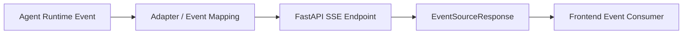

# 07｜Streaming Fundamentals 与 Server-Sent Events（SSE）

AI Chat、RAG、Agent 很多接口都不适合：

```text
请求进来
→ 等模型全部生成
→ 一次性返回完整 JSON
```

用户体验和系统可观测性都会很差。

因此 FastAPI 必须真正理解 **Streaming Response**，而不是只会普通 JSON Response。

---

## 1. 为什么 AI API 经常需要 Streaming

假设模型生成 20 秒：

### 非 Streaming

```text
0s request
...
20s first byte + full answer
```

### Streaming

```text
0s request
1s message_start
1.5s token_delta
2s token_delta
...
20s message_end
```

Streaming 改善的是：

- Time To First Byte / First Token；
- 用户可感知延迟；
- Agent 中间状态可见性；
- 长任务进度反馈。

它并不会自动降低模型总生成时间。

---

## 2. `StreamingResponse` 的核心模型

可以把它理解为：

```text
Iterable / AsyncIterable
      ↓
不断 yield chunk
      ↓
ASGI send response body event
      ↓
Client incremental receive
```

示例：

```python
from fastapi.responses import StreamingResponse

async def generate():
    for token in ["Hello", " ", "world"]:
        yield token

@app.get("/stream")
async def stream():
    return StreamingResponse(generate(), media_type="text/plain")
```

真正生产实现还要处理取消、异常、编码和协议事件。

---

## 3. Raw Streaming 和 SSE 有什么区别

Raw Streaming 只表示：

> Response Body 可以分块持续发送。

SSE 则定义了一个文本事件协议：

```text
event: token
data: {"text":"hello"}
id: 123
retry: 5000

```

事件之间以空行分隔。

SSE 的价值是：

```text
字节流
→ 有事件语义的流
```

---

## 4. 现代 FastAPI 的原生 SSE 支持

当前官方 FastAPI 已提供：

```python
from fastapi.sse import EventSourceResponse, ServerSentEvent
```

可以在 Path Operation 中 `yield` SSE Event。

```python
from collections.abc import AsyncIterable
from fastapi import FastAPI
from fastapi.sse import EventSourceResponse, ServerSentEvent

app = FastAPI()

@app.post("/chat/stream", response_class=EventSourceResponse)
async def chat_stream() -> AsyncIterable[ServerSentEvent]:
    yield ServerSentEvent(event="message_start", data={"id": "m1"})
    yield ServerSentEvent(event="token", data={"text": "hello"})
    yield ServerSentEvent(event="message_end", data={})
```

官方当前 SSE 支持可用于 GET，也可用于 POST。

⚠️ SSE 原生 API 是版本演进结果，历史代码可能使用第三方 EventSourceResponse。教材应该优先解释协议和生命周期，而不是把某个版本 API 当成永恒不变。

---

## 5. AI Chat 的 SSE Event 不应该只有 token

更稳的事件模型：

```text
message_start
content_delta
tool_call_start
tool_call_delta
tool_result
state_update
usage
error
message_end
```

例如：

```json
{
  "event": "tool_call_start",
  "run_id": "run_123",
  "tool": "search_docs"
}
```

前端不应该靠解析自然语言文本猜 Agent 当前状态。

---

## 6. Event Schema 要稳定

建议每个事件至少考虑：

```text
type
run_id / message_id
sequence
payload
timestamp（可选）
version（协议演进需要时）
```

例如：

```json
{
  "type": "content_delta",
  "run_id": "run_123",
  "seq": 7,
  "payload": {"text": "world"}
}
```

这已经开始接近 Agent Runtime 的 Message Model，但 FastAPI 负责的是**把 Runtime Event 映射到 Transport Event**。

---

## 7. SSE 的 keep-alive 和 Proxy 问题

长连接经常经过：

```text
Browser
→ CDN / Load Balancer
→ Reverse Proxy
→ FastAPI
```

中间层可能：

- 空闲超时；
- Buffer Response；
- 缓存；
- 断开长连接。

当前 FastAPI SSE 实现会处理一些常见最佳实践，例如 keep-alive ping、禁止缓存、避免某些代理缓冲。

但真实部署仍需验证自己的 Proxy / LB 配置。

---

## 8. FASTAPI-004：Agent 中间事件如何推前端

真人问题不是：

> FastAPI 怎么返回字符串？

而是：

> FastAPI + SSE 怎样实时把 Agent / LangGraph 中间事件推给前端？

正确分层：



不要让 FastAPI Endpoint 自己实现整个 Agent Loop。

---

## 9. Stream 中途出错怎么办

如果 Response 还没发 Header，可以正常返回 HTTP Error。

但如果 Stream 已经开始：

```text
HTTP 200 already sent
→ token emitted
→ downstream error
```

你通常不能再把整个 HTTP Status 改成 500。

因此 Streaming Protocol 需要显式：

```text
error event
+ terminal event
```

例如：

```json
{"type":"error","code":"MODEL_TIMEOUT","retryable":true}
```

这就是为什么 Streaming API 的 Error Contract 比普通 JSON 更重要。

---

## 10. Client Disconnect

客户端关掉页面时：

```text
Browser disconnected
≠
你的 LLM / Tool 一定已经停止
```

Endpoint / Generator 需要考虑：

- cancellation；
- disconnect detection；
- downstream cancel；
- cleanup；
- 副作用是否还能继续。

第 12 章专门展开。

---

## 11. SSE vs WebSocket 先记一个边界

SSE：

```text
Server → Client 为主
基于 HTTP
事件流简单
AI Chat 很常见
```

WebSocket：

```text
Client ↔ Server 双向
长连接状态更多
适合强实时双向交互
```

如果只是模型结果持续推给用户，不要为了“高级”默认上 WebSocket。

---

## 12. 🎯 面试怎么回答 FASTAPI-004

> 我会把 Agent Runtime Event 和 Transport 解耦。Agent Runtime 产生 typed event，例如 content delta、tool call、state update、error；FastAPI Endpoint 把这些 event 映射成 SSE Event，再通过 EventSourceResponse 流式推给前端。还要设计稳定 event schema、stream 中途错误事件、心跳/代理超时，以及客户端断开后的 cancellation 和资源释放。

---

## 13. 易错点

- ❌ Streaming = 生成更快。
- ❌ SSE 只能 GET。
- ❌ 每个 token 都直接 `print` 到网络就是生产协议。
- ❌ Stream 发出 200 后还能随时改成 500。
- ❌ 浏览器断开后下游任务一定自动停止。
- ❌ SSE 和 WebSocket 谁更“先进”谁就更好。

---

## 14. 本章自测

<details>
<summary>1. Raw Streaming 与 SSE 的本质差异是什么？</summary>

Raw Streaming 只提供增量字节发送；SSE 在文本流之上定义 event/data/id/retry 等事件语义，更适合浏览器消费结构化服务端事件。

</details>

<details>
<summary>2. 为什么 Agent SSE 不能只有 token event？</summary>

Agent 还存在 Tool、State、Usage、Error、Lifecycle 等中间事件。稳定事件协议能让前端按类型处理，而不是解析自然语言猜状态。

</details>

<details>
<summary>3. Stream 已经开始后发生异常，为什么不能简单返回 500？</summary>

HTTP Response Status/Headers 通常已经发送，因此需要在流协议内部发送 error/terminal event 表达失败。

</details>
