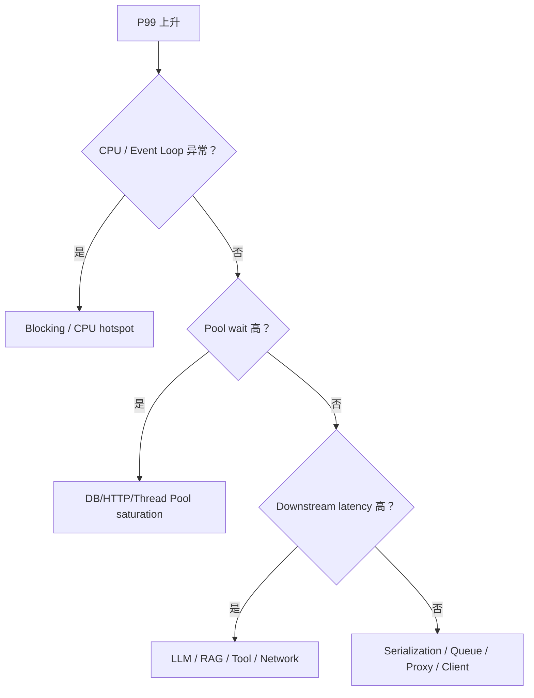

# 14｜Logging、Trace、Metrics 与 FastAPI 性能诊断

FastAPI 服务出了性能问题，不能只看：

```text
CPU 80%
平均延迟 300ms
```

AI Service 的一次请求可能跨：

```text
Gateway
→ FastAPI
→ Redis
→ MySQL
→ Vector DB
→ LLM Provider
→ Tool
```

所以要建立可观测的请求链路。

---

## 1. Access Log 和 Application Log 不一样

Access Log 常记录：

```text
method
path
status
latency
client
request_id
```

Application Log 记录：

```text
业务事件
错误语义
resource id
run id
tenant id
```

不要把所有内容都打成字符串：

```text
something failed
```

更推荐结构化日志。

---

## 2. Request ID 为什么重要

同一个用户请求可能经过很多服务。

如果没有 ID：

```text
FastAPI error log
Redis timeout log
LLM error log
```

彼此无法关联。

Middleware 很适合建立：

```text
request_id / trace_id
```

并继续传给下游。

---

## 3. Trace 要分 Span

例如一次 RAG Chat：

```text
request
├── auth
├── redis session
├── retrieval
│   ├── vector search
│   └── rerank
├── llm generation
└── response stream
```

真正排查延迟时要知道哪一段慢。

不是只知道：

```text
/chat = 7.2s
```

---

## 4. AI-specific Span

常见维度：

```text
model / provider
prompt_version
input_tokens
output_tokens
retrieval_k
rerank latency
tool name
first_token latency
```

但要注意 Prompt / Tool Input 可能含敏感数据，Trace 需要 Redaction。

---

## 5. P50 / P95 / P99

平均值会掩盖尾延迟。

例如：

```text
P50  = 300ms
P95  = 2s
P99  = 12s
```

用户投诉的往往是 P99。

FastAPI 性能诊断应该先拆：

```text
queueing
handler
pool acquisition
downstream
serialization
stream first byte
```

---

## 6. Event Loop Block 怎么看

症状：

```text
CPU 不一定满
但所有 async request 同时变慢
```

可能是某个 `async def` 中执行了同步阻塞操作或长 CPU 任务。

线索：

- Event Loop Lag；
- 某个 Handler 长时间没有 await；
- sync SDK 在 async path 直接调用。

---

## 7. Thread Pool Saturation

症状：

```text
大量 sync endpoint / dependency
→ waiting for thread
→ latency rises
```

不是所有慢请求都来自 Event Loop。

需要区分：

```text
Event Loop Block
vs
Thread Pool Queue
```

---

## 8. Connection Pool Exhaustion

常见：

```text
DB query 20ms
但 request 2s
```

真正时间花在：

```text
wait connection = 1.8s
query = 20ms
```

所以 Pool Acquisition 最好成为独立 Trace/Metric。

---

## 9. Streaming 指标不只 total latency

对于 LLM Stream 至少关心：

```text
TTFB / TTFT
stream duration
event gap
disconnect rate
error-after-stream-start rate
```

用户往往更在意“多久开始出字”，而不是只看最终总耗时。

---

## 10. Middleware Timing 能做什么

简单 Middleware 可以记录整个 Request 总耗时：

```python
@app.middleware("http")
async def timing(request, call_next):
    start = time.perf_counter()
    response = await call_next(request)
    duration = time.perf_counter() - start
    ...
    return response
```

但注意：

> 总耗时只是入口指标，不能替代细粒度 Trace。

---

## 11. Error Metrics 要分类

不要只有：

```text
error_count
```

至少区分：

```text
validation
unauthenticated
forbidden
provider timeout
provider 429
provider 5xx
db pool timeout
stream broken
internal error
```

否则告警后仍然不知道发生了什么。

---

## 12. Cardinality 风险

Metrics Label 不要随便放：

```text
user_id
request_id
prompt text
```

这会导致高 Cardinality。

这些更适合 Log/Trace，Metrics 应保留有限维度。

---

## 13. 性能诊断顺序



先归因，再优化。

---

## 14. 🎯 面试怎么回答

> 我会先给 FastAPI Request 建 request_id/trace_id，再把一次请求拆成 Dependency、Pool Acquire、DB/Redis/Retrieval、LLM/Tool、Serialization/Streaming Span。性能问题优先看 P95/P99 和 Queueing，而不是平均值。AI Streaming 还会单独看 TTFT、stream duration 和 disconnect/error-after-start。Event Loop Block、Thread Pool Saturation、Connection Pool Exhaustion 要分别诊断。

---

## 15. 本章自测

<details>
<summary>1. 为什么平均延迟正常但用户仍然投诉很慢？</summary>

平均值可能掩盖尾延迟；少数 P99 请求可能非常慢，需要看分位数和具体 Trace。

</details>

<details>
<summary>2. DB Query 本身很快，为什么 API 仍可能慢？</summary>

可能长时间等待 Connection Pool、Thread Pool、锁或其它下游资源，真正 SQL 执行只占很小部分。

</details>

<details>
<summary>3. 为什么 request_id 不适合作为 Metrics Label？</summary>

每个请求都不同，会制造极高 cardinality；request_id 更适合 Log/Trace 关联。

</details>
