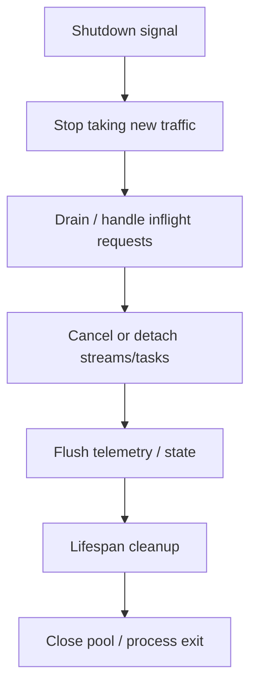

# 15｜Deployment：Worker、Health Check 与 Graceful Shutdown

本章不教 Kubernetes 全家桶，而是建立 FastAPI Service 进入 Production 前必须理解的执行边界：

```text
Process
Worker
Replica
Shared State
Health
Shutdown
```

---

## 1. Development Server 和 Production Runtime 不一样

开发环境常见：

```bash
fastapi dev
```

或 Uvicorn reload。

生产真正关心：

- 进程模型；
- Worker；
- 多核利用；
- Proxy / TLS；
- Health Check；
- Graceful Shutdown；
- 容器与副本。

不要把 `--reload` 作为生产配置。

---

## 2. 一个 Worker 是什么

可以粗略理解：

```text
一个 Python Process
→ 一个 FastAPI Application Instance
→ 自己的 Event Loop / Thread Pool / Memory
```

如果多个 Worker：

```text
Worker A state
≠
Worker B state
```

所以进程内全局 dict 不适合保存需要全局一致的 Session / Agent Run State。

---

## 3. 多 Worker 为什么能利用多核

传统 CPython 下，一个进程中的 Python CPU Thread 受 GIL 约束。

多个 Worker 是多个独立进程，可以由 OS 分配到多个 CPU Core。

但：

> Worker 越多不等于吞吐无限增加。

因为还受：

- Memory；
- DB Pool；
- Provider QPS；
- Redis / Vector；
- Network；
- CPU Context Switching。

限制。

---

## 4. Worker 数和连接池要联动

假设：

```text
4 workers
每 worker DB pool = 20
```

理论最大连接可能接近：

```text
4 × 20 = 80
```

如果数据库只能稳定承受 50，盲目扩 Worker 会放大压力。

因此容量规划必须看整个系统。

---

## 5. Process-local State 为什么危险

错误：

```python
sessions = {}
```

然后假设所有请求都能访问同一个 sessions。

多 Worker 后：

```text
Request 1 → Worker A → writes session
Request 2 → Worker B → session missing
```

真正共享状态应该放在：

- DB；
- Redis；
- Durable State Store；

或通过明确 Sticky Session / Routing 设计承担，但不能无意识依赖。

---

## 6. Liveness 和 Readiness 不一样

### Liveness

回答：

> 这个进程是否还活着？

### Readiness

回答：

> 它现在是否应该接流量？

例如应用刚启动，模型/连接池还没准备好：

```text
alive = yes
ready = no
```

---

## 7. Health Check 不要做得太重

坏例子：

```text
/health
→ call LLM provider
→ query vector db
→ query mysql
→ query redis
```

每秒执行大量下游依赖检查，反而制造额外流量。

更合理：

- Liveness 轻量；
- Readiness 根据关键依赖状态；
- 深度 Dependency Probe 单独低频执行。

---

## 8. Graceful Shutdown 的完整顺序



实际时序受 ASGI Server、Orchestrator 和应用设置影响。

---

## 9. Streaming 对 Shutdown 的影响

如果 SSE / WebSocket 长连接很多：

```text
shutdown signal
→ 等所有连接自然结束？
```

可能永远等不完。

所以需要：

- drain deadline；
- send terminal event（能发时）；
- reconnect 语义；
- durable run 与 connection 分离。

---

## 10. Lifespan Cleanup 在 Shutdown 中扮演什么角色

Application Lifespan 的 `yield` 后部分适合：

```text
close http client
close redis pool
close vector client
release model resource
flush tracer
```

但服务是否先停止接流量、多久杀进程，不是 FastAPI Lifespan 单独决定的。

---

## 11. Container 场景的进程模型

容器里常见两种思路：

```text
一个 Container 一个 Worker
→ 通过多个 Pod/Replica 扩容
```

或：

```text
一个 Container 多 Worker
```

没有所有环境都唯一正确的答案。

要结合：

- Deployment Platform；
- CPU/Memory Limit；
- Connection Pool；
- Startup Cost；
- Scaling Granularity。

---

## 12. 模型/Tokenizer 的 Memory Duplication

如果每个 Worker 都加载一份大对象：

```text
4 workers
×
2GB model/resource
=
large memory pressure
```

AI Service 特别需要关注多进程资源复制。

大模型推理通常也可能是独立 Serving System，而不是直接塞进每个 FastAPI Worker。

---

## 13. Horizontal Scaling 的前提

API 层越 Stateless 越容易扩：

```text
FastAPI Replica
→ shared DB / Redis / Queue / Runtime State
```

但“Stateless”不是没有状态，而是：

> **关键业务状态不依赖某个特定进程的内存存活。**

---

## 14. 🎯 面试怎么回答

> FastAPI Production 部署我会先明确 Worker/Process Model。每个 Worker 有独立内存，所以 Session、Agent Run 等共享状态不能默认存在进程全局。Worker 数要和 CPU、Memory、DB/HTTP Pool、下游 QPS 一起容量规划。服务还要区分 Liveness/Readiness，并设计 Graceful Shutdown：停止接新流量、处理或取消 in-flight、关闭 Stream，再由 Lifespan 释放长期 Client/Pool。

---

## 15. 易错点

- ❌ Worker 越多吞吐一定越高。
- ❌ 多 Worker 共享 Python 全局变量。
- ❌ Liveness = Readiness。
- ❌ Health Check 应该每次完整调用所有外部服务。
- ❌ Lifespan Cleanup 会自动完成所有 Orchestrator Drain。
- ❌ Stateless = 系统没有状态。

---

## 16. 本章自测

<details>
<summary>1. 为什么增加 Worker 可能导致数据库连接数爆炸？</summary>

因为每个 Worker 通常有自己的连接池；总连接上限会随着 Worker 数成倍增长。

</details>

<details>
<summary>2. Liveness 和 Readiness 区别是什么？</summary>

Liveness 判断进程是否活着；Readiness 判断当前实例是否准备好接收流量。

</details>

<details>
<summary>3. 为什么 Agent Run State 不适合只放进 FastAPI Worker 内存？</summary>

Worker 会重启、扩缩容、负载均衡请求也可能落到不同进程；Durable Run 需要外部持久状态。

</details>
