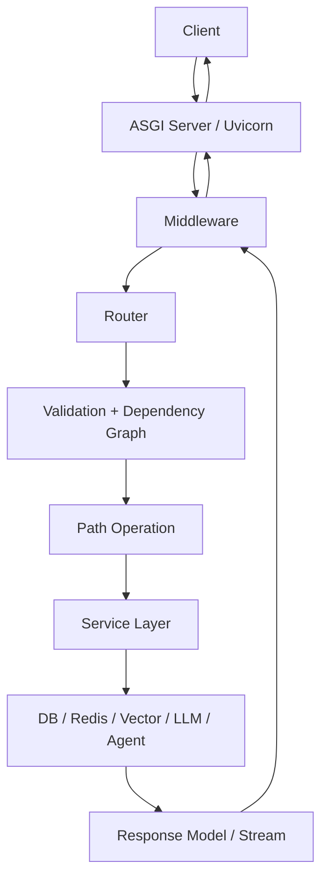
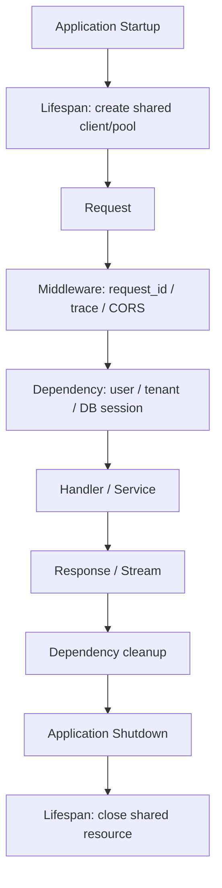
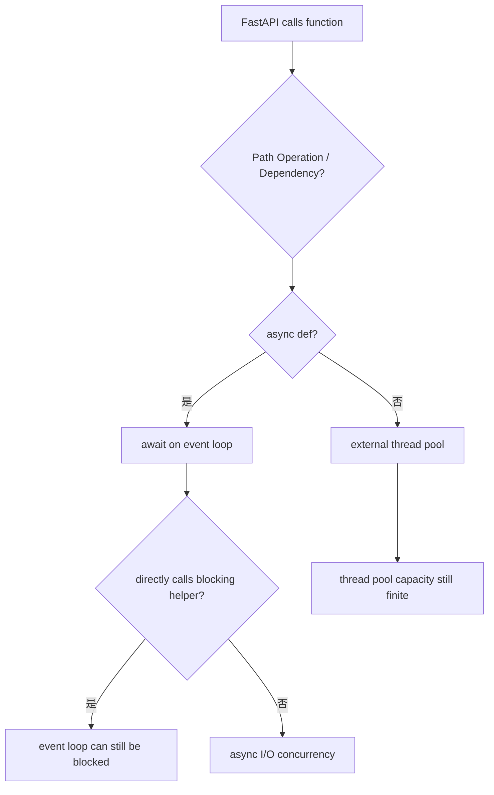
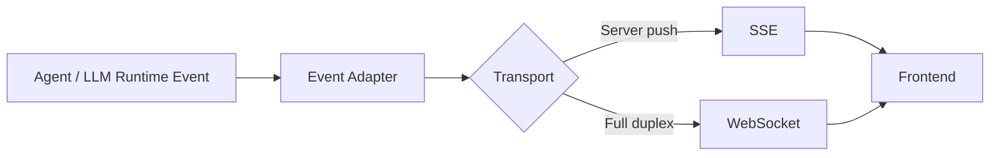
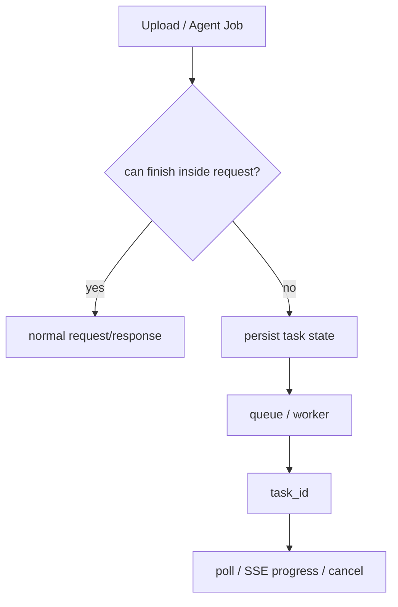

# FastAPI｜Review 与综合自测

[← 模块主页](../README.md) · [↑ Handbook 总目录](../../README.md) · [Learning Path](../../roadmap/learning-path.md) · [高频面试题 →](../interview/高频面试题.md)

> **用途：第二遍复习。** Review 不负责重新复制正文，而是要求从空白纸重建主线、机制、Failure / Trade-off 与面试表达。
>
> **学习路线是可选入口。** 如需整体安排，可参考 [Learning Path](../../roadmap/learning-path.md)；本 Review 也可以按个人节奏独立使用。

---

> 目标不是再读一遍 16 章，而是能从空白纸把 FastAPI 作为 **AI Service Layer** 重新画出来。

---

# 图 1｜一个请求怎样穿过 FastAPI



能口述：Uvicorn、Starlette、FastAPI、Pydantic 各自负责什么。

---

# 图 2｜Middleware、Dependency 与 Resource Lifecycle



关键：Application-scoped 和 Request-scoped 不能混。

---

# 图 3｜`async def` 的执行边界



关键：FastAPI 只对它主动调用的 `def` Path Operation / Dependency 做线程池处理；你在 `async def` 里直接调用同步 helper 不会自动 offload。

---

# 图 4｜AI Streaming 与 Event Protocol



Event 应是 typed protocol：

```text
message_start
content_delta
tool_call_start
tool_result
state_update
error
message_end
```

---

# 图 5｜Long-running Task Boundary



关键：`BackgroundTasks` 不是 Durable Task Queue。

---

# 图 6｜FastAPI 与 Agent Harness 的边界


关键：Transport 与 Runtime 解耦。

---

# 综合自测

### 1. FastAPI、Starlette、Uvicorn、Pydantic 分别是什么？

<details><summary>查看参考答案</summary>

Uvicorn 是 ASGI Server；Starlette 提供 ASGI Web 基础能力；FastAPI 在 Starlette 之上提供类型驱动 API、Dependency、OpenAPI 等；Pydantic 负责 Runtime Data Validation / Serialization。

</details>

### 2. Middleware 和 Dependency 最核心的差异？

<details><summary>查看参考答案</summary>

Middleware 是 Application 级横切层；Dependency 是 Route-aware 的输入/资源/前置条件图。Request ID、CORS、全局 timing 常放 Middleware；Current User、Tenant、DB Session 常放 Dependency。

</details>

### 3. 为什么 `async def` 里直接调用同步 SDK 仍可能阻塞？

<details><summary>查看参考答案</summary>

因为那只是普通 Python 函数调用，不会被 FastAPI 自动放入线程池；如果同步 SDK 阻塞，它会占住 Event Loop 线程。

</details>

### 4. 普通 `def` Path Operation 怎么执行？

<details><summary>查看参考答案</summary>

FastAPI 会把普通 `def` Path Operation / Dependency 放到外部线程池执行并等待结果。

</details>

### 5. 为什么 Thread Pool 不能当成“同步代码安全区”？

<details><summary>查看参考答案</summary>

线程池容量有限，阻塞调用很多时仍会排队；下游连接池/QPS 也可能成为瓶颈。

</details>

### 6. `yield` Dependency 和 Lifespan 的主要边界？

<details><summary>查看参考答案</summary>

`yield` Dependency 常管理请求/Route 级资源；Lifespan 管 Application startup/shutdown 级共享资源。

</details>

### 7. Streaming Response 为什么让 Dependency cleanup 更复杂？

<details><summary>查看参考答案</summary>

Handler 返回 Response 后，真正的数据发送可能持续很久；如果 Stream 仍需要某资源，就必须让资源生命周期覆盖 Stream，或提前 materialize 数据。

</details>

### 8. Response Model 除了文档还有什么作用？

<details><summary>查看参考答案</summary>

可以验证、序列化并过滤输出字段，是 API Contract 和潜在安全边界的一部分。

</details>

### 9. Schema Validation 为什么不能替代 Authorization？

<details><summary>查看参考答案</summary>

Schema 只确认结构/类型；Authorization 需要结合身份、资源和策略判断是否允许操作。

</details>

### 10. SSE 和普通 Streaming 的区别？

<details><summary>查看参考答案</summary>

普通 Streaming 只分块发送字节；SSE 在文本流上定义 event/data/id/retry 等事件协议。

</details>

### 11. 现代 FastAPI SSE 是否只能 GET？

<details><summary>查看参考答案</summary>

不是。当前官方 SSE 支持可以用于不同 HTTP 方法，包括 POST。

</details>

### 12. Stream 已开始后下游失败，为什么不能直接改 HTTP 500？

<details><summary>查看参考答案</summary>

Status/Headers 通常已发出，需要在流协议内发送 error/terminal event 表达失败。

</details>

### 13. 什么场景更适合 WebSocket？

<details><summary>查看参考答案</summary>

需要持续双向低延迟交互，例如 Realtime Voice、游戏、用户持续控制；普通单向 AI Chat 通常 SSE 已足够。

</details>

### 14. Client Disconnect 是否等于 Agent Run Cancel？

<details><summary>查看参考答案</summary>

不一定。短生成可取消；Durable Run 可以在 UI 断开后继续，稍后按 run_id 重新连接。

</details>

### 15. 为什么 `BackgroundTasks` 不能替代任务队列？

<details><summary>查看参考答案</summary>

它是当前应用进程内响应后的任务，不具备完整持久化、跨进程调度、Lease/Heartbeat、Worker Recovery 等 Durable Task 语义。

</details>

### 16. `bytes` 文件参数和 `UploadFile` 的主要差异？

<details><summary>查看参考答案</summary>

`bytes` 会把完整内容加载进内存；UploadFile 使用 spooled temporary file，更适合大文件并提供 file-like 接口。

</details>

### 17. 为什么 DB Session 不应该长期跨 Streaming 持有？

<details><summary>查看参考答案</summary>

会延长连接/事务生命周期，增加 Pool、锁和版本压力；如果 Stream 不再需要 DB，应提前释放。

</details>

### 18. Dependency Override 解决什么问题？

<details><summary>查看参考答案</summary>

测试时可以替换真实 Dependency，例如 Auth Provider/DB，构造稳定、便宜、可控的测试。

</details>

### 19. FastAPI P99 高但 SQL 只要 20ms，应该看什么？

<details><summary>查看参考答案</summary>

看 Pool Acquisition、Thread/Event Loop、其它下游、Queueing、Serialization 和 Proxy；SQL 执行时间只是请求链的一段。

</details>

### 20. 为什么 Metrics 不适合用 request_id 当 Label？

<details><summary>查看参考答案</summary>

request_id 几乎每次都不同，会造成极高 Cardinality；更适合 Log/Trace。

</details>

### 21. 多 Worker 为什么不能共享普通全局 dict？

<details><summary>查看参考答案</summary>

Worker 是独立进程，各自有独立内存；共享状态需要外部 Store 或明确路由设计。

</details>

### 22. Liveness 和 Readiness 区别？

<details><summary>查看参考答案</summary>

Liveness 判断进程是否活着；Readiness 判断实例当前是否准备好接流量。

</details>

### 23. 为什么 `/agent/runs` 比单个 `/chat` 更适合长 Agent？

<details><summary>查看参考答案</summary>

显式 run_id 能承载状态查询、事件流、取消、审批、重连、Checkpoint 等长期生命周期能力。

</details>

### 24. FASTAPI-005 最终在考什么？

<details><summary>查看参考答案</summary>

不是考更多装饰器，而是考你是否理解 Request/Resource Lifecycle、Async Boundary、Streaming/Event、Session/Run、Cancellation、Long-running Task、Observability、Deployment，以及 FastAPI 与 Agent Runtime 的边界。

</details>
