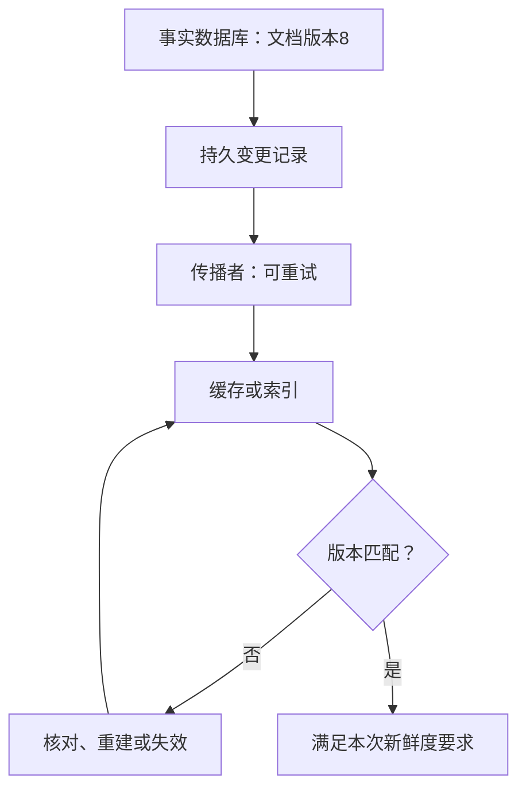

# 多份数据不一致时，怎样恢复业务正确性

[← 进程重启后，任务怎样继续推进](12-ReliableAsyncTask.md) · [模块主页](../README.md) · [谁能访问什么，权限怎样贯穿请求与任务 →](15-AuthSession与TenantBoundary.md)

文档在数据库已经改为版本 8，页面却仍看到版本 7。我们希望查得快，所以增加缓存；但多放一份数据，就增加了一份可能落后的状态。本章先沿时间线找出旧值从哪里回来，再区分修复数据与撤销业务这两种完全不同的工作。

## 1. 缓存旁路的正常路径

**Cache Aside（缓存旁路）** 由应用决定查缓存与回源。读取命中缓存就返回，未命中则查事实数据库，并将结果放入缓存。更新时先提交数据库，再使相应缓存失效，是一种常见业务策略，但不是强一致性的证明。

假设 doc-42 的数据库版本为 7、缓存为空，第一次读取回源得到 7 并缓存；随后命中者免去一次数据库读取。收益是少做工作，代价是缓存何时反映新值需要单独设计。TTL（生存时间）限制某次缓存值的寿命，不保证每次回源都读到最新事实。

## 2. 写数据库再删缓存，为什么仍可能读旧

先看删除失败：数据库提交 8 后进程崩溃，缓存 7 没删。可靠失效事件、失败重试或 TTL 可以缩短这个旧值窗口。

再看更隐蔽的并发回填：

| 时刻 | 读者 R | 写者 W | 缓存 |
|---|---|---|---|
| 1 | 未命中，读到数据库版本 7，随后暂停 | | 空 |
| 2 | | 提交数据库版本 8，删除缓存 | 空 |
| 3 | 恢复，把先前的 7 放进缓存 | | 7 |

删除操作没有失败，旧值仍然回来。因此“写成功再删”并没有把数据库修改和所有在途读者绑定成一个事务。延迟再删一次可以降低某些竞态出现概率，但等待多久、删除能否成功和进程是否存活都有条件，不能称作无条件强一致。

## 3. 版本检查保护哪里，版本就要活在哪里

让缓存拒绝较旧版本是一个方向，但必须问它与什么比较。若版本 8 的高水位只保存在缓存值里，缓存被删或淘汰后，高水位也消失了，迟到的版本 7 又可能被当成第一条更新接受。

可根据业务选择保留更可靠的版本屏障、按版本命名不可变缓存并单独管理当前版本指针，或在对新鲜度要求高的路径回查事实源。每一种都需要解释原子更新与失效规则：仅“加一个 version 字段”不等于整个协议成立。配套实验以一个内存反例演示高水位丢失，不把它冒充真实 Redis 并发验证。

如果回源走异步只读副本，副本自身还可能是 7。此时反复删除缓存并不能制造版本 8，应考虑读主库、等待必要版本、读后写一致性标记或业务允许的旧读策略。数据库复制机制的主责在 MySQL，本章只使用“副本可能落后”的最小模型。

## 4. “最终”需要谁负责把状态推向事实

收敛意味着在明确假设下，未完成的传播会被发现并持续修复。例如已提交的更新通过 Outbox 或 CDC（变更数据捕获）通知下游，下游重复处理不会退回旧版本；扫描器定期核对事实版本与索引版本，发现漏项后补建。

必须给出触发者、重试上限之后谁接手、允许多久不一致，以及如何发现永久失败。下游一直不可用、输入已经丢失或修复队列没人消费时，“最终一致”就没有兑现前提。

删除同样需要版本或墓碑（表示某个对象已删除的记录）。否则迟到的旧更新可能把已删除对象重新创建。权限或敏感数据删除不能只说等 TTL，应明确立即阻断访问与异步清理各自的责任。

## 5. 补偿不是把时间倒回去

假设一次流程先创建文档，再向用户发出付费通知，最后更新搜索索引失败。数据库事务能回滚尚未提交的本地修改，却不能收回已收到的通知。

**Compensation（补偿）** 是新的业务动作：退款、发更正通知、撤销尚未生效的预约。它可能需要审批，也可能失败，因此补偿也需要稳定操作键、持久状态和重试。Saga 是把跨步骤业务动作与相应补偿安排起来的一类流程方式，不会让多个系统突然共享一个本地事务。

不是每一步都可逆，也不是所有失败都应补偿。搜索索引暂时没更新，可以重建索引；已经确认的付款不应仅因通知失败就自动退款。先确定业务必须保持的条件，再选择向前修复、补偿或人工核对。

## 6. 对账先确认事实，再决定修复动作

Reconciliation（对账或状态核对）比较不同系统对同一业务操作的记录。它首先回答“发生了什么”，之后才决定“怎样处理”。

例如本地支付记录 unknown，供应商记录 success：若能可靠匹配同一操作，应补全本地结果，而不是再次扣款。若双方金额不同，应阻断自动修复并升级处理；若供应商暂时找不到记录，也要确认其查询一致性与旧请求是否仍在执行。

为对账保留业务操作标识、外部编号、版本和足够但不泄密的审计证据。按事实推导动作，才能避免“为了把状态改成一致”反而制造第二次业务错误。

## 本章小结

多份状态的正确性来自事实归属、传播协议和修复机制。缓存回填、版本记录失效、副本落后与迟到删除都可能造成旧状态；补偿是新的业务动作，对账则先确认已经发生的事实。

## 🎯 面试怎么答

**数据库和缓存怎样保证一致？**

> 先定义哪份是事实以及业务允许的旧读窗口。缓存旁路中，写数据库后失效缓存仍有删除失败和旧读回填窗口，需要可靠传播、适当版本检查与核对；版本屏障不能随缓存淘汰一起丢失。强新鲜度路径应采用相应读取协议，不能把 TTL 或延迟双删说成普遍强一致。

## ⚠️ 易错点

> ⚠️ 缓存失效成功仍可能被暂停的旧读者回填。

> ⚠️ TTL 约束缓存值寿命，不自动约束落后副本或重复旧回填。

> ⚠️ 补偿可能失败且不一定可逆；对账不是无依据地覆盖另一份状态。

## 本章自测

先写判断和依据，再展开提示或答案。

### 1. 数据库从 7 更新为 8，缓存版本 8 被淘汰后，迟到的版本 7 事件到达。“只有更大版本才能写”能否单独挡住它？请说明缺失前提。

提示

目标端还知道已见过的最高版本吗？

参考答案与解释

不能单靠空缓存中的比较。高水位已丢失，需要另有可靠版本屏障、事实查询或完整版本化访问协议；否则 7 可以被当成新值。

### 2. 付款已确认成功，通知发送失败，搜索结果仍是旧值。是否应该统一回滚所有步骤？请分别给出处理方向。

提示

区分业务事实、不可逆动作和可重建副本。

参考答案与解释

不应机械统一回滚。保留已确认付款事实；通知使用防重重试或人工处理，索引重建。是否退款取决于业务规则而非技术错误码，退款本身也是需要记录和防重的新动作。

