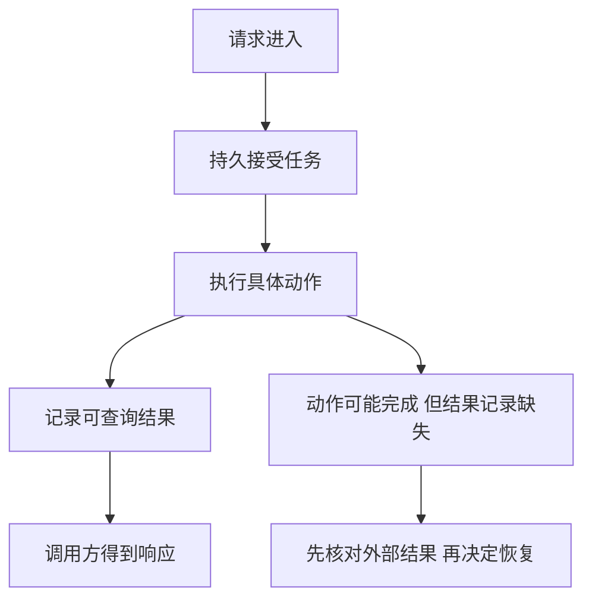

# Review｜从一次失败重建后端主线

[模块主页](../README.md) · [机制实验](../examples/README.md) · [表达训练](../interview/高频面试题.md)

第二遍不要从组件名单开始。先选择一个业务操作，画出谁相信哪份状态、谁占着什么资源、在哪个位置失去证据，再决定需要哪种恢复机制。

## 1. 同一次操作的四种事实

“已接受”“已执行”“有持久结果”“客户端知道结果”可以发生在不同时间。数据库内部可以用一笔事务合并部分状态变化；外部动作不能仅靠本地事务被包成原子操作。消息确认、TCP 确认和业务确认各自观察的对象也不同。

## 2. 用一张关系表判断工具负责什么

| 机制 | 能确定的事 | 仍需别的机制确定的事 |
|---|---|---|
| 在途接纳上限 | 已接收未终结的工作不会无限增加 | 单次任务成本、跨实例总预算 |
| 截止时间 | 这条调用链何时不再值得继续等待 | 下游动作是否已发生、资源是否真的终结 |
| 唯一键与本地事务 | 本库内重复操作和相关修改的提交关系 | 外部供应商是否接受了动作 |
| MQ 确认 | 某次交付在相应协议层的进度 | 业务事务、结果可见与用户观察 |
| 租约与代际 | 哪个执行尝试可被本资源接受 | 不检查代际的外部资源是否被旧执行者修改 |
| 缓存与版本 | 在明确保存版本依据时拒绝部分旧更新 | 版本记录被淘汰后的旧值回填、复制延迟 |
| 探针与摘流 | 控制器观察到的健康与路由资格 | 已有连接、传播延迟、长任务是否可恢复 |

## 3. 综合自测：改条件，而不是复述原句

以下均为教学场景。请先列出状态和可检查结论，答案只负责核对推理。

### 1. 吞吐降低时，原容量计划还成立吗？

一条队列已有 12,000 项工作。原来每秒能处理 300 项、新到达 100 项；现在下游限流使处理能力下降到 80 项/秒。每个排队对象占 4 KiB。请计算原清空时间、现在一分钟后的积压和新增内存，并说明哪项措施能先阻止继续增长。

回看：[连接怎样复用，容量怎样计算](../docs/05-ConnectionPool与ResourceCapacity.md) · [到达速度超过处理能力时怎么办](../docs/06-Backpressure与RateLimit.md)

提示

使用净消耗率，不用总处理率。

参考答案与解释

原来 12,000÷(300−100)=60 秒。现在每秒净增 20 项，一分钟后 13,200 项，比原来增加 1,200×4 KiB=4,800 KiB，约 4.69 MiB。要先使被接纳速率低于可持续处理能力或恢复有效处理能力；增加队列只是推迟溢出。

### 2. 本地事务成功，客户端却收到失败。

文档、操作结果和 Outbox 已一起提交，返回响应时连接断开。客户端同键同参数重试。请写出应返回的结果以及是否新增事件。再把相同键的文档内容改掉，判断处理方式。

回看：[怎样识别同一次操作，避免重复副作用](../docs/09-APIIdempotency与SideEffect.md) · [消息怎样交付，确认到底确认了什么](../docs/10-MQ与DeliverySemantics.md) · [进程重启后，任务怎样继续推进](../docs/12-ReliableAsyncTask.md)

提示

关注持久操作记录，而不是客户端看见的状态。

参考答案与解释

先查回原结果，不新增事件。相同键不同参数应拒绝冲突，不能默默复用旧结果。新业务意图使用新键；Outbox 已提交仍不表示消息已经发出。

### 3. 租约与资源边界换了。

A 已向供应商发起外部写入，响应丢失。A 的本地租约过期后 B 取得新代际。供应商既不检查代际，也没有可查询操作键。能否凭 B 的新代际宣称安全重做？说明缺什么能力。

回看：[怎样识别同一次操作，避免重复副作用](../docs/09-APIIdempotency与SideEffect.md) · [进程重启后，任务怎样继续推进](../docs/12-ReliableAsyncTask.md) · [多份数据不一致时，怎样恢复业务正确性](../docs/13-Consistency与Compensation.md)

提示

把本地 UPDATE 与外部请求分开。

参考答案与解释

不能。新代际只能保护实际检查它的资源，供应商可能已经执行 A 的动作。缺少供应商防重或结果查询依据时，应保留未知状态并采取人工核对或业务补偿策略；不能假造 exactly-once 保证。

### 4. 一条缓存记录并不是完整的恢复依据。

数据库已到版本 8，旧读请求仍持有版本 7。缓存先记住版本 8，随后数据和版本记录一起被淘汰。旧读者试图填入版本 7。仅比较“缓存现有版本”能否阻止？

回看：[多份数据不一致时，怎样恢复业务正确性](../docs/13-Consistency与Compensation.md) · [哪些状态必须保存，恢复时相信哪一份](../docs/14-DataLayering与StateOwnership.md)

提示

比较依赖的高水位还存在吗？

参考答案与解释

不能，缺失记录无法证明已经见过 8。要保存可依赖的版本依据、核对事实源或采用明确的失效修复方案。额外还要考虑读到复制旧值的情况；TTL 只能限制部分驻留时间，不自动消除重填窗口。

### 5. 权限在排队期间改变。

员工有权创建导出任务，任务排队时被移出团队。工作者随后领取，结果链接也可能被缓存。请列出必须重新判断的边界，不要求实现完整权限服务。

回看：[谁能访问什么，权限怎样贯穿请求与任务](../docs/15-AuthSession与TenantBoundary.md) · [不可信输入怎样被限制在安全边界内](../docs/21-BackendSecurity.md)

提示

创建、执行、获取结果是不同时间的访问。

参考答案与解释

创建时确定可信身份和资源范围；执行前按业务规则复核仍可执行的权限；结果查询和下载继续授权，缓存不能只按文档或任务ID跨用户复用。审批也应绑定动作与输入版本，不能把旧批准扩展成任意新动作。

### 6. SQL 优化没有解决接口慢。

同一请求串行耗时为等连接 1,000 ms、SQL 50 ms、模型 850 ms、组装响应 100 ms。原 SQL 为 800 ms。求当前总耗时与继续将 SQL 降为 10 ms 的收益，并说明接下来观察什么。

回看：[连接怎样复用，容量怎样计算](../docs/05-ConnectionPool与ResourceCapacity.md) · [从慢请求的证据定位瓶颈](../docs/17-Observability与PerformanceDiagnosis.md) · [把应用故障追到 Linux 资源](../docs/18-LinuxTroubleshooting.md)

提示

先画该请求时间线，别相加不同样本的 P99。

参考答案与解释

当前 2,000 ms；继续优化 SQL 只减少 40 ms，即当前总耗时的 2%。先看连接持有时间、池等待、并发和模型调用；不是盲目扩池。这个加法只适用于同一串行请求，不适用于并行分支或各阶段独立分位数。

### 7. 发布窗口比任务短。

Pod 停机宽限 30 秒，preStop 已耗费 8 秒，任务还需 20 分钟。请说明当前进程最多还有怎样的预算、什么时候停止接纳，以及如何避免把发布变成任务丢失。

回看：[进程重启后，任务怎样继续推进](../docs/12-ReliableAsyncTask.md) · [部署、探针与停机怎样配合应用](../docs/19-ContainerK8s与Deployment.md) · [配置和版本怎样安全改变](../docs/20-ConfigRelease与ServiceEvolution.md)

提示

摘流和终止存在传播与并发，不是完美串行。

参考答案与解释

宽限不是等 preStop 完才重新计时，余量约 22 秒且还要预留清理。进入终止时就限制新工作，并为传播期间的请求定义处理方式；长任务靠持久状态和恢复协议继续，不指望在该 Pod 上等完。已有连接、旧 Worker 和新版本输入兼容仍需检查。

## 4. 怎样记录真实薄弱点

把错误写成“我混淆了哪两个状态，漏了哪个条件”，例如把请求取消当成工作结束，或把 MQ 重复消息 ID 当成业务操作身份。随后回到对应正文和实验验证，不用再抄一遍术语定义。

综合判断能走通以后，再加入 Java、Spring 或 Go 的具体实现差异：代理是否经过、线程上下文何时清理、运行时如何调度。对应关系只帮助迁移问题，不表示各生态行为完全相同。
