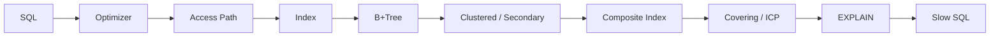
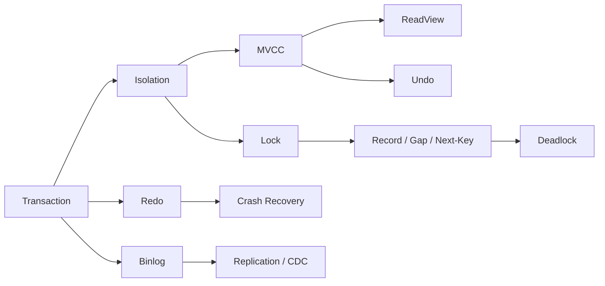
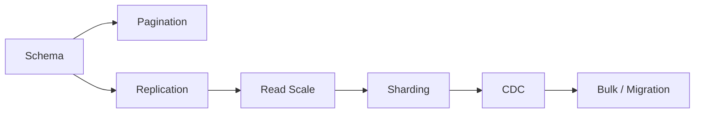
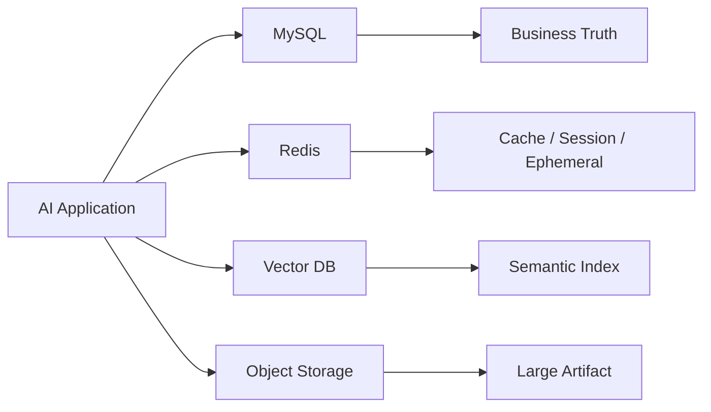

# MySQL｜Review 与综合自测

[← 模块主页](../README.md) · [↑ Handbook 总目录](../../../README.md) · [Learning Path](../../../guide/learning-path.md) · [高频面试题 →](../interview/高频面试题.md)

> **用途：第二遍复习。** Review 不负责重新复制正文，而是要求从空白纸重建主线、机制、Failure / Trade-off 与面试表达。
>
> **学习路线是可选入口。** 如需整体安排，可参考 [Learning Path](../../../guide/learning-path.md)；本 Review 也可以按个人节奏独立使用。

---

> 正文 23 章负责从 0→1 建立知识体系；本目录只负责第二遍 / 第三遍复习，**不能替代正文学习**。

MySQL 最容易出现的问题不是“名词没见过”，而是：

```text
B+Tree 会背
但不会推执行路径

MVCC 会背
但不会推两个事务

Redo / Undo / Binlog 会背
但职责混在一起

Sharding 会背
但不知道为什么应该最后才学
```

所以复习必须沿“因果链”进行。

---

## 1. 四张总图

### 图一：查询性能链



复习顺序：

`02 → 03 → 04 → 05 → 06 → 07 → 08 → 09 → 10`

---

### 图二：事务正确性链



复习顺序：

`11 → 12 → 13 → 14 → 15`

---

### 图三：规模增长链



注意：真实学习顺序不是“因为 Sharding 高频就提前学 Sharding”，而是先理解单库，再理解副本，再理解分片。

---

### 图四：AI 数据层



最重要的一句话：

> **MySQL 保存结构化业务事实；Redis、Vector DB 和 Cache 层解决另外的问题。**

---

## 2. 第一轮复习：只回答“为什么”

不要看答案，口述下面问题：

<details>
<summary>为什么 InnoDB 常使用 B+Tree，而不是红黑树？</summary>

数据库索引面向 Page / Block I/O。B+Tree 扇出大、树高低，内部节点只保存 Key / Pointer，叶子有序且适合范围扫描；红黑树高度远大于 B+Tree，更适合内存中的指针结构而不是大规模页式磁盘索引。

</details>

<details>
<summary>为什么 Secondary Index 叶子通常保存 Primary Key？</summary>

因为 InnoDB 聚簇索引的叶子保存完整 Row。Secondary Index 找到目标后，可使用 Primary Key 回到 Clustered Index 取完整记录；同时主键变化会影响所有 Secondary Index，因此主键设计非常重要。

</details>

<details>
<summary>为什么 RR 不能只用一句“MVCC 解决幻读”解释？</summary>

普通 Consistent Read 依赖 MVCC Snapshot 保持重复读取一致；Locking Read / Range Update 还需要 Record / Gap / Next-Key Lock 控制并发插入。两类读取语义不同。

</details>

<details>
<summary>为什么 Redo 与 Binlog 都存在？</summary>

Redo 是 InnoDB Crash Recovery / WAL 基础；Binlog 属于 Server 层，面向 Replication、PITR、CDC。职责不同，提交时需要协调二者状态。

</details>

<details>
<summary>为什么 Sharding 不是 MySQL 学习的前半程？</summary>

因为它用巨大复杂度换容量和写扩展。必须先掌握单库 Schema / Index / Transaction / Replication，确认单节点成为真实瓶颈后，再承担跨分片 Query、Transaction、Unique、Migration 等成本。

</details>

---

## 3. 第二轮复习：自己推演执行路径

建议拿纸画出以下 8 个过程：

1. Secondary Index 等值查询 → 回表；
2. Composite Index `(tenant_id,user_id,created_at)` 的范围扫描；
3. `LIMIT 100000,20` 为什么慢；
4. RR 下 A / B 两事务普通 SELECT 的 ReadView；
5. `SELECT ... FOR UPDATE` 范围查询的锁语义；
6. Deadlock 的循环等待；
7. Commit 时 Undo / Redo / Binlog 的职责；
8. Source → Binlog → Replica / CDC。

只要其中某一步画不出来，就回正文。

---

## 4. 第三轮复习：用真实面试深度验收

根据冻结 `S001–S279` 市场证据，MySQL 高频 Topic 包括：

| Topic | HUMAN-A Sources |
|---|---:|
| Isolation Levels | 14 |
| B+Tree | 13 |
| Slow SQL / EXPLAIN | 11 |
| Index Invalidation | 11 |
| Composite Index | 10 |
| Sharding | 10 |
| MVCC / ReadView | 9 |
| Covering / Back-to-table / ICP | 8 |

但复习规则仍然是：

> **频率决定“多练几遍”，不决定“删掉低频前置”。**

完整证据见：[`interview/canonical/mysql.md`](../../../interview/canonical/mysql.md)。

---

## 5. 四条面试追问链

### Index Chain

```text
为什么需要 Index
→ 为什么 B+Tree
→ Clustered / Secondary
→ 为什么会回表
→ Covering / ICP
→ Composite / Leftmost Prefix
→ 为什么 Optimizer 不选 Index
→ EXPLAIN 怎么证明
```

### Transaction Chain

```text
ACID
→ Isolation
→ RC vs RR
→ MVCC / ReadView
→ Snapshot vs Locking Read
→ Record / Gap / Next-Key
→ Deadlock
→ Redo / Undo / Binlog
```

### Scale Chain

```text
慢查询
→ Schema / Index
→ Pagination
→ Replication
→ Replication Lag
→ Sharding
→ Cross-shard Query
→ Re-sharding
```

### AI Data Chain

```text
哪些放 MySQL
→ 哪些放 Redis
→ 哪些放 Vector DB
→ Document Version
→ Agent Run / Step / Tool Event
→ CDC
→ Cache Consistency
```

---

## 6. 掌握标准

一个 Topic 至少达到四层：

```text
L1 认识：知道名词
L2 解释：能讲原理
L3 推演：给 SQL / 并发顺序能分析
L4 设计：能说 Failure / Trade-off / Scale
```

例如 MVCC：

```text
L1：知道 MVCC
L2：知道 Undo + ReadView
L3：能推 RC / RR 两个事务读什么
L4：能解释长事务、Purge、Lost Update 边界
```

---

## 7. 推荐复习顺序

第一次：

```text
README
→ docs/01 ~ docs/23
```

第二次：

```text
本页四张图
→ 回正文补盲点
```

第三次：

```text
../interview/高频面试题.md
→ ../interview/面试易错点.md
```

面试前：

```text
../interview/面试前速查表.md
```
