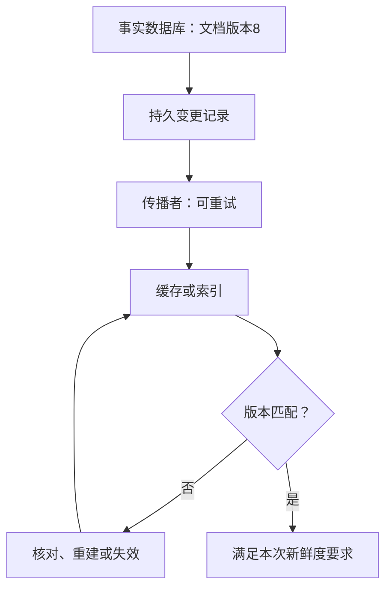

# 多份数据不一致时，怎样恢复业务正确性

[← 进程重启后，任务怎样继续推进](12-ReliableAsyncTask.md) · [模块主页](../README.md) · [谁能访问什么，权限怎样贯穿请求与任务 →](15-AuthSession与TenantBoundary.md)

文档在数据库已经改为版本 8，页面却仍看到版本 7。我们希望查得快，所以增加缓存；但多放一份数据，就增加了一份可能落后的状态。本章先找出旧值从哪里回来，再走通一种有明确保证的读取方案，最后区分修复数据与撤销业务。

## 1. 缓存旁路的正常路径

**Cache Aside（缓存旁路）** 由应用决定查缓存与回源。读取命中缓存就返回；未命中则查事实数据库，并将结果放入缓存。更新时先提交数据库，再使相应缓存失效，是常见策略，但不是强一致性的证明。

假设 doc-42 的数据库版本为 7、缓存为空，第一次读取回源得到 7 并缓存；随后命中者免去一次数据库读取。收益是少做工作，代价是必须设计新值传播。TTL（生存时间）限制某次缓存值的寿命，不保证每次回源都读到最新事实。

## 2. 写数据库再删缓存，为什么仍可能读旧

先看删除失败：数据库提交 8 后进程崩溃，缓存 7 没删。可靠失效事件、失败重试或 TTL 可以缩短这个旧值窗口。

再看并发回填：

| 时刻 | 读者 R | 写者 W | 缓存 |
|---|---|---|---|
| 1 | 未命中，读到数据库版本 7，随后暂停 | | 空 |
| 2 | | 提交数据库版本 8，删除缓存 | 空 |
| 3 | 恢复，把先前的 7 放进缓存 | | 7 |

删除操作没有失败，旧值仍然回来。“写成功再删”没有把数据库修改和所有在途读者绑成一个事务。延迟再删一次可以降低某些竞态出现概率，但等待多久、删除能否成功、进程是否存活都有条件，不能称作无条件强一致。

## 3. 版本检查保护哪里，版本就要活在哪里

让缓存拒绝较旧版本，必须先问：拿新值与哪份版本依据比较？若已见版本 8 的记录只在缓存值里，缓存被删除或淘汰后，这个依据也消失了。迟到的版本 7 又可能被当成第一条更新接受。

因此“加一个 version 字段”还不是方案。至少要解释版本由谁分配、保存多久、检查和写入是否原子。更可靠的版本屏障、版本化缓存键、必要时回查事实源是不同方向，需要按业务选择，不必全部叠加。

另一个来源是只读副本。若副本自己还停在 7，反复删除缓存也不能让它产生 8。这里要改变回源选择、等待必要版本，或者明确接受旧读，而不是继续修缓存删除代码。

## 4. 走通一种方案：先确定版本，再取该版本的内容

假设文档正文较大，允许多一次很小的版本查询，但要求： **本次读取不能把已确认的版本 8 错换成版本 7。** 我们选择“权威版本记录 + 按版本命名的不可变内容缓存”。这是教学设计，不是 Redis 自动提供的跨库事务。

先把数据放置规则说清楚：

| 数据 | 保存位置与规则 |
|---|---|
| 当前版本与删除状态 | 权威数据库；同一文档的修订号递增且不复用 |
| 每一版正文 | 按文档和修订号保存；发布后不再修改这一版的内容 |
| 正文缓存 | 键包含团队、文档与修订号，例如 `team-a:doc-42:v8` |

发布版本 8 时，先在 **同一个数据库事务** 内保存版本 8 的正文，并将当前版本改为 8；提交后才报告成功。这样不会只发布“请读 8”，却还没有可读取的版本 8。删除也形成新的修订状态，文档编号重用时不能重新从旧修订号开始。

读取按下面的顺序进行：

1. 验证当前请求的访问权，再从权威数据库读取当前修订号及删除状态。此路径要求读到相应已提交状态，不能复用旧事务快照或随意读取落后副本。
2. 若记录已经删除或请求无权访问，就不返回正文；否则固定本次读到的修订号，例如 8。
3. 查 `team-a:doc-42:v8`。命中时核对对象和版本后返回；缓存中存在 v7 与本次请求无关。
4. 未命中时读取数据库中 **明确属于版本 8** 的正文，再回填 v8。找不到 8 就查询可靠来源或明确失败，不能取到 7 却贴上 v8 的标签。

再让刚才暂停的旧读者回来：

| 事件 | 状态变化 | 新读者会选择什么 |
|---|---|---|
| R 已拿到版本 7，暂停 | R 固定了旧修订号 | 不决定其他请求的版本 |
| W 提交版本 8 | 权威当前版本成为 8 | 此后符合上述读取条件的请求选 8 |
| 缓存中的 v8 被淘汰 | 只丢可重建正文缓存 | 仍按权威版本选 8，必要时回源 |
| R 迟到回填 v7 | 只写 v7 键，不覆盖 v8 | 仍选 8，不会把 v7 当作 8 |

**关键不是旧值永远不出现，而是新请求不再通过一个可被旧值覆盖的公共内容键决定版本。** 老版本可在既定保留期后清理；清理引发的缓存未命中也不能触发旧版本降级。

代价与失败行为也要一起接受：

- 每次读仍需权威版本查询。缓存节省的是大正文读取或相应派生计算，不是免去所有数据库访问。
- 缓存不可用，可以按预算从权威来源读取所选版本；权威版本不可确认时，这条新鲜度路径应明确失败，而不是静默返回任意旧缓存。
- 只读副本尚无版本 8 时，应等待、转权威来源或失败。不同文档的版本号不能直接比较；缓存派生结果还需包含决定结果的处理版本。

> ⚠️ 保证以本次权威读取观察到的版本为准。已经选到 7 的在途读者，不会因后续提交 8 自动切换；要求交付瞬间的最新权限或更强读写协调时，必须另设校验边界。数据库故障切换、旧快照和删除策略也属于前提，不能用缓存键替代它们。

上述版本选择用于推演这些条件下的结果，不代表真实 MySQL、Redis、复制或故障切换集成已经通过验证。

## 5. “最终”需要谁负责把状态推向事实

有些列表、摘要或搜索索引允许短暂落后，不必每次走上述读取路径。但 **最终一致** 仍需要有人持续推进未完成的传播，不能只给状态贴一个名称。

例如更新与 Outbox 同时提交，传播者读取待发记录通知下游；或用 CDC（变更数据捕获）读取已提交变化。下游按相应版本规则防止倒退，扫描器定期核对事实版本与索引版本，发现漏项后补建。

必须指定触发者、失败重试的接手者、允许的落后窗口与永久失败告警。下游持续不可用、输入已经丢失或队列没人处理时，收敛前提就不成立。

删除同样需要可靠版本或 **墓碑** ，即表示对象已删除的记录，否则迟到更新可能使对象复活。敏感删除和撤权需要先在访问边界阻断，再异步清理副本，不能只说等 TTL。

## 6. 补偿不是把时间倒回去

一次流程先创建文档，再向用户发出付费通知，最后更新搜索索引失败。数据库事务能回滚尚未提交的本地修改，却不能收回用户已收到的通知。

**Compensation（补偿）** 是新的业务动作，例如退款、发更正通知、撤销尚未生效的预约。它可能需要审批，也可能失败，因此仍需稳定操作键、持久状态与重试。 **Saga** 把跨步骤动作及其相应补偿安排成流程，不会让多个系统共享一个本地事务。

不是每一步都可逆，也不是所有失败都应补偿。索引暂时没更新，可以继续重建；已确认付款不应仅因通知失败自动退款。先看业务必须保持的条件，再选择向前修复、补偿或人工核对。

## 7. 对账先确认事实，再决定修复动作

**Reconciliation（对账或状态核对）** 比较各系统对同一业务操作的记录。它先回答“发生了什么”，之后才决定“怎样处理”。

本地支付记录是 unknown，供应商记录是 success：可靠匹配同一操作后，应补全本地结果，不是再次扣款。若金额不同，应停止自动修复并升级处理；若供应商暂时找不到，也要检查查询是否滞后、旧请求是否仍在执行。

为此保留业务操作标识、外部编号、版本和足够但不泄密的审计证据。不能为了让两个状态字符串相同，反而制造第二次业务错误。

## 本章小结

缓存旁路有失效失败和旧读回填窗口。版本化读取可以把所选版本与内容绑定，但权威版本、不可变内容及失败策略都必须成立。允许落后的副本需要可靠传播与核对；补偿是新业务动作，对账则先确认事实。

## 🎯 面试怎么答

**数据库和缓存怎样保证一致？**

> 先定义事实源和可接受的旧读窗口。普通缓存旁路仍有删除失败与旧值回填；较严格的读取可先查权威版本，再只读取该版本的不可变缓存或正文，代价是保留版本查询。异步副本要有传播、防倒退和对账机制。TTL、version 字段或延迟双删都不是无条件强一致。

## ⚠️ 易错点

> ⚠️ 缓存失效成功仍可能被旧读者回填；版本依据不能随缓存淘汰一起丢失。

> ⚠️ 选定版本 8 后读不到它，不应退回版本 7 并伪装成功。

> ⚠️ 补偿可能失败且不可完全逆转；对账不能无依据覆盖另一份状态。

## 本章自测

### 1. 数据库已到 8，缓存的数据和版本依据被一起淘汰，迟到的版本 7 到达。“只接收更大版本”能单独挡住它吗？

提示

比较需要的旧依据是否还在？

参考答案与解释

不能。空缓存不证明已经见过 8，需要可靠版本依据、事实查询或完整版本化访问协议。

### 2. 本次权威读取选到 8，v8 缓存未命中，只读副本只有 7。应怎样返回？迟到的 v7 回填会改变答案吗？

参考答案与解释

等待所需版本、转权威来源或按预算失败，不能拿 7 充当 8。迟到回填只写 v7 键，不改变本次所选修订号；缓存不可用时仍可读取可靠来源中的版本 8。

### 3. 付款成功，通知失败，索引仍旧。是否统一回滚？

参考答案与解释

保留已确认付款；通知按防重协议重试或人工处理，索引重建。退款由业务规则决定，它本身也需要记录、防重与结果核对。

## 知识回看与权威资料

- [状态归属](14-DataLayering与StateOwnership.md)：判断哪份数据是裁决依据，哪份可以重建。
- [MySQL 复制与读写分离](../../03-mysql/docs/09-提交以后：日志、故障恢复、复制与数据同步.md)：核对副本进度和事务可见性为什么是不同条件。
- [可靠任务](12-ReliableAsyncTask.md)：复习持久发现、检查点与过期执行者的处理。
- [Redis 淘汰机制](https://redis.io/docs/latest/develop/reference/eviction/)：核对版本依据为何不能只依赖可能被淘汰的缓存；本章版本化读取是应用协议。
