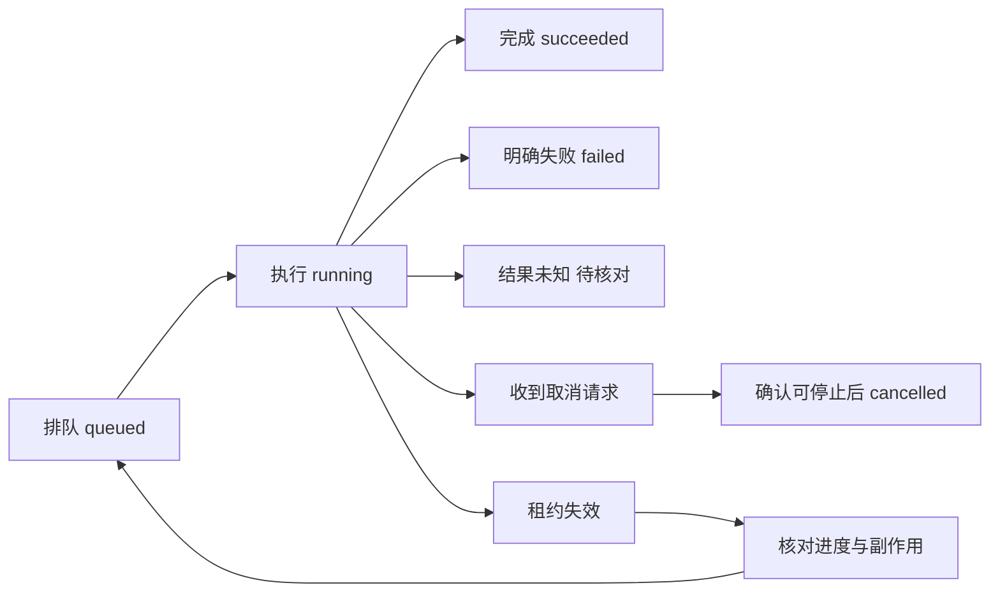

# 进程重启后，任务怎样继续推进

[← Kafka 怎样分工、保序与恢复消费](12-KafkaPartition与Backlog.md) · [模块主页](../README.md) · [多份数据不一致时，怎样恢复业务正确性 →](14-Consistency与Compensation.md)

用户提交“更新一万份文档”，页面很快获得 job-42。五分钟后执行进程重启。此时系统应能回答：任务还在不在，已经完成哪些文档，谁有权继续，重复执行会不会把结果写坏？只把函数放到后台线程，无法保存这些答案。

## 1. 接受任务，首先保存可以恢复的事实

长期任务需要持久记录：任务身份、可信团队范围、输入引用、状态、重试安排和结果位置。字段的价值来自恢复问题：输入只在进程内存里，重启后就无从执行；状态只有“失败”，则分不清永久拒绝与可以重试。

本例状态可以从 `queued` 进入 `running`，最后进入 `succeeded`、`failed` 或 `cancelled`。`cancel_requested` 表达用户已经提出取消，不能与外部动作已撤销混为一谈。外部结果未知时要留下待核对状态，而不是塞进普通失败后自动重试。



图中的箭头表示**允许的转换条件**，不是进程随时能随意赋值。终态是否允许重新开启，也要由接口规则明确；常见做法是为新的业务意图创建新任务。

## 2. 保存成功但通知丢失，怎样让工作仍被发现

先写任务表，再发消息，中间崩溃会留下永远没人知道的任务。**Outbox（事务发件箱）** 把任务和“需要通知执行者”的记录写进同一数据库事务：要么都提交，要么都不提交。独立转发者再读取未发送记录、发给消息系统并记录发送进度。

| 失败位置 | 可以依靠什么继续 |
|---|---|
| 事务提交前 | 整组未提交，可按同一操作键重试 |
| 已提交，尚未发消息 | Outbox 中仍有待发记录 |
| 消息已被接收，尚未标记已发 | 可能重复发送；消费者按稳定操作键去重 |
| 消费者已完成，确认前崩溃 | 可能重复投递；核对任务和业务结果 |

Outbox 保存的是**发送意图**，不是自动完成 MQ 发布。转发者仍需容量、重试、告警和清理；删除未确认记录会把恢复依据删掉。实验将文档、操作结果与 Outbox 一起提交，但没有运行真实消息代理，不能把“表里有事件”称为端到端交付成功。

MQ 也不是唯一唤醒方式。规模较小时，可以定期扫描数据库中到期的持久任务；扫描周期决定额外等待，索引和领取协议决定成本。MQ 更适合及时唤醒、缓冲和多个消费者分工，周期扫描适合简单调度或作为漏通知的修复通道。两者都需要持久状态，不能将可靠数据库扫描与进程内一次性定时器混为一谈。

## 3. 领取、续约与进度各自说明什么

工作者领取任务时，数据库用条件更新检查它仍可领取，并记录拥有者、租约截止时间和新代际。租约让失联工作者不永久占有任务；心跳或续约延长有效期；检查点则记录**业务已经走到哪里**。三者含义不同。

假设 A 在逻辑时刻 0 领取 job-42，代际为 1，租约到 10；A 暂停后，B 在 11 重新领取，代际为 2，租约到 21。A 在 12 恢复，它手里仍有旧变量，但数据库里的权利已经变了。

## 4. 资源必须实际拒绝旧工作者

下面片段直接取自 [统一实验源](../examples/backend_lab.py)，是连续程序的一部分，连接、事务与初始化见实验说明。`owner` 是本次工作者身份，`generation` 是领取时获得的代际，`now` 是实验显式传入的逻辑时间。

<!-- snippet: fenced_update -->
```python
FINISH_SQL = """UPDATE tasks SET status='succeeded', result=?
WHERE task_id=? AND status='running'
  AND owner=? AND generation=? AND lease_until>?"""


def finish_task(path: Path, task_id: str, owner: str, generation: int,
                now: float, result: str) -> bool:
    with connection(path) as con, transaction(con):
        changed = con.execute(FINISH_SQL, (result, task_id, owner, generation, now)).rowcount
        return changed == 1
```
<!-- /snippet -->

这条修改只有在任务仍执行中、拥有者和代际都匹配、租约尚未过期时才成立。`changed == 1` 表示真的修改一行；`False` 表示没获得完成权，不是数据库已经“成功保存但不用管”。在上述时间线里，A 返回 False，B 返回 True，最终结果只能来自 B。

这里的安全性来自**任务记录所在数据库同时检查条件并写入**。如果后面还要更新另一份业务记录，两份本地修改应置于合适的同一事务中；如果还要调用外部 API，则外部资源也必须提供可验证的版本或幂等协议。只在本地任务表写下代际，挡不住外部系统接受旧动作。

> ⚠️ 教学实验使用同一逻辑时间轴。真实多机租约必须指定权威时间与允许的时钟误差，不能把各机器未经约束的本地时间直接混用。

## 5. 检查点必须对得上已经产生的效果

处理一万行资料，每 100 行提交一个批次。若前 5,000 行已提交、检查点也在同一事务记为 5,000，恢复可以从下一批开始。若业务已提交但检查点没保存，则可能重放这一批，必须能识别重复；若先推进检查点、实际写入还没提交，则恢复可能跳过未完成内容。

检查点可以是行号、输入版本、分页游标或某阶段结果引用，但前提是重放时输入仍有可识别的一致含义。源文件换了内容，单独一个“第 5,001 行”不再足够，因此任务还要固定输入版本或内容摘要。

同一批里包含外部通知时，数据库检查点并不能撤销已经发出的通知。应将外部动作拆出独立稳定操作身份与结果核对，不能把整段函数重新运行视为天然安全。

### 换成分块上传，恢复依据仍然是明确状态

手算一个 3 块文件上传：服务生成上传身份 U，固定所属团队、总块数、总大小和最终内容校验方式。每块用 `(U, 块序号)` 标识；同一位置重复传相同内容可返回已有结果，内容摘要不同则拒绝冲突，不能默默覆盖。

| 时刻 | 持久事实 | 恢复动作 |
|---|---|---|
| 收到第 1、3 块，第 2 块未到 | 已验证块集合 `{1,3}`，上传未完成 | 客户端查询缺块并补 2，不重新上传全部 |
| 第 2 块成功落地，但成功响应丢失 | 已验证块集合 `{1,2,3}` | 重传按块身份与摘要识别，不增加第四块 |
| 合并输出一半时工作者退出 | 原块完整，临时合并结果未发布 | 丢弃或重做不完整产物，不暴露为最终文件 |
| 完整结果校验通过，更新结果引用 | 上传进入完成态并保存结果引用 | 查询返回同一结果；清理不再需要的临时对象 |

“已验证块集合”必须对应确实保存的内容。可先写不可变临时对象、校验成功后记元数据；两处之间中断可能产生未登记的孤儿对象，需要扫描清理，而不是假装对象存储与数据库自动共享事务。最终发布通过受版本或领取代际保护的元数据更新完成，别让旧合并者覆盖新结果。

清理也有前提：区分仍在续约的活跃上传、已经完成的临时产物、超过保留期的废弃上传。只按文件创建时间一刀切，可能删掉仍在进行的工作。每次只处理有限分块、限制并发合并数，可以避免把所有视频同时装进内存。此例是机制推演，不是本实验已实现的上传服务。

## 6. 取消、重试和停止都要留下可观察的结果

取消请求先持久化。执行者在安全边界检查它：尚未开始的工作可以不执行；已提交的修改需要保留事实；已发送的外部动作按业务决定补偿，而不是假装从未发生。

重试安排保存 `next_attempt_at`、尝试次数和明确原因，避免进程重启后立即集体重试。达到尝试或截止上限后进入人工可见的处理队列，不能无限把任务改回 queued。任务系统仍要遵守并发和速率预算，恢复不意味着可以瞬间启动所有积压任务。

观测至少能够关联任务、操作、一次执行尝试和外部结果。这样“心跳正常但进度不动”“租约反复过期”“结果未知不断增加”才能成为不同问题，而不是同一个笼统失败率。

## 本章小结

可靠任务由持久输入与状态、可靠发现、条件领取、检查点和副作用协议共同组成。MQ 负责交付，租约协调执行权，资源侧条件决定旧工作者是否还能写；任何一项都不能单独保证业务完成。

## 🎯 面试怎么答

**服务重启后，长任务怎样恢复并避免重复？**

> 先恢复持久任务和固定输入，通过消息或数据库扫描发现待执行项。领取时原子更新拥有者、租约和代际，续约与检查点分开；落地结果时资源实际校验代际和状态。重放使用稳定业务键，外部结果未知先核对。取消、重试时间和终态也持久化，并限制恢复并发。

## ⚠️ 易错点

> ⚠️ 租约到期不会终止另一台机器的线程；心跳也不是业务检查点。

> ⚠️ Outbox 行提交不等于消息已发，更不等于业务已完成。

> ⚠️ 本地 fencing 只保护实际检查代际的资源，不能替外部 API 作保证。

## 本章自测

先写判断和依据，再展开提示或答案。

### 1. A 的代际为 1、租约到 10；B 在 11 取得代际 2。A 与 B 都在 12 写完成。请预测实验返回值、最终结果，并说明该结论是否保证外部短信只发送一次。

<details>
<summary>提示</summary>

看 UPDATE 的所有条件，以及它真正修改哪个资源。

</details>

<details>
<summary>参考答案与解释</summary>

A 为 False、B 为 True，任务结果来自 B。但 SQL 只保护任务表；如果 A 已发短信，本地条件不能收回或阻止该外部效果。短信仍需供应商幂等或核对。

</details>

### 2. 输入文件版本 V1 的前 5,000 行已提交，检查点只到 4,900。重启后应怎样处理？如果输入已变成 V2，能否直接从 4,901 行继续？

<details>
<summary>提示</summary>

检查点落后意味着可重复；输入变化会改变位置含义。

</details>

<details>
<summary>参考答案与解释</summary>

可以重放 4,901 起的批次，但必须防重，核对后再推进检查点。不能直接把 V1 的行号用于 V2；需固定原输入、映射业务身份，或明确创建新任务与迁移规则。

</details>
