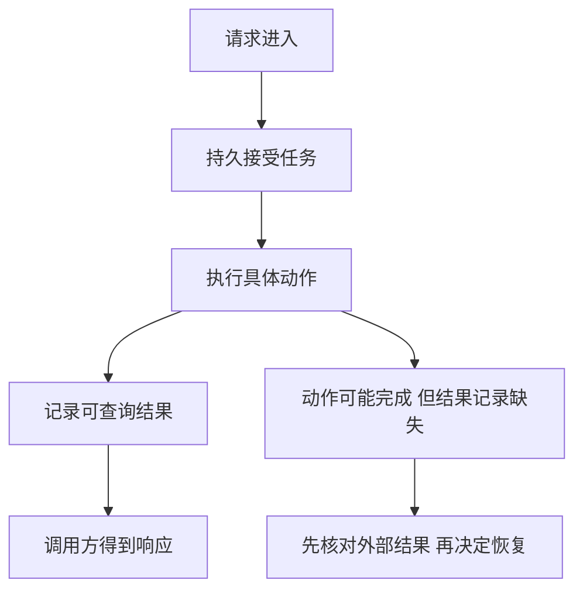

# Review｜从一次失败重建后端主线

[模块主页](../README.md) · [Handbook](../../../README.md) · [表达训练](../../../interview/05-backend-engineering/01-高频面试题.md)

第二遍不要从组件名单开始。先选择一个业务操作，画出谁相信哪份状态、谁占着什么资源、在哪个位置失去证据，再决定需要哪种恢复机制。下面的题目改变正文条件，检验能否迁移已经学过的规则。

## 1. 同一次操作的四种事实

“已接受”“已执行”“有持久结果”“客户端知道结果”可能发生在不同时间。数据库事务可以合并部分本地状态变化；外部动作不能仅靠本地事务变成原子操作。消息确认、TCP 确认和业务确认观察的对象也不同。

## 2. 用一张关系表判断工具负责什么

| 机制 | 能确定的事 | 仍需别的机制确定的事 |
|---|---|---|
| 在途接纳上限 | 已接收未终结的工作不会无限增加 | 单次任务成本、跨实例总预算 |
| 截止时间 | 调用链何时不再继续等待 | 下游动作是否发生、资源是否终结 |
| 唯一键与本地事务 | 本库内重复操作和相关修改的提交关系 | 外部供应商是否接受了动作 |
| MQ 确认 | 某次交付在相应协议层的进度 | 业务事务、结果可见与用户观察 |
| 租约与代际 | 哪次执行的写回可被本资源接受 | 不检查代际的外部资源是否已被修改 |
| 权威版本与版本化内容 | 在前提成立时，将所选版本与内容绑定 | 权威源故障、交付时权限、历史版本清理 |
| 探针与摘流 | 控制器观察到的健康与路由资格 | 已有连接、传播延迟、长任务恢复 |

## 3. 综合自测：改条件，而不是复述原句

以下均为教学场景。先列出状态与可检查结论，再展开答案。遗忘时使用回看入口；不要求先实现完整生产平台。

### 1. 吞吐降低时，原容量计划还成立吗？

队列已有 12,000 项工作。原来每秒处理 300 项、新到达 100 项；现在下游限流使处理能力降到 80 项/秒。每个排队对象占 4 KiB。计算原清空时间、现在一分钟后的积压和新增内存，并说明怎样先阻止继续增长。

回看：[连接与容量](../docs/05-ConnectionPool与ResourceCapacity.md) · [背压](../docs/06-Backpressure与RateLimit.md)

提示

使用净消耗率，不用总处理率。

参考答案与解释

原来 12,000÷(300−100)=60 秒。现在每秒净增 20 项，一分钟后积压 13,200 项，新增 1,200×4 KiB=4,800 KiB，约 4.69 MiB。要使被接纳速率低于可持续处理能力或恢复处理能力；扩大队列只是推迟溢出。

### 2. 本地事务成功，客户端却收到失败。

文档、操作结果和 Outbox 已一起提交，返回响应时断线。客户端同键同参数重试，应返回什么、是否新增事件？再把相同键的内容改掉，判断处理方式。

回看：[幂等](../docs/09-APIIdempotency与SideEffect.md) · [消息交付](../docs/10-MQ与DeliverySemantics.md) · [可靠任务](../docs/12-ReliableAsyncTask.md)

提示

看持久操作记录，不只看客户端状态。

参考答案与解释

查回原结果，不新增事件。同键不同参数应报告冲突，不默默复用结果。新的业务意图才使用新键；Outbox 已提交不表示消息已发出。

### 3. 租约与资源边界换了。

A 已向供应商发起外部写入，响应丢失。A 租约过期，B 取得新代际。供应商不检查代际，也没有可查询操作键。能否凭 B 的新代际宣称安全重做？

回看：[副作用与幂等](../docs/09-APIIdempotency与SideEffect.md) · [任务领取](../docs/12-ReliableAsyncTask.md) · [对账与补偿](../docs/13-Consistency与Compensation.md)

提示

把本地 UPDATE 与外部请求分开。

参考答案与解释

不能。代际只保护实际检查它的资源，供应商可能已经执行 A。缺少外部防重或结果查询依据，应保留未知状态并进行业务或人工核对，不能假造 exactly-once 保证。

### 4. 版本信息放在不同位置，会改变什么？

先采用普通内容键：数据库已到版本 12，旧读者持有 11，缓存中的正文与版本记录一起被淘汰。仅比较缓存现有版本能否挡住旧回填？

再采用正文中的版本化读取：新请求从权威记录选到 12，v12 缓存未命中，只读副本只有 11。应怎样继续？旧读者向 v11 键回填，会改变新请求的选择吗？

回看：[一致性中的完整读取方案](../docs/13-Consistency与Compensation.md) · [状态归属](../docs/14-DataLayering与StateOwnership.md)

提示

分别找出版本依据、内容键，以及本次已经确定的版本。

参考答案与解释

普通键的比较依据已丢失，无法单靠空缓存知道曾见过 12。版本化读取则应只取 12：等待必要版本、转权威来源或按预算失败，不能用 11 顶替。迟到回填只影响 v11，不改所选版本。已经在更新前选到 11 的旧请求仍可能返回 11；此方案不承诺所有在途请求在交付瞬间切换最新状态。

### 5. 权限在排队期间改变。

员工有权创建导出任务，排队时被移出团队。业务要求撤权立即生效，任务随后才领取，结果链接还可能被缓存。列出必须重新判断的边界。

回看：[权限生命周期](../docs/15-AuthSession与TenantBoundary.md) · [安全边界](../docs/21-BackendSecurity.md)

提示

创建、执行、获取结果发生在不同时间。

参考答案与解释

创建时验证主体与资源范围；执行读取前复核当前权限；结果查询和下载继续授权。缓存不代替授权，旧审批也不能覆盖新对象和新参数。还需按业务政策停止在途任务、处理临时输出，不能只撤销页面按钮。

### 6. SQL 优化没有解决接口慢。

同一请求串行耗时：等连接 1,000 ms、SQL 50 ms、模型 850 ms、响应组装 100 ms。原 SQL 为 800 ms。求当前总耗时；继续将 SQL 降到 10 ms 能省多少？接下来观察什么？

回看：[连接池](../docs/05-ConnectionPool与ResourceCapacity.md) · [请求时间线](../docs/17-Observability与PerformanceDiagnosis.md) · [Linux 证据](../docs/18-LinuxTroubleshooting.md)

提示

画同一请求的时间线，不相加不同样本的 P99。

参考答案与解释

当前 2,000 ms；进一步优化 SQL 省 40 ms，即当前总时延的 2%。先看连接持有时间、池等待、并发和模型调用。这个加法只适用于给定串行条件，不用于并行分支或独立分位数。

### 7. 发布窗口比任务短。

Pod 停机宽限 30 秒，preStop 已耗费 8 秒，任务还需 20 分钟。当前进程剩余多少预算、何时停止接纳，怎样避免发布导致任务丢失？

回看：[任务恢复](../docs/12-ReliableAsyncTask.md) · [停机](../docs/19-ContainerK8s与Deployment.md) · [兼容演进](../docs/20-ConfigRelease与ServiceEvolution.md)

提示

摘流与终止存在传播和并发，不是完美串行。

参考答案与解释

宽限不在 preStop 结束后重新计时，余量约 22 秒且须预留清理。进入终止时限制新工作，定义传播期间请求的处理方式；长任务由持久状态和恢复协议继续，不指望此 Pod 等完。已有连接、旧工作者和新版本输入兼容仍要检查。

## 4. 用小任务检查能否独立操作

| 小任务 | 不看答案时应做到什么 | 核对入口 |
|---|---|---|
| 线程任务抛异常 | 区分 Future 已完成、调用者观察异常和名额释放；预测取消结果 | [并发章](../docs/04-Concurrency与ThreadPool.md) |
| PKCE 兑换失败 | 指出客户端保存什么、授权服务保存什么、兑换时比较什么，不把授权码当访问令牌 | [认证章](../docs/15-AuthSession与TenantBoundary.md) |
| FD 接近上限 | 读目标 PID 的限制和趋势，提出假设及反证，不用当前 shell 或单次截图代替 | [Linux 章](../docs/18-LinuxTroubleshooting.md) |
| 新增哈希节点 | 手算哪些键改了归属，再区分映射变化和实际数据搬迁 | [路由章](../docs/16-ServiceDiscovery与LoadBalancing.md) |

## 5. 怎样记录真实薄弱点

把错误写成“我混淆了哪两个状态，漏了哪个条件”，例如把取消请求当成工作终结，或把消息 ID 当成业务操作身份。随后回到正文核对，不用再抄一次术语。

综合判断走通后，再按岗位进入 [Java/Spring](../docs/22-CrossLanguageRuntimeMapping.md#java-path) 或 [Go](../docs/22-CrossLanguageRuntimeMapping.md#go-path) 分支。映射帮助迁移问题，不说明各生态行为完全相同。
