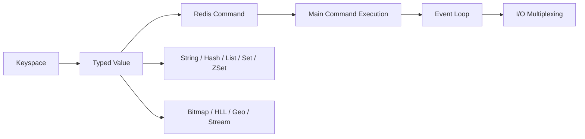
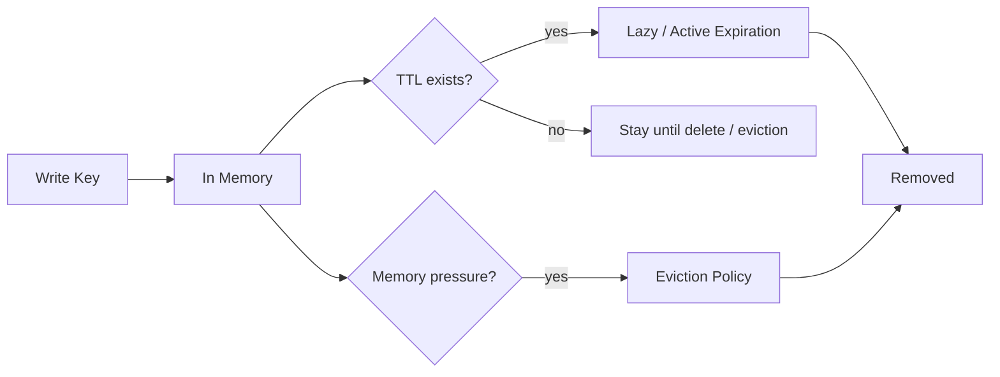
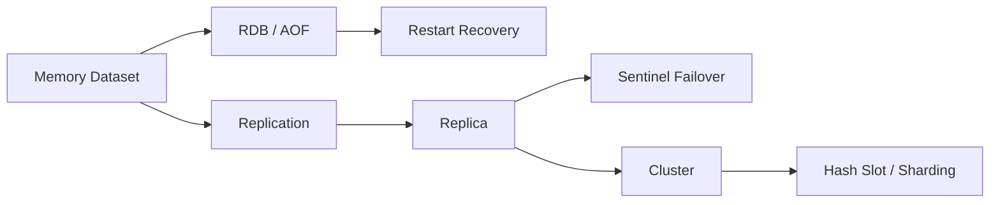
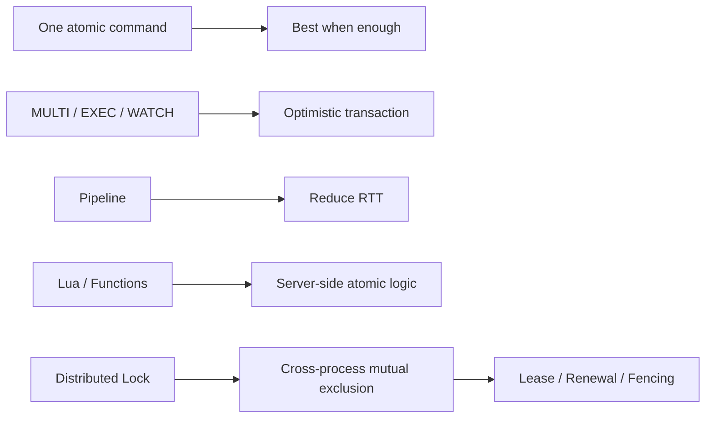
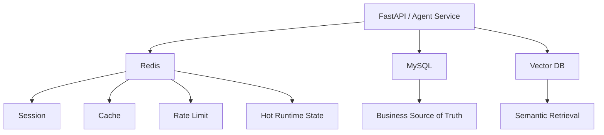

# Redis｜Review 与综合自测

[← 模块主页](../README.md) · [↑ Handbook 总目录](../../../README.md) · [Learning Path](../../../guide/learning-path.md) · [高频面试题 →](../interview/高频面试题.md)

> **用途：第二遍复习。** Review 不负责重新复制正文，而是要求从空白纸重建主线、机制、Failure / Trade-off 与面试表达。
>
> **学习路线是可选入口。** 如需整体安排，可参考 [Learning Path](../../../guide/learning-path.md)；本 Review 也可以按个人节奏独立使用。

---

> 先完成 `docs/01 → 24`，再用这里压缩知识。
>
> Review 的作用不是替代正文，而是检查你能否把 24 个知识小板块重新串成少数几条因果链。

## 1. 建议复习节奏

```text
首次系统学习
→ D+1 回忆总图
→ D+3 做自测
→ D+7 口述追问链
→ 面试前看速查表
```

每次复习不要先展开答案。

---

# 2. 总图一：Redis 从 Key 到 Runtime



口述时至少回答：

```text
为什么 Redis 不只是 KV？
为什么单个 Command 容易保持原子？
为什么慢命令会拖住其它请求？
I/O Multiplexing 解决的到底是哪一层问题？
```

---

# 3. 总图二：一个 Key 的生命周期



必须分清：

```text
Expiration
≠
Eviction
```

---

# 4. 总图三：可靠性演进



口述重点：

```text
Persistence
≠ Replication
≠ High Availability
≠ Sharding
≠ Backup
```

---

# 5. 总图四：并发控制工具箱



最容易说错的是：

```text
Pipeline ≠ Transaction
Transaction ≠ MySQL Transaction
Lock ≠ Idempotency
TTL ≠ Lock Correctness
```

---

# 6. 总图五：AI Application 中 Redis 的位置



---

# 7. 关键追问链

## Cache

```text
为什么用 Cache？
→ Cache Aside 怎么读？
→ TTL 怎么定？
→ 穿透/击穿/雪崩怎么区分？
→ BigKey/HotKey 怎么治理？
→ Redis 故障后 DB 会不会被打爆？
→ DB + Cache 一致性怎么做？
```

最后一问 Primary 在 AI Backend Engineering。

## Distributed Lock

```text
SET NX PX 怎么加锁？
→ 为什么 Value 要唯一？
→ 为什么不能直接 DEL？
→ TTL 到期但任务没结束怎么办？
→ Renewal 还会失败吗？
→ Failover 会不会双持锁？
→ Fencing Token 怎么保护下游？
→ 这个场景真的需要 Redis Lock 吗？
```

## HA

```text
RDB/AOF 是什么？
→ Replication 怎么同步？
→ Replica Lag 怎么办？
→ Primary 挂了谁切换？
→ Sentinel 和 Cluster 区别？
→ Cluster 如何分片？
→ 为什么 Cluster 仍不强一致？
```

---

# 8. 自测

<details>
<summary>1. Redis 为什么快？</summary>

内存访问、高效原生数据结构、mostly single-threaded 的核心命令执行减少共享状态锁竞争、Event Loop/I/O Multiplexing 管理大量连接；但慢命令、BigKey、fork、Swap 等仍会制造延迟。

</details>

<details>
<summary>2. Redis 整个进程只有一个线程吗？</summary>

不是。核心命令执行长期主要采用单线程串行模型，但后台工作以及现代版本部分网络 I/O 会使用额外线程。

</details>

<details>
<summary>3. Expiration 和 Eviction 有什么区别？</summary>

Expiration 由 Key 的 TTL 语义触发；Eviction 是达到 maxmemory 后为腾出空间主动淘汰 Key。

</details>

<details>
<summary>4. 穿透、击穿、雪崩如何快速区分？</summary>

不存在数据持续绕过缓存是穿透；单个热点 Key 失效造成并发回源是击穿；大量 Key 同时失效或 Redis 整体故障造成大范围回源是雪崩。

</details>

<details>
<summary>5. BigKey 和 HotKey 有什么不同？</summary>

BigKey 是 Value/Collection 太大；HotKey 是访问流量太集中。Cluster 能分散 Keyspace，但不能自动拆一个 HotKey。

</details>

<details>
<summary>6. RDB 和 AOF 的核心区别是什么？</summary>

RDB 是时间点 Snapshot；AOF 是写操作日志，恢复时 Replay。数据安全窗口、文件体积和恢复成本不同。

</details>

<details>
<summary>7. Replication 为什么不是强一致？</summary>

默认主要异步复制，Primary 可能在 Replica 尚未同步时就确认写入；Failover 时存在最近写丢失窗口。

</details>

<details>
<summary>8. Sentinel 和 Cluster 的区别是什么？</summary>

Sentinel 为非分片 Primary/Replica 提供监控和自动 Failover；Cluster 进一步把 Keyspace 分成 Hash Slot，由多个 Primary 分片并提供 Failover。

</details>

<details>
<summary>9. Redis Cluster 为什么有 Hash Tag？</summary>

让多个 Key 根据 `{...}` 中相同内容落到同一个 Hash Slot，以支持需要同节点执行的 Multi-key、Transaction 或 Lua 操作。

</details>

<details>
<summary>10. Redis Transaction 能像 MySQL 一样回滚吗？</summary>

不能这样理解。MULTI/EXEC 保证 queued commands 连续执行，但运行时命令错误通常不会让已经成功的命令自动通用回滚。

</details>

<details>
<summary>11. Pipeline 和 Transaction 有什么区别？</summary>

Pipeline 主要减少网络 RTT；Transaction 关注执行连续性和 WATCH 乐观并发控制。Pipeline 本身不是事务。

</details>

<details>
<summary>12. Lua 最大的优点和风险是什么？</summary>

优点是把多步骤 read-modify-write 放服务器端原子执行并减少 RTT；风险是长脚本占用主要命令执行路径，阻塞其它客户端。

</details>

<details>
<summary>13. Redis Lock 为什么需要唯一 Token？</summary>

释放/续约时要证明当前锁仍属于自己，防止旧客户端误删或续约别人后来获得的新锁。

</details>

<details>
<summary>14. TTL 为什么不能保证分布式锁正确？</summary>

旧 Owner 可能暂停超过 TTL；锁过期后新 Owner 获得锁，旧 Owner 恢复后仍可能继续产生业务副作用。

</details>

<details>
<summary>15. Fencing Token 解决什么？</summary>

为每次锁持有生成单调版本，让下游拒绝旧版本 Owner 的 stale write，真正把过期 Owner 挡在被保护资源之外。

</details>

<details>
<summary>16. Pub/Sub 和 Stream 最大区别是什么？</summary>

Pub/Sub 是在线广播，离线订阅者错过历史消息；Stream 有持久 Entry、Consumer Group、Pending/Ack，更适合可靠消费。

</details>

<details>
<summary>17. Semantic Cache 比 Exact Cache 多了什么风险？</summary>

可能发生 False Semantic Hit：Query 看起来相似但真实意图、Tenant、权限或知识版本不同，导致错误复用答案。

</details>

<details>
<summary>18. Agent State 和 Agent Memory 是一回事吗？</summary>

不是。State 是某次运行当前执行位置/Owner/Lease 等；Memory 是 Agent 跨轮/跨任务保留和召回的信息语义。Redis 只是潜在存储后端。

</details>

<details>
<summary>19. Redis 做 Rate Limit 挂了怎么办？</summary>

必须预先定义 Fail-open / Fail-closed 或本地 fallback，取决于限流是普通流量保护、成本控制还是安全/额度硬边界。

</details>

<details>
<summary>20. Redis 在 AI 系统里最重要的设计问题是什么？</summary>

明确每类 Key 的 Source of Truth、可重建性、TTL、大小/热度上界、持久性和故障降级；不要把所有“状态”都默认丢进 Redis。

</details>
