# Vector Database｜Review 与综合自测

[← 模块主页](../README.md) · [↑ Handbook 总目录](../../README.md) · [Learning Path](../../roadmap/learning-path.md) · [高频面试题 →](../interview/高频面试题.md)

> **用途：第二遍复习。** Review 不负责重新复制正文，而是要求从空白纸重建主线、机制、Failure / Trade-off 与面试表达。
>
> **学习路线是可选入口。** 如需整体安排，可参考 [Learning Path](../../roadmap/learning-path.md)；本 Review 也可以按个人节奏独立使用。

---

> 这一层不是重新讲一遍正文，而是把 **16 个正式知识小板块**压缩成几条可以在脑中反复推演的执行路径。当前正文已连续编号为 `docs/01 → 16`，与正式学习顺序一致。
>
> 推荐顺序：**先看图回忆 → 自己口述 → 再展开答案检查。**

---

# 1. 总图：从 Vector 到 Production Vector DB

```mermaid
flowchart LR
    A["语义对象"] --> B["Embedding Vector"]
    B --> C["Dimension / Normalization"]
    C --> D["Cosine / Dot / L2"]
    D --> E["Exact Top-K"]
    E --> F["Scale Problem"]
    F --> G["ANN"]
    G --> H["HNSW / IVF / Quantization"]
    H --> I["Schema / Metadata / Filter"]
    I --> J["Update / Delete / Compaction"]
    J --> K["Shard / Replica"]
    K --> L["Product / Architecture Selection"]
```



这张图是整个模块的主干。

如果某个知识点解释不出来，优先问自己：

> **它是在解决哪一步的瓶颈？**

---

# 2. 总图：Exact Search → ANN

```text
Exact Search
= 全量比较
= Ground Truth / 小规模简单可靠
        ↓ 数据规模上升
计算量 / Latency ↑
        ↓
ANN
= 少搜索一部分候选
= 用 Recall 换 Latency / Memory / Build Cost
```

你应该能解释：

```text
为什么 ANN 不是“更快但完全相同的 Exact Search”
为什么 Benchmark 需要 Exact Ground Truth
Recall@K 怎样定义
```

---

# 3. 总图：ANN Index 选择

```text
                  ANN
       ┌──────────┼──────────┐
       ▼          ▼          ▼
     Graph     Partition   Quantization
       │          │          │
     HNSW        IVF       SQ / PQ
```

思考顺序：

```text
数据量 / 维度 / 内存
→ Recall 目标
→ P95 / P99 Latency
→ 更新频率
→ Filter Selectivity
→ Build / Rebuild 成本
→ Index Selection
```

不是：

```text
HNSW 看起来流行
→ 就选 HNSW
```

---

# 4. 总图：HNSW 参数

```text
M
→ Graph Degree
→ Memory / Build / Connectivity

efConstruction
→ Build Search Breadth
→ Build Time / Index Quality

efSearch
→ Query Search Breadth
→ Recall / Query Latency
```

真正的调优方法：

```text
固定 Dataset + Query Set
→ Exact Ground Truth
→ Sweep Parameters
→ Recall@K / P95 / Memory / QPS
→ 找 Pareto Front
```

---

# 5. 总图：Filter + ANN

```text
Query
→ Metadata Constraint
→ ANN Search
```

但实现可能是：

```text
Pre-filter
Post-filter
Filter-aware ANN
Iterative Expansion
Partition Pruning
```

排查召回问题时画四格：

```text
Exact + No Filter
Exact + Filter
ANN   + No Filter
ANN   + Filter
```

这样才能分清：

```text
Embedding / Corpus
Filter
ANN
ANN + Filter interaction
```

---

# 6. 总图：Vector Index Lifecycle

```text
Source of Truth
      ↓
Chunk / Record
      ↓
Embedding v1
      ↓
Vector Index Generation A
      ↓
Insert / Update / Delete
      ↓
Tombstone / Compaction
      ↓ model upgrade
Embedding v2
      ↓
Generation B
      ↓ validate / switch / rollback
```

必须能解释：

```text
为什么 Vector DB 往往是 Derived Index
为什么 Delete 可能不是立即物理消失
为什么 Re-embedding 需要 Version
为什么 Rebuild 不能直接覆盖线上唯一 Index
```

---

# 7. 总图：Distributed Vector Search

```text
Query
├─ Shard A → Local Top-K
├─ Shard B → Local Top-K
└─ Shard C → Local Top-K
        ↓
Global Merge
        ↓
Final Top-K
```

重点：

```text
Shard ↑
≠ Latency 一定 ↓

Fan-out / Tail Latency / Hot Shard / Merge
都会变重要
```

Partition / Tenant Routing 的价值之一就是减少无效 Fan-out。

---

# 综合自测

<details><summary>1. 为什么 Vector DB 之前要先学 Embedding，但 Embedding Model 原理又不属于 Vector DB？</summary>

Vector DB 的输入就是向量，所以必须知道向量从哪里来；但模型如何训练、怎样选择 Embedding Model 属于 LLM Foundation。Vector DB 从“给定向量后如何存、索引、检索和维护”开始负责。
</details>

<details><summary>2. Cosine 和 Dot Product 什么时候可能排序一致？</summary>

当向量都做 L2 Normalization 时，Dot Product 等于 Cosine，因此排序一致。
</details>

<details><summary>3. 为什么 Exact Search 仍然重要？</summary>

它是小规模可靠方案，也是 ANN Recall Benchmark 的 Ground Truth 来源。
</details>

<details><summary>4. ANN 的核心 Trade-off 是什么？</summary>

减少搜索成本换取近似误差，因此要同时看 Recall、Latency、Memory、Build / Update Cost。
</details>

<details><summary>5. HNSW 的 efSearch 调大会发生什么？</summary>

通常搜索候选更多，Recall 上升、Latency 增加；具体曲线必须 Benchmark。
</details>

<details><summary>6. IVF 的 nprobe 控制什么？</summary>

控制 Query 搜索多少个倒排 Cell。更大 nprobe 通常提高 Recall，同时增加查询工作量。
</details>

<details><summary>7. PQ 和 IVF 有什么本质区别？</summary>

IVF 主要减少搜索区域；PQ 主要压缩向量表示并近似距离，两者可以组合。
</details>

<details><summary>8. 为什么 Metadata Filter 可能影响 ANN Recall？</summary>

Filter 会改变合法搜索空间；简单 Post-filter 可能删掉大量 Top Candidate，Pre/Filter-aware ANN 也会改变图或分区的搜索行为。
</details>

<details><summary>9. 为什么 Tenant Isolation 不能只依靠 Prompt？</summary>

隔离必须由 Auth、Query Construction、Namespace / Filter、Result Audit 等系统边界保证，LLM Prompt 不是访问控制机制。
</details>

<details><summary>10. 为什么 Vector DB 常常不是 Source of Truth？</summary>

向量和 Index 通常是由业务文档、Chunk、Embedding 派生，可在模型升级或损坏后重建；业务原始事实更适合保留在权威存储中。
</details>

<details><summary>11. Tombstone 为什么需要 Compaction？</summary>

逻辑删除如果长期不回收，会造成存储膨胀、Segment 碎片和查询开销；Compaction 会清理废弃版本并重写有效数据。
</details>

<details><summary>12. Re-embedding 为什么不能直接把 v1 和 v2 混在同一检索空间？</summary>

不同模型产生的向量空间可能不可比较；应版本化并通过新 Generation 验证后切换。
</details>

<details><summary>13. Shard 和 Partition 有什么区别？</summary>

Shard 更偏底层物理水平扩展；Partition / Namespace 更偏逻辑组织和 Query Routing，具体映射取决于产品。
</details>

<details><summary>14. Replica 为什么不等于 Backup？</summary>

错误写入或 Delete 也可能同步到 Replica；Backup / Source of Truth 解决的是历史恢复问题。
</details>

<details><summary>15. Vector DB 选型第一步是什么？</summary>

先确定数据规模、过滤、更新、Recall、Latency、HA、运维等需求，再决定 FAISS / pgvector / Search Engine / Dedicated Vector DB，而不是先选产品再找理由。
</details>

<details><summary>16. Graph DB 和 Vector DB 的核心区别？</summary>

Vector DB 主要解决相似性近邻搜索；Graph DB 主要解决显式实体关系、路径与邻接遍历。两者可以组合但不能互相简单替代。
</details>

---

# Review 完成标准

你应该能够从空白纸画出：

```text
Vector Space
→ Exact
→ ANN
→ HNSW / IVF / PQ
→ Metadata Filter
→ Index Lifecycle
→ Distributed Search
→ Product Selection
```

并能回答每一步：

```text
为什么需要？
优化了什么？
牺牲了什么？
怎么验证？
哪里会坏？
```
