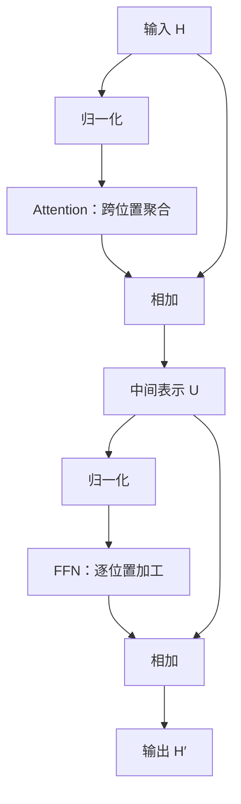

# 03｜Transformer 怎样把 Token 序列变成候选分数

[← Token、上下文与长文本](02-TokenContext与LongContext.md) · [模块首页](../README.md) · [Attention 与位置信息 →](04-Attention与Position.md)

上一章得到了 Token ID。假设输入编号是 `[1, 4, 2]`，模型并不能把 4 比 2 大理解成“这个词更重要”。它需要先把编号变成可计算的表示，再让不同位置交换信息，最后得到下一 Token 的候选分数。

本章沿这条路径解释 Transformer Block（Transformer 的重复计算单元）。先看整体协作，第 4 章再进入 Attention 的内部计算。

## 1. 从编号查到向量，而不是直接对编号做推理

**向量**是一组有固定顺序的数；**矩阵**是按行、列排列的一组数。模型有一个 Token Embedding（Token 嵌入）矩阵，每个词表编号对应其中一行。读到编号，先取出对应向量。

为了看清对象，下面假设词表有 6 个 Token，每个向量有 4 个分量。数值全部人为设定，不代表训练模型：

| 输入位置 | Token ID | 从嵌入矩阵取到的行 |
|---:|---:|---|
| 0 | 1 | `[0.2, 0.1, -0.3, 0.4]` |
| 1 | 4 | `[0.5, -0.2, 0.0, 0.1]` |
| 2 | 2 | `[-0.1, 0.3, 0.2, 0.2]` |

三个位置得到一个 `3 × 4` 的矩阵。前一个数字表示位置数，后一个表示每个位置的表示宽度。模型每层处理的这类中间表示称为 **Hidden State（隐藏状态）**，“隐藏”表示内部计算结果，不表示它是应用保存的长期记忆。

同一个 Token 在最初查表时取得相同的 Token 向量；经过上下文计算后，它在不同句子中的隐藏状态可以不同。例如“苹果手机”和“切开苹果”中的相关位置，会接收到不同上下文的信息。

> ⚠️ 注意：这里每个位置都有一个向量，不等于已经得到“整段文档的检索向量”。怎样把序列表示汇总成适合检索的向量，在第 9 章单独说明。

## 2. 一个 Block 里，哪些操作改变什么

先看常见的 **Pre-Norm（子层之前归一化）** 形式。它是本章使用的教学结构，不宣称所有 Transformer 的归一化顺序相同。



两条绕过子层的连线很重要，它们就是残差路径。对应关系是：

```text
U  = H + Attention(Norm(H))
H′ = U + FFN(Norm(U))
```

Attention 让当前位置从允许读取的其他位置聚合信息。**FFN（Feed-Forward Network，前馈网络）** 继续加工每个位置已经得到的表示。残差把原表示加回来；归一化调节表示的数值尺度。

原始 Transformer 论文展示了 Attention、逐位置前馈网络、残差与归一化的协作，其中采用的子层顺序与上面的 Pre-Norm 示例有所不同。读架构时要检查连线和运算顺序，不能只看组件名称。[原始结构](https://arxiv.org/html/1706.03762v7#S3)

## 3. Attention 与 FFN 为什么都需要

### Attention 负责从哪些位置取信息

读到“订单 A 尚未发货，所以它……”时，“它”对应的位置需要使用前文。Attention 会为可见位置计算权重，并对这些位置携带的内容做加权汇总。权重与当前输入及已训练参数有关，不是程序员预先写好的“代词一定连到最近名词”规则。

第 4 章会计算一次具体权重。这里先抓住它的作用范围：**跨位置的信息交互**。

### FFN 负责加工已经汇集的信息

FFN 通常在每个位置上使用同一套参数，但不直接把不同位置再混合一次。常见结构是先把表示变到更宽的内部空间，经过非线性函数，再变回原宽度。非线性使多层计算不至于退化成一个线性变换。

例如表示宽度为 4，某个前馈层可以做 `4 → 12 → 4`；这些宽度是假设值。每个位置单独经过同一过程，所以输入是 `3 × 4` 时，输出仍是 `3 × 4`，可以与残差相加。

**逐位置计算不等于不使用上下文。** FFN 接收的隐藏状态已经被前面的 Attention 更新，里面可以包含其他位置的信息。

## 4. 残差和归一化不是可有可无的装饰

### 残差保留一条直接的信息路径

若某位置的原表示为 `[1, 2]`，子层算出的更新为 `[0.1, -0.4]`，残差相加后得到 `[1.1, 1.6]`，不是直接把原表示替换成 `[0.1, -0.4]`。

深层网络由许多这样的更新组成。直接路径帮助信息与训练时的梯度传播，但不保证网络永远不会退化，也不意味着可以删掉子层而没有影响。

### 归一化控制的是数值尺度

把某位置各维度的数值缩放到较稳定的尺度，有助于后续计算。**LayerNorm（层归一化）** 通常减去均值，再除以方差加数值稳定项后的平方根，并带有可学习的缩放、偏置。**RMSNorm（均方根归一化）** 按均方根缩放，不执行相同的去均值步骤。两者不是同一个公式换名字。[RMSNorm 的定义](https://arxiv.org/abs/1910.07467)

本章不要求背归一化推导，但要知道三个边界：归一化不是把所有 Token 变成同一个向量，不是把隐藏状态变成词表概率，也不是解决事实错误的验证器。Pre-Norm 与 Post-Norm 的区别要结合实际架构阅读。

## 5. 位置怎样参与计算，最后又怎样输出分数

仅知道有哪些 Token，还不够表达顺序。位置机制把顺序信息引入模型。某些方法在嵌入上加入位置向量；RoPE（旋转位置编码）则在 Attention 内处理参与匹配的查询与键表示（Q/K）。因此总图里可以写“引入位置机制”，却不能笼统地说所有模型都在 Token Embedding 上加位置向量。

经过多层 Block 后，本例仍可得到 `3 × 4` 的隐藏状态。**LM Head（语言模型输出头）** 把每个位置的隐藏状态映射成词表分数。假设词表大小为 6，则分数矩阵是 `3 × 6`：每行对应一个位置，每列对应一个候选 Token。

普通自回归生成时，使用当前最后位置的分数选择下一 Token。**Logits**就是这些尚未归一化的分数。它们可以为负，也不必加起来等于 1；第 5 章解释怎样把它们变成生成决策。

```text
N 个 Token ID
    ↓ 查嵌入；在相应位置引入位置机制
N × d 的隐藏状态
    ↓ 多层 Block
N × d 的隐藏状态
    ↓ LM Head
N × 词表大小 的分数
    ↓ 读取最后位置
下一 Token 的候选分数
```

## 6. 训练为什么可以并行，生成为什么仍有依赖

训练时，一段已有文本可以同时提供多处监督信号。假设完整训练序列是 `A B C D`，把输入与希望预测的目标错开一位：

| 输入位置能看到的前缀 | 要预测的目标 |
|---|---|
| A | B |
| A B | C |
| A B C | D |

这些目标在训练样本中已经存在，可以在一次前向计算中计算多个位置的预测，再比较目标，形成损失。**损失**衡量预测与训练目标的差距；反向传播据此计算参数应怎样调整的梯度，优化器再更新参数。

但必须限制每个位置只读取允许的前缀，否则预测 B 时直接看到了 B，就没有学到真实生成时的任务。这个限制就是下一章的因果掩码。

推理时，未来 Token 尚未产生，不能直接把正确答案预先放进输入。先选择 B，再用包含 B 的前缀计算后续。这是数据依赖，不是说 Transformer 完全不能并行：同一层中多个已知位置、多个注意力头和不同请求仍可并行处理。

Encoder-only（仅编码器）模型常允许双向读取已给定输入；Encoder-decoder（编码器—解码器）模型先编码源输入，再让解码器生成目标。架构的可见范围与任务目标不同，不能把 Decoder-only 的因果规则当作所有模型唯一的阅读方式。

## 本章小结

编号先查成向量，Attention 让位置之间交换信息，FFN 加工各位置已获得的表示，残差与归一化支撑深层计算，输出头最终产生词表分数。训练可以对已知序列并行监督；生成则必须尊重尚未产生的 Token 的依赖。

## 🎯 面试怎么回答

**问：Transformer 不就是 Attention 吗，FFN 和残差有什么用？**

> Attention 负责跨位置聚合信息，FFN 对每个位置的表示做非线性加工，两者作用不同。残差把子层更新与原表示相加，保留直接的信息路径；归一化调节数值尺度。堆叠这些 Block 后，输出头把隐藏状态映射成词表分数。具体模型还要检查归一化顺序、位置机制和注意力可见范围，不能只列组件名称。

## ⚠️ 易错点

不要把隐藏维度、词表大小和序列长度混为一谈：它们分别描述每个位置的表示宽度、候选单元数量和当前位置数量。

FFN 对每个位置独立运算，不意味着它接收的是没有上下文的信息；Attention 的输出已经包含上下文。训练中的并行计算，也不等于生成时已经知道未来答案。

## 自测

**任务 1：** 输入 5 个 Token，隐藏宽度 8，词表大小 20。写出嵌入后、宽度不变的 Block 后、LM Head 后的矩阵形状，并指出普通生成取哪一行。

<details><summary>答案与解释</summary>

分别为 `5 × 8`、`5 × 8`、`5 × 20`，生成取最后一个位置对应的 20 个候选分数。Block 的内部前馈宽度可以不同，但输出要回到这里约定的隐藏宽度。

</details>

**任务 2：** 训练文本为 `A B C`。某个实现允许用位置 A 读取 B，再预测 B。它为什么可能在训练集上表现很好，却不符合真实生成条件？

<details><summary>答案与解释</summary>

它泄漏了目标信息。真正生成 B 时只有前缀 A 可用，不能从尚未生成的 B 读取答案。训练损失好看不代表这种计算满足生成任务。

</details>

## 知识回看与资料

回看 [Token 与聊天表示](02-TokenContext与LongContext.md)。原始架构、Attention 和 FFN 的角色见 [Transformer 第 3 节](https://arxiv.org/html/1706.03762v7#S3)；要核对某个具体模型，先查其模型文档，不从这张教学图反推实现。[资料索引](../../../references/llm-foundation/README.md)
