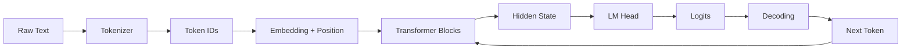
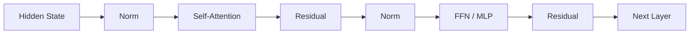
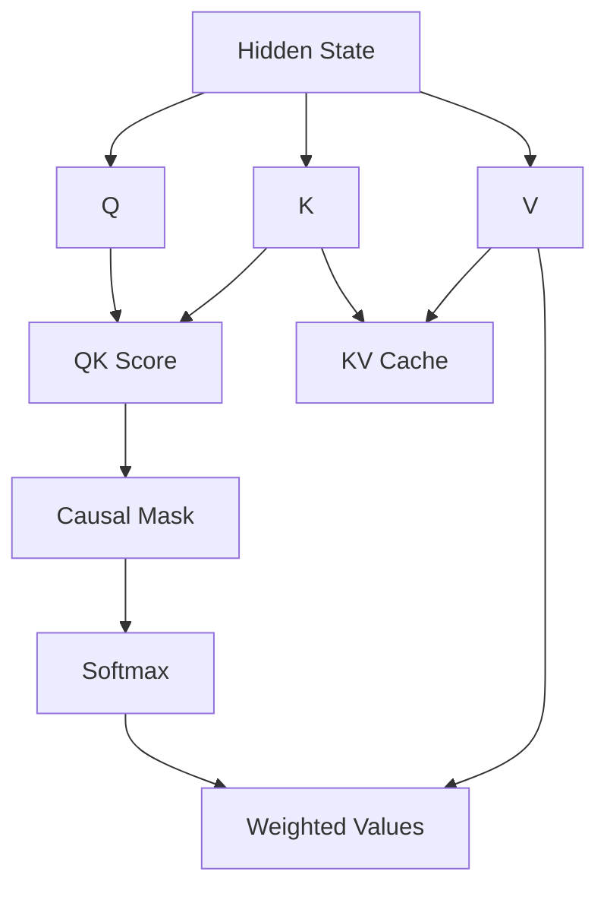
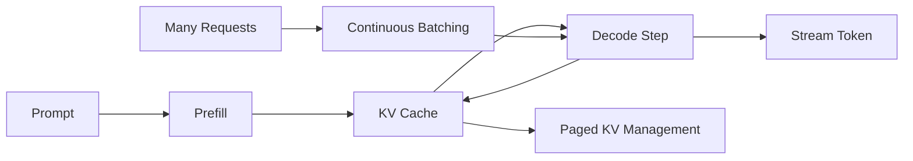
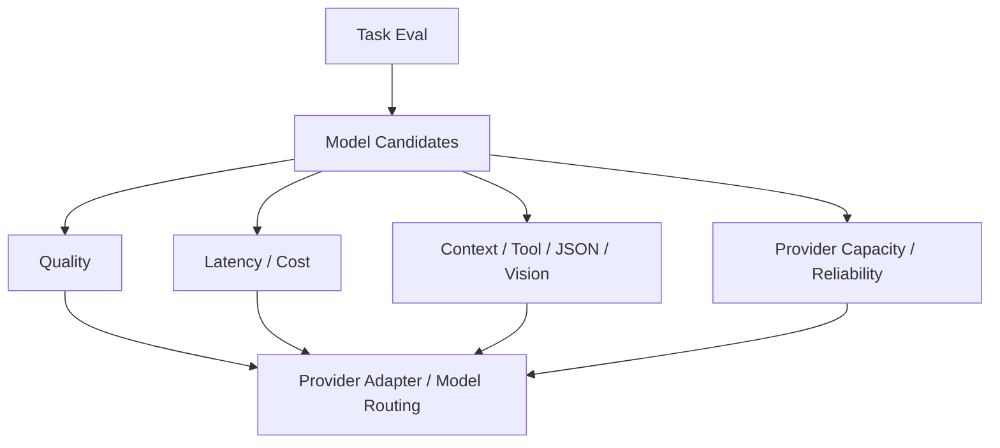
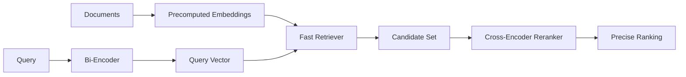
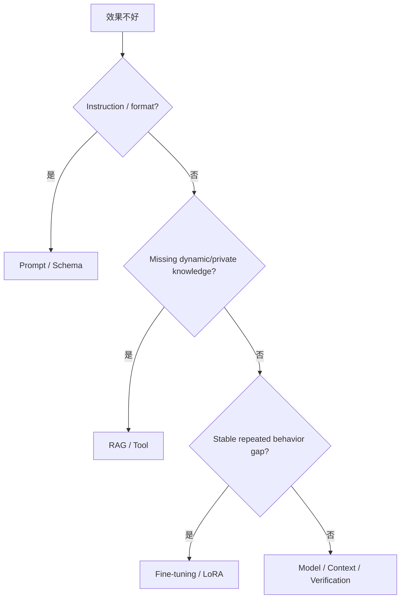

# LLM Foundation（应用工程深度）｜Review 与综合自测

[← 模块主页](../README.md) · [↑ Handbook 总目录](../../../README.md) · [Learning Path](../../../guide/learning-path.md) · [高频面试题 →](../interview/高频面试题.md)

> **用途：第二遍复习。** Review 不负责重新复制正文，而是要求从空白纸重建主线、机制、Failure / Trade-off 与面试表达。
>
> **学习路线是可选入口。** 如需整体安排，可参考 [Learning Path](../../../guide/learning-path.md)；本 Review 也可以按个人节奏独立使用。

---

> 第一遍按 `../README.md` 的 **14 个知识小板块**建立体系；这一层不再按文件逐章重复，而是把机制压缩成少数几条因果链。
>
> 教材是 14 个知识块，不代表自测只能有 14 题。这里仍保持更细的问题粒度，用来检查你是否真的掌握机制。

---

## 图 1｜Text → Token → Transformer → Next Token



你应该能解释：Token 为什么是成本单位、Context Window 怎么被多个组件共享、为什么输出要逐 Token 生成。

---

## 图 2｜Transformer Block



记住：

```text
Attention → 跨 Token 信息交互
FFN       → 位置内非线性加工
Residual  → 信息/梯度直通
Norm      → 数值稳定
RoPE      → Position 进入 Attention
```

---

## 图 3｜QKV、Causal 与 KV Cache



重点追问：为什么缓存 K/V、为什么 Context 越长 KV Cache 越大、GQA/MQA 为什么能降低缓存压力。

---

## 图 4｜Prefill / Decode / Serving



```text
Input Length  → Prefill / TTFT / KV Memory
Output Length → Decode Steps / TPOT / Cost
Concurrency   → KV Cache / Scheduler Pressure
```

---

## 图 5｜Model Access & Selection



最终看的是：

```text
Cost per Successful Task
```

而不是单纯排行榜或 Token 单价。

---

## 图 6｜Embedding → Retrieval → Rerank



核心：Bi-Encoder 适合大规模召回；Cross-Encoder 更精细但每个 Pair 都要重新推理。

---

## 图 7｜Prompt / RAG / Fine-tuning Decision



---

# 综合自测

<details><summary>1. Context Window 为什么不是免费容量？</summary>
长输入会增加 Prefill、KV Cache、TTFT、成本和信息噪声；能放下不代表模型会稳定利用。
</details>

<details><summary>2. Attention 和 FFN 的核心分工是什么？</summary>
Attention 负责跨 Token 聚合上下文；FFN 对每个位置的表示做非线性加工。
</details>

<details><summary>3. Causal Mask 为什么必要？</summary>
让当前位置不能在训练时看到未来 Token，使训练信息边界与真实自回归生成一致。
</details>

<details><summary>4. Temperature、Top-k、Top-p 分别控制什么？</summary>
Temperature 调整分布尖锐程度；Top-k 固定保留前 k 个候选；Top-p 保留累计概率达到阈值的动态集合。
</details>

<details><summary>5. Temperature=0 是否保证事实正确？</summary>
不保证。它降低随机性，但最高概率续写本身仍可能是错误事实。
</details>

<details><summary>6. KV Cache 为什么能加速？</summary>
历史 Token 的 K/V 可以复用，新 Token 无需每步重新计算全部历史 K/V。
</details>

<details><summary>7. Prefill 与 Decode 最大区别是什么？</summary>
Prefill 一次处理完整输入、并行度较高；Decode 逐 Token 串行生成并持续读取历史 KV。
</details>

<details><summary>8. Continuous Batching 为什么适合 LLM Serving？</summary>
不同请求输出长度不同，完成请求可以动态退出、新请求立即加入，提高 GPU 利用率。
</details>

<details><summary>9. PagedAttention 解决什么？</summary>
主要解决动态 KV Cache 的内存分配与碎片问题，不是另一套 Attention 数学公式。
</details>

<details><summary>10. Quantization 为什么不一定更快？</summary>
速度依赖硬件、Kernel、反量化和 Workload；Memory 更小不自动等于端到端更快。
</details>

<details><summary>11. 为什么模型选型要看 Cost per Successful Task？</summary>
便宜模型如果错误率高、反复重试，最终完成一个正确任务的成本可能更高。
</details>

<details><summary>12. Bi-Encoder 与 Cross-Encoder 为什么组合？</summary>
前者可预计算文档向量做大规模召回，后者对少量候选联合编码做更精细排序。
</details>

<details><summary>13. Prompt、RAG、Fine-tuning 的主要边界是什么？</summary>
Prompt 解决任务表达/约束；RAG/Tool 提供动态或私有知识；Fine-tuning 稳定改变行为和特定任务能力。
</details>

<details><summary>14. 为什么 Fine-tuning 不适合存最新公司政策？</summary>
知识会快速变化且需要权限/删除/引用，更适合外部 Retrieval/Tool 而不是反复写入模型参数。
</details>

<details><summary>15. LoRA 为什么参数高效？</summary>
冻结 Base Weight，只训练低秩增量矩阵，大幅减少可训练参数和 Optimizer State。
</details>

<details><summary>16. 为什么必须记录 Model / Prompt / Adapter Version？</summary>
没有版本就无法复现 Regression、比较 Eval 或安全回滚。
</details>

---

第二遍复习完成标准：你应该能不看文档画出：

```text
Token → Transformer → Attention → Generation
Prefill → KV Cache → Decode → Serving
Model Selection
Embedding → Reranker
Prompt / RAG / Fine-tuning Boundary
```
