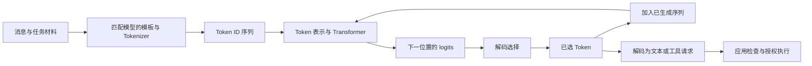
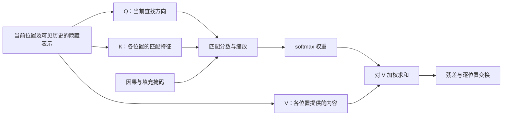
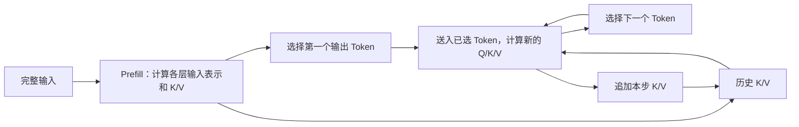
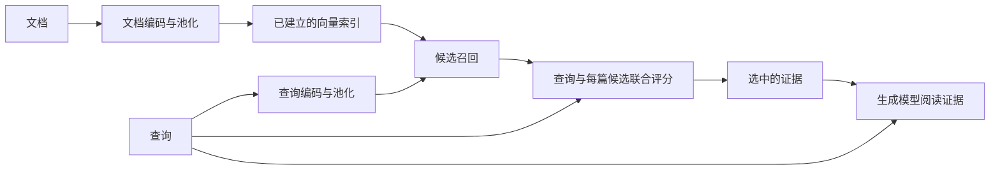
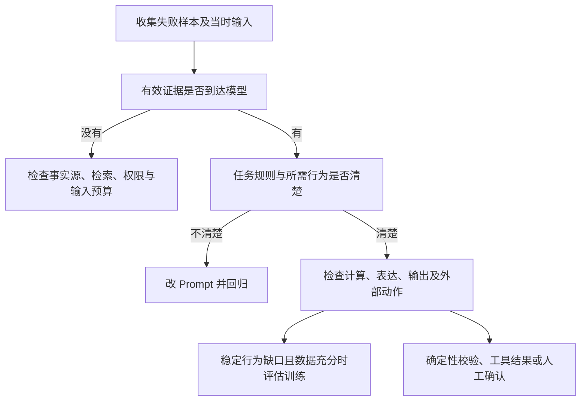

# Review｜把模型机制连成可判断的过程

[← 模块首页](../README.md) · [表达训练](../interview/高频面试题.md) · [机制小实验](../labs/README.md)

复习时先遮住图后的解释，回答每条边“谁把什么交给了谁”。如果只能复述名词，而说不清对象在哪里改变，就沿回看链接补上那一步。这里的新情境只使用正文已经建立的规则。

## 1. 一次回答，哪些状态真的改变了

这张图的循环不是“把所有旧计算无条件重做”。KV 缓存复用的对象在第 3 节展开。一次普通生成不会因此修改训练好的权重；输出一段工具参数也不会自动完成外部操作。

**先口述：** 输入一条查询订单的消息，模型输出“退款成功”。从图上说明：哪些环节可以证明它确实完成了退款，哪些环节只能证明生成了这句话？

回看：第 01 章负责模型与应用的分工，第 02 章负责输入如何表示，第 05 章负责生成循环，第 08 章负责响应与动作的边界。

## 2. 计算图要画出信息来源，而不只画方框

Q、K、V 来自学习到的投影，不是人为指定哪个词是主语。某位置因果上不可见时，掩码应使它的权重为零；不是仅把它的原分数乘成零。残差路径、归一化、FFN 与多个 Head 的合成回到第 03、04 章看，不把本图视为完整网络实现。

**迁移任务：** 某个不可见位置的 V 从 `[1,1]` 改为 `[1000,1000]`。其他输入保持不变，正确掩码下当前输出应否改变？若发生改变，应先检查哪里？

答案与解释

不应改变。先检查该位置的注意力权重是否确实为零、掩码方向是否正确，以及它是否通过其他未屏蔽的输入路径泄露信息。仅观察最终答案不够，要回到可见性和加权过程。

## 3. 时间与显存来自不同对象

图中“选择 Token”与“把它送回模型”是两个时刻。刚从输入最后位置的 logits 选出的第一个输出 Token，通常尚未进入该请求的 KV 缓存。停止前最后选出的 Token 也不一定再被送回。估算上限仍可以保守使用输入加输出预算。

**迁移任务 A：** 使用标准全注意力 KV 的模型有 24 层、4 个 KV Head、每个 Head 64 个数，缓存每个数占 2 字节。两个请求已缓存长度分别为 2,048 与 4,096。计算原始 KV 大小；把 KV Head 改成 8 个后又是多少？其他开销不计。

提示

一层同时保存 K 和 V；按两个请求的长度之和计算，不把并发数再次乘进去。

答案与解释

每 Token 为 `2×24×4×64×2=24,576` 字节。总长 6,144，大小为 150,994,944 字节，即 144 MiB。KV Head 翻倍，大小变为 288 MiB。这里没有计入权重、激活、元数据、分页尾块或其他请求；更改头数也是模型架构条件变化，不是对既有模型随便改一个参数。

**迁移任务 B：** 一次请求在第 0.6 秒收到首个输出 Token，第 3.6 秒收到第 61 个、也是最后一个 Token，第 3.8 秒收到完成事件。计算 TTFT、平均 TPOT 和客户端完成延迟。若网络把每三个 Token 合成一个分片，还能把分片间隔叫作 ITL 吗？

答案与解释

TTFT 为 0.6 秒，平均 TPOT 为 `(3.6−0.6)/(61−1)=0.05` 秒，即 50 毫秒；到完成事件为 3.8 秒。分片不是 Token，只有分片时间戳不能恢复真实逐 Token 间隔。要声明测量位置和事件定义。

回看第 06 章的缓存对象、第 07 章的测量口径。Continuous Batching 解决调度空位，PagedAttention 解决 KV 的组织与访问，FlashAttention 减少注意力计算中的内存读写；不要互换它们的作用对象。

## 4. 检索模型与生成模型怎样配合

双塔编码能预先处理文档，因为编码文档时不需要知道本次查询。交叉编码需要查询与候选共同参与，计算次数随候选数增长。生成阶段还必须正确理解所选证据，前两步的指标不能替代最终任务正确性。

**迁移任务：** 更换 Embedding 模型后向量仍是 768 维，却发现检索突然恶化。当前只重算了查询向量，历史文档向量未动。是否应该先扩大 HNSW 搜索范围？按先后说明检查办法。

答案与解释

先确认查询和文档是否在同一模型、同一编码约定的向量空间；同维不代表兼容。用少量已知相关文档按新模型重算，并检查模板、池化、归一化和截断。再比较一致空间中的精确搜索与 ANN；只有确认损失主要由近似搜索带来，才进一步调整索引。完整重建和版本切换归 Vector DB，召回质量归 RAG。

回看第 09 章；多模态时还要区分“跨模态相似检索”和“理解图表并正确计算”，见第 10 章。

## 5. 改什么，取决于最早的失败点

这不是僵硬的先后清单。例如明显的权限漏洞需要立即在应用层阻断，不能等 Prompt 和微调都试过。图的用途是避免用改模型掩盖数据或执行错误。

**迁移任务 A：** 文档明确说明退货期为 30 天，但模型输入中只剩“请回答退货政策”，系统误答成 7 天。换一个更强模型后偶尔答对了。应怎样判断这是否修复？

答案与解释

关键证据在输入组装前后丢失，应检查实际发送内容、截断和预算。偶然答对可能依赖参数中的旧知识，不证明系统能稳定使用授权的当前版本。修复后要以不同产品、不同有效期和冲突版本验证证据确实到达并支持回答。

**迁移任务 B：** 一个模型生成的 JSON 100% 可解析，订单状态只有 75% 正确；另一个模型 96% 可解析，状态为 94% 正确。允许自动执行更新吗？这些指标是否足够直接选出胜者？

答案与解释

都不能据此直接自动执行。需要同一组样本上的联合通过率、拒绝与超时情况、状态权限和跨字段条件；两个单独指标不能在不知道相关性的情况下直接相乘。还要区分只读问答与有副作用的写操作，按实际风险设置门槛。第 08、12 章提供推理依据，动作审批与验证归 Agent。

## 6. 训练方法不是互斥的产品按钮

用一段话连接以下对象，而不是只背展开名：示范回答、偏好对、奖励、可训练参数、教师输出。

| 数据或限制 | 对应判断 |
|---|---|
| 有高质量目标回答 | 可以评估 SFT，但要检查截断、训练目标与数据泄漏 |
| 只允许训练少量参数 | 可以评估 LoRA；它可以与 SFT 等目标组合 |
| 有同一输入的可靠偏好对 | 可以评估 DPO，不能把偏好标注当事实真值 |
| 可采样且有可信奖励 | 可以评估相应强化学习方法，检查奖励被取巧的风险 |
| 希望把教师能力迁移给目标模型 | 可以评估蒸馏，先确认能取得哪种教师信号 |

**迁移任务：** 教师只提供文本输出，不提供 logits，教师和学生还使用不同 Tokenizer。有人建议“把 Token 概率逐项相除就能蒸馏”。指出前提问题，并给出可实施的路线。

答案与解释

没有可用的教师概率，而且词表中的位置也不对应，不能直接逐项计算分布损失。可以构建任务输入，用教师生成候选回答，依据可信规则、测试或人工审查过滤，转换成学生可用的训练样本。保留与训练不同来源的测试集，分别验证效果、延迟、成本和失败边界。具体数据授权仍需确认。

回看第 13、14 章。课程小实验只能核对数值关系，不能证明某次真实微调或强化学习训练有效。

## 7. 复习完成的检查

选一个自己的失败案例，提交一份简短复盘：当时的输入与约束、最早偏离预期的步骤、能区分两种可能原因的实验，以及实际结果和未验证范围。没有真实运行记录时，可以做明确标注的教学推演，不把它写成项目业绩。

[权威资料索引](../../../references/llm-foundation/README.md) 用于核对机制和版本；[高频面试题](../interview/高频面试题.md) 用于把理解组织成可追问的表达。
