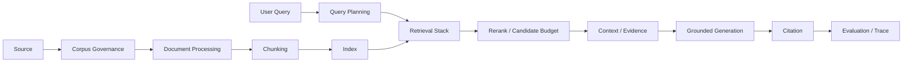
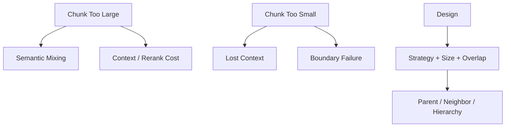
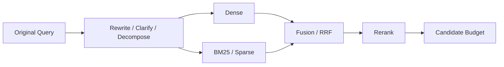
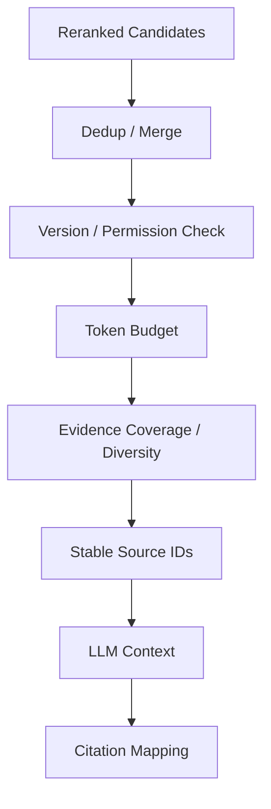
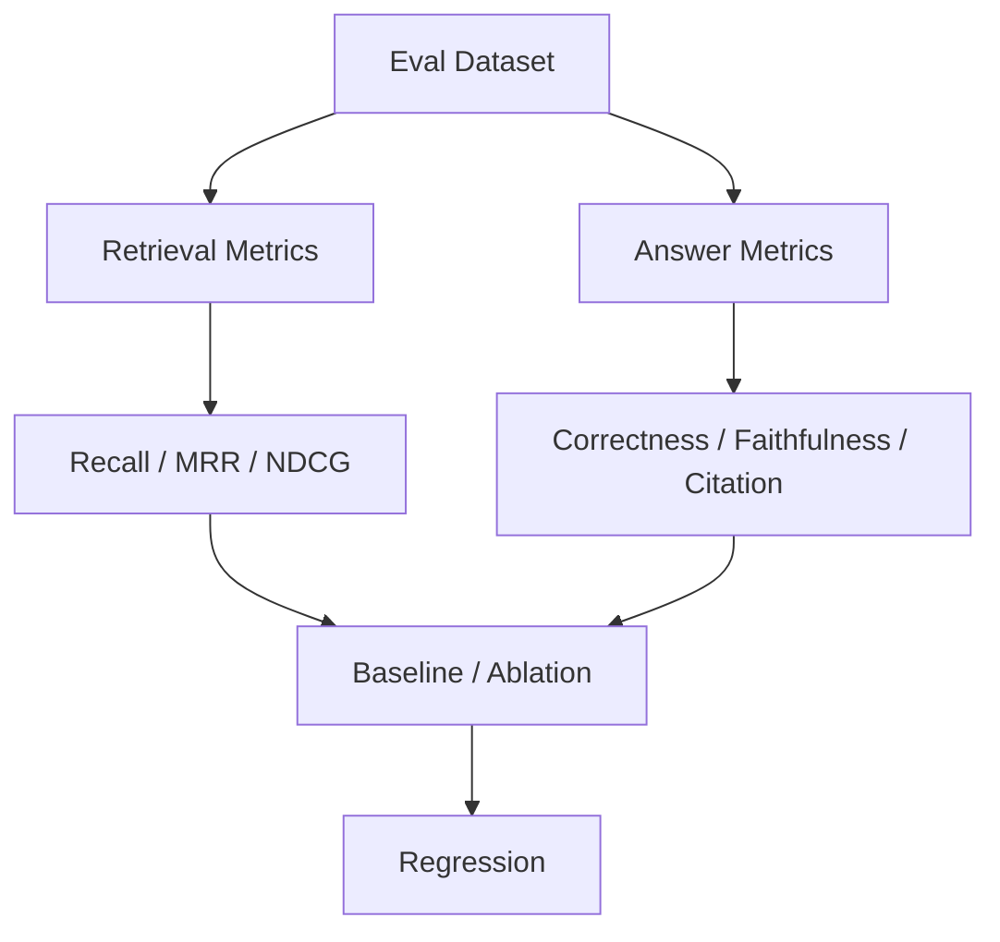
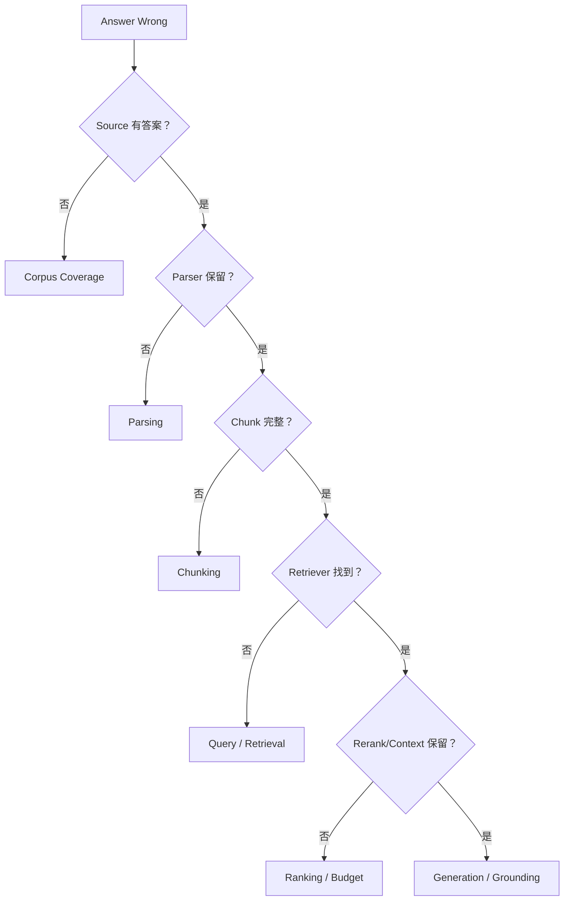

# RAG｜Review 与综合自测

[← 模块主页](../README.md) · [↑ Handbook 总目录](../../../README.md) · [Learning Path](../../../guide/learning-path.md) · [高频面试题 →](../interview/高频面试题.md)

> **用途：第二遍复习。** Review 不负责重新复制正文，而是要求从空白纸重建主线、机制、Failure / Trade-off 与面试表达。
>
> **学习路线是可选入口。** 如需整体安排，可参考 [Learning Path](../../../guide/learning-path.md)；本 Review 也可以按个人节奏独立使用。

---

> 第一遍按 `../README.md` 的 **14 个 Production RAG 子系统**学习；这里用于第二遍把它们压缩成少数几条 Pipeline，并用更细的自测题检查理解。

---

## 图 1｜完整 Production RAG



核心问题：每一层失败时，下一层能不能补救？大多数情况下不能完全补救，所以要分层 Attribution。

---

## 图 2｜Chunking 的核心矛盾



不要背固定 512 Token；要用真实 Query/Eval 找 Operating Point。

---

## 图 3｜Query → Candidate Funnel



必须能解释：Rewrite Drift、Dense/Sparse 互补、RRF 为什么不直接加 Score、Reranker 为什么救不回漏召回。

---

## 图 4｜Candidate → Evidence



`retriever[:5]` 不是完整 Context Construction。

---

## 图 5｜Evaluation 分层



---

## 图 6｜Bad Case Attribution



---

# 综合自测

<details><summary>1. 为什么 RAG 不等于 Vector DB？</summary>
Vector DB 负责向量存储/ANN/Filter；RAG 还包含 Corpus、Parsing、Chunk、Query Planning、Hybrid/Rerank、Context、Citation、Eval 和 Freshness。
</details>

<details><summary>2. 为什么先做 Corpus Audit？</summary>
因为 Source、格式、版本、重复、权限和更新频率会决定整个 Ingestion 与 Retrieval 设计，脏 Corpus 会污染后续所有组件。
</details>

<details><summary>3. Chunk Size 为什么没有通用答案？</summary>
它受 Query 粒度、答案跨度、文档结构、Embedding/Reranker 长度、Context Budget 和指标共同影响。
</details>

<details><summary>4. Parent-child 解决什么矛盾？</summary>
用小 Child 做精准召回，命中后扩展较大的 Parent/Neighbor 给模型更完整上下文。
</details>

<details><summary>5. Query Rewrite 最大风险是什么？</summary>
Query Drift：改写后的 Query 偏离用户原意，所以要保留原 Query 并通过 Eval 对比。
</details>

<details><summary>6. Dense 与 BM25 为什么常组合？</summary>
Dense 擅长语义/同义，BM25 擅长精确词、ID、稀有术语，两者 failure mode 互补。
</details>

<details><summary>7. RRF 为什么适合异构 Retriever？</summary>
它主要基于各路 Rank，而不是不可直接比较的原始 Score Scale。
</details>

<details><summary>8. Reranker 为什么不能修复 Retriever 漏召回？</summary>
它只能给 Candidate Set 里的文档重排，没进入候选的正确文档根本看不到。
</details>

<details><summary>9. Candidate Top-K 为什么不等于 Context Top-K？</summary>
最终 Context 还受 Token Budget、Diversity、Evidence Coverage、Version、Permission 和去重约束。
</details>

<details><summary>10. Citation 为什么需要稳定 Source Mapping？</summary>
防止模型自由编造引用，并支持从 Claim 追到 Chunk、Document Version 和原始 Source。
</details>

<details><summary>11. Recall@K、MRR、NDCG 分别更关注什么？</summary>
Recall 看相关证据进入前 K 的覆盖；MRR 强调第一条相关结果位置；NDCG 适合多级相关性和整体排名质量。
</details>

<details><summary>12. LLM Judge 为什么不能直接当 Ground Truth？</summary>
Judge 也有偏差、Prompt 敏感和版本漂移，需要人工标注集校准。
</details>

<details><summary>13. 为什么要做 Ablation？</summary>
隔离 Query Rewrite、Hybrid、Rerank 等组件的独立贡献，避免多个改动同时发生后无法 Attribution。
</details>

<details><summary>14. RAG Bad Case 第一问是什么？</summary>
权威 Source 中是否本来存在正确答案；不存在的话后续组件不可能召回。
</details>

<details><summary>15. Freshness 为什么不仅是正文更新？</summary>
ACL、有效期、Tenant、状态变化也会改变“此刻允许检索的知识”。
</details>

<details><summary>16. 为什么大规模 Rebuild 需要 Snapshot + Delta Replay？</summary>
构建期间 Source 继续变化，不追增量会让新 Generation 缺少构建开始之后的数据。
</details>

<details><summary>17. Permission 为什么不能等生成后再做？</summary>
无权限内容一旦进入 Reranker/LLM Context 就已经发生敏感数据暴露风险。
</details>

<details><summary>18. GraphRAG 解决的主要问题是什么？</summary>
显式实体/关系、多跳关系和全局结构问题；它不是所有 RAG 的默认替代方案。
</details>

<details><summary>19. Agentic RAG 与普通 RAG 最大区别？</summary>
Agent Runtime 可以根据中间证据决定是否继续、改写、换路由或调用其它工具；控制面属于 Agent Harness，检索质量仍属于 RAG。
</details>

<details><summary>20. 怎样证明一次 RAG 优化真的有效？</summary>
版本化 Baseline + 固定 Eval Dataset + Retrieval/Answer/Latency/Cost 指标 + Ablation + Regression，再进入 Canary/A-B，并把线上 Bad Case 回流测试集。
</details>

---

第二遍完成标准：你应该能不看文档画出：

```text
Source → Process → Chunk
Query → Dense/Sparse → Fusion → Rerank
Candidate → Context → Grounding/Citation
Eval → Regression → Bad Case
Freshness / Permission / Observability
```
