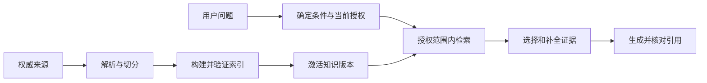
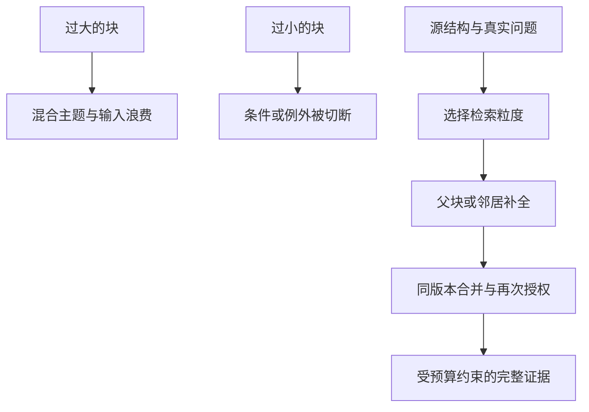
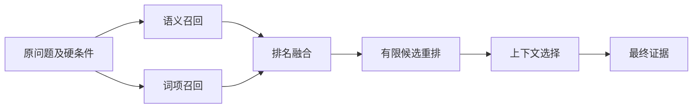
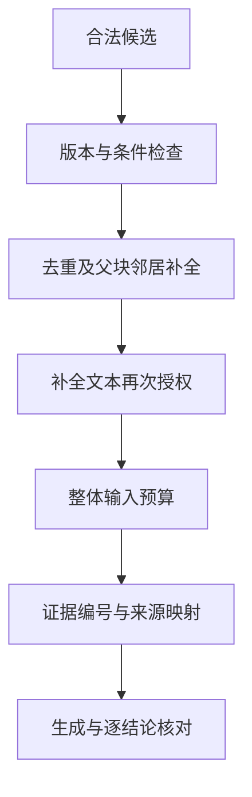
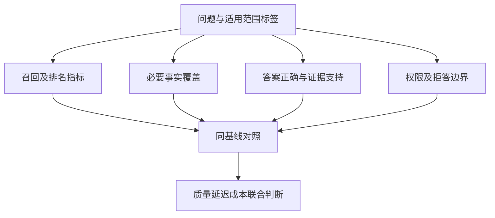
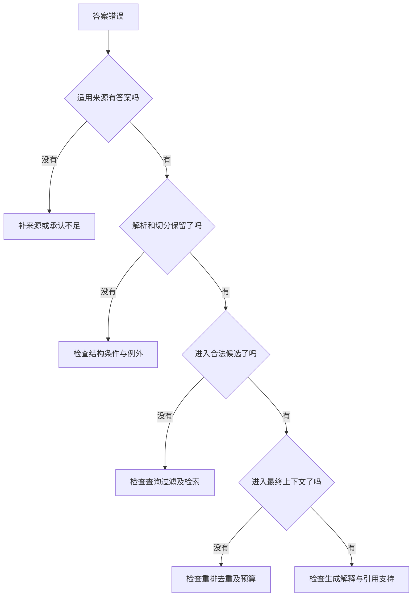

# RAG｜Review 与综合自测

[← 模块目录](../README.md) · [机制实验](../examples/README.md) · [面试表达](../interview/高频面试题.md)

这份复习材料用于第二遍重建关系，而不是代替正文。先不看图，尝试从一个用户问题画出数据流，再用图检查遗漏。下面的综合情境改变了正文条件，推理所需机制均已在主线建立。

## 1. 两条链，三个“完成”

源文档更新完成、索引写入完成、用户已经能查到新版本，是三个不同的时刻。每个箭头都需要说明传递的对象与确认条件；“任务入队成功”不能替代最终可见性。

**综合任务：** P1 的新版本已保存在文档系统；解析完成，词项索引已更新，向量索引写入超时且结果未知。是否可以宣布知识已全部更新？请给出确认顺序和不破坏旧版本的处理方式。

提示

先区分数据到达、可查询与跨存储版本一致，再考虑重试是否会重复写入。

参考答案与解释

不能。先按稳定身份查询向量写入是否已发生，再补齐未确认项，验证新版本在各必要存储中可查询且使用兼容配置；请求只能选择已验证的完整知识代号，不能在两个版本之间随意拼接。新代号未准备好时继续服务允许使用的旧代号，或明确更新未完成；但当前撤权和删除仍须立即按安全政策处理。依据第 12 章的版本切换、写入可见性与授权分离。

## 2. 切分不是长度问题，而是证据关系问题

检索单位、上下文单位和引用单位可以不同。扩大块与扩大 overlap 都不是无条件修复：它们增加的内容可能与本题无关，也可能仍覆盖不到远处例外。

**综合任务：** 一份设备手册第 2 页给一般操作，第 18 页给高温环境例外。查询明确涉及高温，系统命中第 2 页。把相邻一块补进来足够吗？还缺哪种关系与验证？

参考答案与解释

不一定。物理相邻关系不能跨越到远处的适用条件；应利用章节引用、条件索引或针对高温例外的查询补充召回，再检查它们属于同一设备、版本和授权范围。必要关系不等于词向量相似或相邻位置。用包含一般规则与例外的必要事实标签评测，不能只看“命中任一相关块”。依据第 4、5、6、10 章。

## 3. 候选漏斗：不同阶段丢的东西不同

每条路线都在授权范围内执行。原问题不能被改写结果覆盖，检索分数不能被解释成答案概率，重排不能恢复从未进入候选的内容。

**综合任务：** 查询中包含精确错误码 `ERR-7B`。改写模型把它改成“网络异常”，Dense 和词项两路都只收到改写后的问题。增加 RRF 权重或换大重排模型，能可靠解决吗？应该先改哪里？

参考答案与解释

不能可靠解决，因为两路在检索之前已经丢失关键约束。应保留原查询与精确错误码，确认分词和字段匹配支持该标识，再检查它是否进入候选；随后才分析融合和重排。改写不是修正用户所有表达，更不能自由替换事实标识。依据第 6、7、8 章。

## 4. 候选到上下文：排名不等于适用性

有引用只说明某个来源被指向；还要判断该来源是否适用、当前是否允许读取，以及它是否真的支持对应结论。压缩后剩下的句子也必须保留条件、否定词和例外。

**综合任务：** 可用证据预算 150 单位。一般规则 80、重复的一般规则 70、例外 60。前两条排名最高，第三条是回答问题必需的例外。如何组织上下文？能否把旧版 40 单位的例外替代当前版以节约预算？

参考答案与解释

去掉重复一般规则，保留当前适用版本的一般规则与例外，共 140 单位，并维护各自来源。不能仅为省预算替换成旧例外；版本和适用条件优先于方便。真实系统还需计算完整消息的模型 Token 与输出预留，而非直接套用本题抽象单位。依据第 5、8、9、12 章。

## 5. 评测不是一个总分

RR 只看第一条相关结果；完整性要检查全部必要证据。忠实于错误或过期材料，仍可能答错；恰好答对但没有检索证据支持，也不能证明 RAG 链路可靠。

**综合任务：** 旧方案在固定 200 个问题中答对 160 个；新方案答对 170 个。新增正确 18 个，旧正确退化 8 个，其中 3 个是重要权限问题。请计算百分点提升，并判断能否仅凭总分上线。

参考答案与解释

旧正确率 80%，新正确率 85%，提升 5 个百分点；18−8=10 个净改善，与总数一致。不能仅凭总分上线，权限错误可能构成硬阻断；应检查退化类型、任务分布、延迟与成本，并把回归修复后重新评测。依据第 10、11 章，业务门槛必须在看结果前定义。

## 6. 沿丢失位置排查，而不是从组件名猜原因

失败可能不止一个；找到第一处缺口后，应以受控输入验证后续阶段。不能为了诊断而把无权材料发给重排或生成服务。

**综合任务：** 最终回答遗漏 B。Trace 显示融合候选包含 A、B、C，重排后 A、C、B，上下文只放 A。把已授权的 A+B 直接提供给同一生成配置后，模型仍忽略 B。是否只有重排问题？

参考答案与解释

至少存在两个层面的问题：证据选择阶段丢了 B；在完整上下文控制实验中，生成阶段也没有正确使用 B。需要分别修复和验证，不应把全部失败归因于重排，也不能用一次换模型成功掩盖候选选择错误。依据第 11 章。

## 复习完成判断

独立解释一条正常链、一条缺证据链、一条版本切换链和一条撤权链。每次都说清楚：对象是什么、谁在做决定、依据哪些条件、发生了什么可观察结果，以及哪些结果仍未证明。再用 [机制实验](../examples/README.md) 验证可计算部分，用 [第 14 章](../docs/14-GraphRAG与AgenticRAG.md) 判断新问题是否真的需要图或动态检索。
