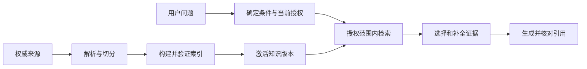
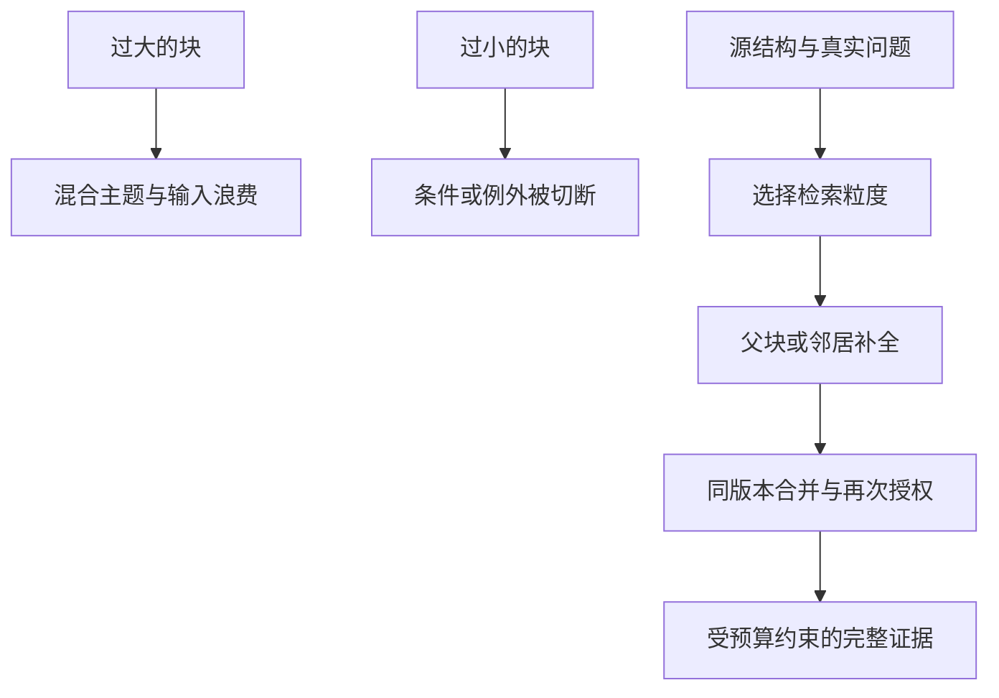
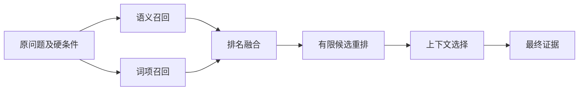
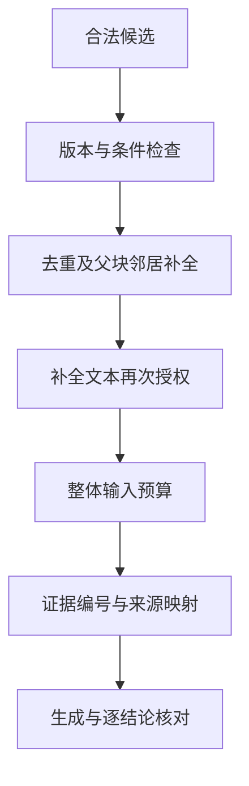
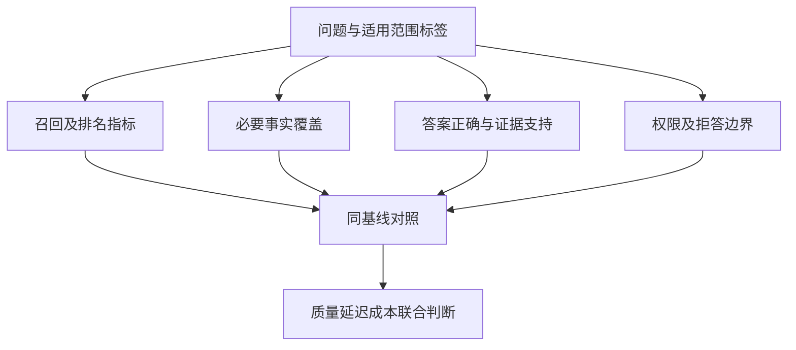
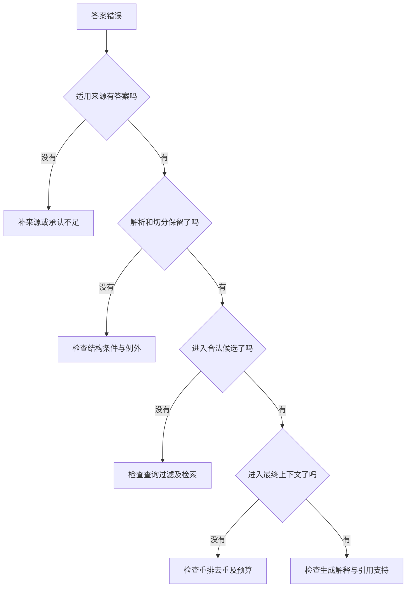

# RAG｜Review 与综合自测

[← 模块目录](../README.md) · [机制实验](../examples/README.md) · [面试表达](../interview/高频面试题.md)

第二遍先从空白纸重建关系，再用下面的图和情境检查。答案只调用正文已经建立的机制；遇到不清楚的前提，回到对应章节，而不是背下一个固定结论。

## 1. 两条链，三个“完成”

源文档更新、索引写入、用户能查到新版本，是三个时刻。“任务入队成功”不能替代最终可见性。

**综合任务：** P1 新版本已保存，解析和词项索引已完成，向量写入超时且结果未知。能否宣布知识更新完成？

参考答案与解释

不能。按稳定身份核对写入事实，补齐未确认项，验证各必要资源可查询且配置兼容，再发布。此前继续服务允许使用的旧内容，当前撤权与删除则独立执行。依据 [第 12 章](../docs/12-ProductionGovernance.md)。

## 2. 切分不是长度问题，而是证据关系问题

检索、上下文和引用单位可以不同。扩大块或 overlap 增加的内容可能无关，也可能仍覆盖不到远处条件。

**综合任务：** 设备手册第 2 页给一般操作，第 18 页给高温例外。问题明确涉及高温，只命中第 2 页。补相邻块够吗？

参考答案与解释

未必。应利用章节引用、条件索引或针对高温的补充查询，核对同一设备、适用版本与授权。物理相邻、语义相似与业务依赖不同；离线评测要检查所需事实组合，不只看命中任一相关块。依据 [04](../docs/04-ChunkingDesign.md)、[05](../docs/05-AdvancedChunkStructure.md)、[06](../docs/06-QueryPlanning.md)、[10](../docs/10-RetrievalEvaluation.md)。

## 3. 候选漏斗：不同阶段丢的东西不同

原问题和硬条件要保留，重排只处理已有候选。多路排名支持也不等于事实正确概率。

**综合任务：** 用户输入 `ERR-7B`，改写后只剩“网络异常”，两路检索都仅接到改写文本。调整 RRF 或换大重排模型能直接解决吗？

参考答案与解释

不能。先恢复原查询与精确标识，检查分析器、字段匹配和授权过滤，确认相关内容进入候选，再分析融合与重排。依据 [06](../docs/06-QueryPlanning.md)、[07](../docs/07-RetrievalStack.md)、[08](../docs/08-Rerank与CandidateBudget.md)。

## 4. 候选到上下文：先问缺什么，再决定放什么

**综合任务 A：** 用户明确设备处于高温环境，只找到一般操作说明。系统不知道还有没有例外。此时应该记录什么缺口，怎样继续，而不是要求它预先知道“第 18 页”？

参考答案与解释

记录“高温条件下该操作是否仍适用：未获得支持”，针对该条件查询或沿真实引用扩展。找到适用条款再限定结论；仍无支持时说明限制或转人工。不能据此声称一定有例外或不存在例外。条件检查本身也可能遗漏，需要按风险核验。依据 [第 09 章](../docs/09-EvidenceDelivery.md)。

**综合任务 B：** 离线标签已确认一般规则与例外都必要。预算 150，一般规则 80、重复副本 70、当前例外 60。怎样选择？能用旧版 40 单位例外省预算吗？

参考答案与解释

去重复，保留当前一般规则与例外，共 140，保存来源映射；不能仅为省预算换旧规则。这个任务使用人工已知标签，不代表线上能预知全部必要证据。真实请求另需按模型计入包装与输出预留。依据 [08](../docs/08-Rerank与CandidateBudget.md)、[09](../docs/09-EvidenceDelivery.md)。

## 5. 评测不是一个总分

RR 只看首个相关结果；忠于错误材料仍可能答错，恰好答对但没有证据也不能证明链路可靠。

**综合任务：** 固定 200 题，旧方案正确 160、新方案 170；新增正确 18，旧正确退化 8，其中 3 个是重要权限问题。提高多少个百分点，能否仅凭总分上线？

参考答案与解释

80% 到 85%，提高 5 个百分点；18−8=10 个净改善。权限退化可能构成硬阻断，应修复并复测，且联合检查任务切片、延迟与成本。依据 [10](../docs/10-RetrievalEvaluation.md)、[11](../docs/11-EndToEndQualityEngineering.md)。

## 6. 沿丢失位置排查，而不是从组件名猜原因

**综合任务：** 融合有 A、B、C，重排为 A、C、B，最终只装 A；把获准使用的 A+B 直接交给同一生成配置后，模型仍忽略 B。是否只有重排问题？

参考答案与解释

至少涉及证据选择和生成使用两层。分别修复、用受控输入验证；不能把所有失败归因于重排，也不能用换模型偶然成功掩盖上下文丢失。依据 [第 11 章](../docs/11-EndToEndQualityEngineering.md)。

## 7. 将机制迁移到发布和复杂检索

**发布任务：** 快照边界为 100，103 已完成但 101 失败，能发布吗？补齐后控制记录已提交 g2，进程在派发 104 之前退出，重启应发给谁？

参考答案与解释

不能只看最大序号，应确认连续完成到 103 及资源可见性。发布记录提交后，恢复者按记录把 104 发给 g2；若提交前失败则仍按 g1 的记录恢复。已绑定 g1 的请求继续使用配套资源或终止，不能混用 c2，当前权限不随代际冻结。依据 [第 12 章](../docs/12-ProductionGovernance.md)。

**方法选择任务：** 为什么“服务 R 的依赖”适合实体中心检索，而“全部事故的共同风险”可能需要跨社区报告汇总？两份报告提到重试故障，能算两起独立事故吗？

参考答案与解释

前者有中心实体，可组合邻域与原文；后者需要跨主题覆盖，分批提取要点再汇总。报告可能来自重叠事故，要回查原事件身份，不能按报告数量计算频率。后续是否继续搜，则取决于已知缺口和预算。依据 [第 14 章](../docs/14-GraphRAG与AgenticRAG.md)。

## 复习完成判断

独立解释正常链、缺证据链、版本切换链和撤权链。每次说清对象、决定者、依据、状态变化及尚未证明的结果，再用 [机制实验](../examples/README.md)核对可计算部分。
