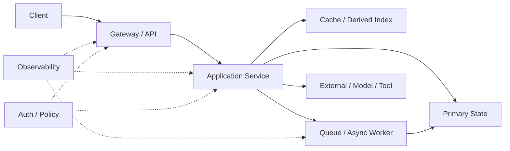

# 01｜System Design 的职责与完整答题框架

System Design 不是“知道很多组件名”，而是：

> **面对一个不完整需求，能主动澄清目标、量化约束、确定状态边界、画出关键数据流，再解释为什么这样取舍、哪里会失败、怎样验证。**

---

## 1. 为什么这门课放在最后

前面的模块解决局部问题：

```text
MySQL      → 事务 / 索引 / 持久状态
Redis      → Cache / Hot State / Coordination
Vector DB  → ANN / Vector Storage
LLM        → Model Behavior / Serving
RAG        → Evidence Pipeline
Agent      → Control Loop / Tool / State
```

System Design 要把它们组合起来。

例如“设计 AI Customer Service Agent”不是重新背：

```text
RAG 是什么？
Redis 是什么？
Agent Loop 是什么？
```

而是回答：

```text
哪些请求走固定 Workflow？
哪些进入 Agent？
订单事实从哪里读？
RAG 只负责哪些知识？
哪些 Tool 有副作用？
什么时候必须人工接管？
Session / Memory 放哪里？
如何防止重复下单？
如何 Trace 一次错误回答？
```

---

# 2. System Design 的核心不是“画图”，而是 Decision

架构图只是结果。

真正被考察的是：

```text
Constraint
→ Decision
→ Consequence
```

例如：

```text
要求订单不能重复
→ 引入 idempotency key / unique constraint
→ 需要保存 request/result 状态
```

或者：

```text
允许排行榜 1 秒延迟
→ 可以异步聚合 + Redis ZSet
→ 牺牲绝对实时，换更低写放大
```

如果你只说“这里加 Redis”，没有解释为什么，就是组件堆砌。

---

# 3. 一道题的标准 8 步

## Step 1：Clarify Requirement

先问：

```text
核心用户动作是什么？
读多还是写多？
必须实时吗？
允许丢吗？
允许重复吗？
强一致还是最终一致？
多租户吗？
数据保存多久？
```

不要一上来画数据库。

## Step 2：Define SLO / Constraint

至少明确：

```text
QPS
Latency
Availability
Freshness
Durability
Consistency
Cost
Security
```

## Step 3：Estimate Order of Magnitude

不追求小数点精确，而是判断：

```text
10 QPS
还是 100K QPS？

10GB
还是 10TB/day？
```

数量级决定架构。

## Step 4：Define API / Data / State

先回答：

```text
谁调用谁？
请求长什么样？
核心实体是什么？
Source of Truth 在哪？
哪些是 Derived State？
```

## Step 5：Draw Happy Path

先只画正常路径：

```text
Client
→ API
→ Service
→ Storage / Queue / Model
→ Response
```

没有 Happy Path 就直接讲 Failover，会非常乱。

## Step 6：Find Bottleneck / Hot Path

问：

```text
哪里最慢？
哪里最贵？
哪里会被放大？
哪里最容易热点？
哪里状态最难保持一致？
```

## Step 7：Break the System

主动制造 Failure：

```text
DB 慢了？
Redis 挂了？
Worker 成功但 Ack 丢了？
LLM 超时？
用户重复提交？
某个 Tenant 占满资源？
```

## Step 8：Verify

最后必须回答：

```text
监控什么？
怎么压测？
怎么做 Bad Case / Regression？
怎么知道优化真的有效？
```

---

# 4. 一张通用系统图



你不需要每道题都长这样，但应该能指出：

- 请求入口；
- 状态拥有者；
- 派生数据；
- 异步边界；
- 外部依赖；
- 安全与观测横切面。

---

# 5. 先区分 Functional 与 Non-functional Requirement

## Functional

系统要“做什么”。

例如秒杀：

```text
用户提交购买
系统判断库存
创建订单
返回结果
```

## Non-functional

系统“做到什么程度”。

例如：

```text
100K QPS
P99 < 200ms
不超卖
订单不重复
99.99% 可用
```

System Design 真正拉开差距的通常是第二类。

---

# 6. 不要追求“最强架构”

设计始终受约束。

例如：

```text
强一致
高可用
低延迟
低成本
简单运维
```

很少能全部最大化。

你需要说清：

> 在当前 Requirement 下，我优先保证什么，允许什么退化。

这比背 CAP 三个字母更有价值。

---

# 7. 面经真正改变的是追问深度

冻结真人流程里 System Design 24/24 都是 L4。

这意味着面试官通常不会停在：

> “你会用 Redis 吗？”

而会继续：

```text
为什么放 Redis？
Redis 挂了怎么办？
缓存和 DB 谁是 SoT？
双写失败怎么办？
热点怎么办？
扩容怎么办？
怎么证明没有超卖？
```

所以本模块默认从设计进入 Failure / Scale / Verification。

---

# 8. 常见坏答法

⚠️ 一上来画 20 个组件。  
Requirement 还没澄清。

⚠️ “加 Kafka / Redis / ES 就好了。”  
没有说明问题与代价。

⚠️ 只讲正常路径。  
Production 设计一定要讲失败。

⚠️ 每个地方都要求强一致。  
成本和可用性会失控。

⚠️ 架构画完就结束。  
没有 Capacity / Observability / Verification。

---

# 9. 🎯 面试怎么回答“你怎么做 System Design”

> 我通常先澄清 Functional Requirement 和 SLO，再做数量级估算，确定核心实体和 Source of Truth，然后画最小 Happy Path。接着找 Hot Path、状态一致性和外部依赖，再逐层讨论 Cache、Partition、Queue、Retry、Failover、安全和多租户。最后我会主动做 Failure Walkthrough，并说明需要哪些 Metric、Trace、Load Test 或 Evaluation 来验证设计。这样能避免一开始就堆组件。

---

# 10. 本章自测

<details>
<summary>1. 为什么 System Design 不应该一开始就选数据库？</summary>

数据库是需求和状态模型的结果。必须先知道数据量、访问模式、一致性、查询和生命周期，才能合理选择存储。
</details>

<details>
<summary>2. 为什么 Happy Path 要先于 Failure Path？</summary>

没有正常数据流，就无法判断失败发生在哪一层、哪些状态已经提交、哪些副作用需要恢复或补偿。
</details>

<details>
<summary>3. 一个方案说“更快”为什么还不够？</summary>

需要定义指标和 Baseline，例如 P95/P99、吞吐、成本、错误率，并通过压测或线上实验验证。
</details>
