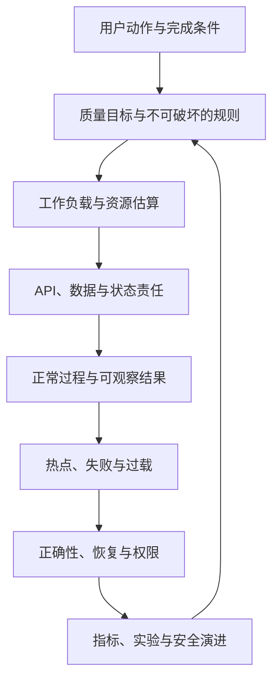
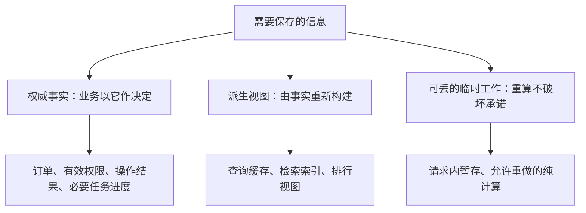
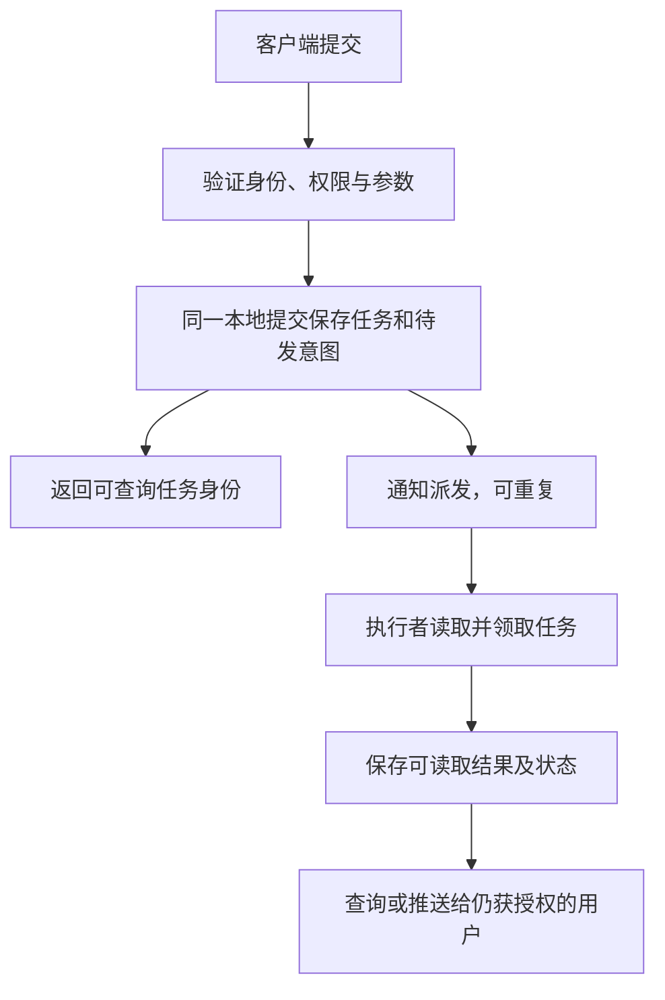
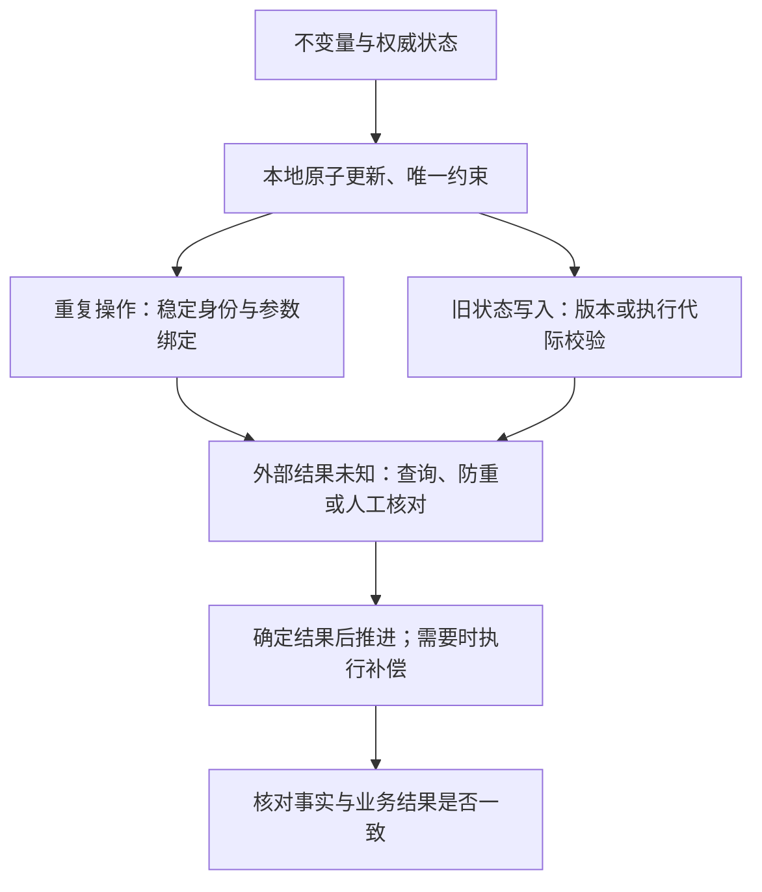
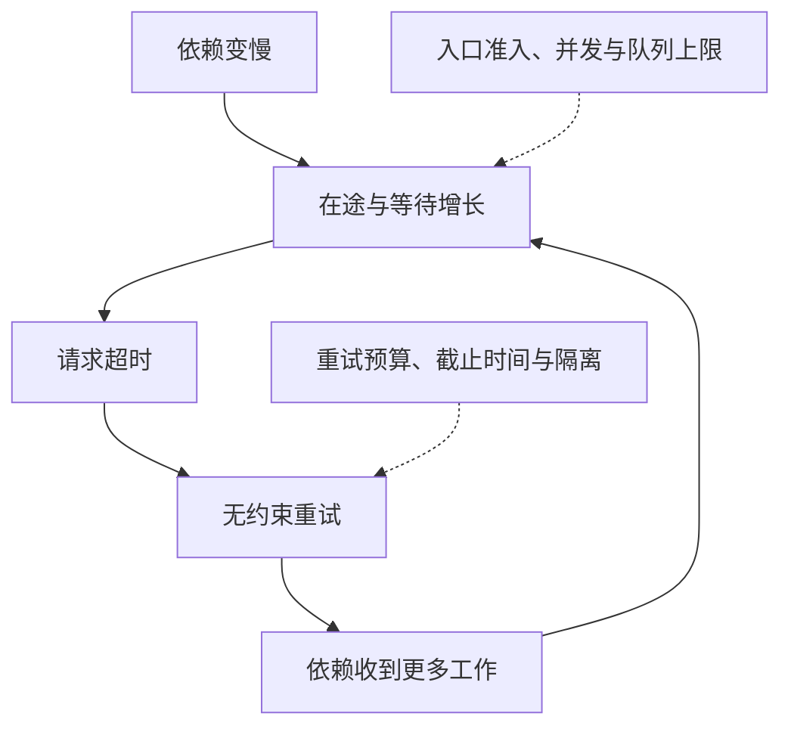
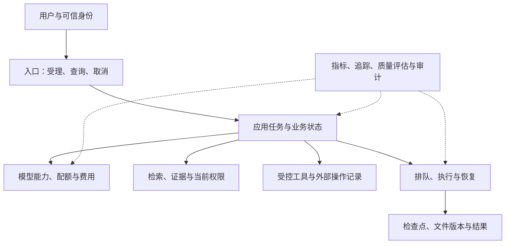

# System Design｜关系重建、综合自测与机制实验

[← 模块入口](../README.md) · [Handbook](../../../README.md) · [学习路线](../../../guide/learning-path.md) · [面试训练 →](../interview/高频面试题.md)

本页用于第二遍学习。先不看章末答案，从空白纸画出每张图所表达的关系，再用下面的新条件检验能否推导。图不是固定部署模板；箭头应被解释成具体动作或因果，而不是组件名之间的装饰线。

## 图 1｜设计结论怎样相互依赖



例如，模型配额不足不是“再画一个网关”就能解决，它可能要求改变排队和完成时间承诺。最后一条回边表示验证会修正前面的假设。

## 图 2｜状态按恢复责任分类



Session、Lease 和 Progress 不是天然的临时状态。如果它们承担撤销登录、拒绝旧执行者、跨重启恢复的责任，就必须按相应保证保存或可靠重建。判断依据是丢失后会破坏什么，而不是对象名称。

## 图 3｜连接结束以后谁继续工作



202 是接口的受理语义，不自动提供持久性。可靠任务是应用另外实现的承诺。通知可以重复，任务查询和执行不能依靠当前连接里的局部变量。

## 图 4｜不同错误需要不同保护



重试、补偿不是每次失败都必须经过的流水线。重试取决于安全性和剩余预算；补偿是新的业务动作，也可能失败。先确定缺的是执行权、结果依据还是业务纠正。

## 图 5｜故障怎样被请求放大



停止继续增加工作可以保护已接受任务。快速查询和取消操作也需要自己的可用资源，不能与最昂贵的生成任务争抢全部槽位。

## 图 6｜AI 职责怎样组合，而非强制拆服务



框表示责任，可以先在一个进程里实现清楚。需要独立扩容、隔离高风险执行或跨部署恢复时，再拆物理服务。权威业务状态不交给模型自行解释成最终事实。

## 综合自测

### 1. 相同 QPS，不同模型成本

条件：入口仍为 100 次/s。60 次查询状态，20 次读取报告，20 次提交生成；生成改为两次模型调用，每次输入 2,000 Token、输出 300 Token。假设每次调用平均占一个槽位 8 秒；两次调用顺序执行，稳定负载，无重试。输入、输出每百万 Token 的虚构价格分别为 1 和 4。

任务：给出模型调用率、输入和输出吞吐、平均模型调用在途量、持续一天费用。说明“用户任务在途”和“模型调用在途”为什么不是同一对象。

<details><summary>提示</summary>

把业务提交先展开成调用，再计算每次调用的资源；不要把调用时长与整个任务时长混用。

</details>

<details><summary>参考答案与解释</summary>

模型 40 次/s；输入 80,000 Token/s，输出 12,000 Token/s；平均调用在途量 40 × 8 = 320；一天费用为 (80,000 + 12,000 × 4) / 1,000,000 × 86,400 = 11,059.2 计价单位。若只有这两段顺序调用，用户任务平均执行时间为 16 秒，20 × 16 也是 320；数值巧合相等不代表对象相同，加入排队、并行或其他步骤后两者会不同。对应第 03、16 章。

</details>

### 2. 处理速度提高，积压为什么还没消失

条件：服务正常到达 24 项/s，最多持续完成 30 项/s。一次 50 秒突发到达 42 项/s，突发前无积压；用恒定速率流体模型，不考虑时长波动。

任务：计算新增积压、突发后净消化速率和消化时间；若恢复后到达为 30 项/s，回答“队列不会继续变长”是否等于“已经恢复”。

<details><summary>提示</summary>

处理能力先满足仍然到达的新任务，剩余部分才用于消化历史积压。

</details>

<details><summary>参考答案与解释</summary>

积压 (42-30) × 50 = 600 项；正常恢复后净消化 6 项/s，需要 100 秒。到达改为 30 时，没有净消化余量，流体模型里积压仍为 600；随机系统更不能据此保证稳定。对应第 09、10 章。

</details>

### 3. 用户最近记录与断线补发

条件：用户 U 的源事件有严格递增序号，展示最新三条；已收到 101、103、102、重复 103、104，随后收到迟到的 99。用户 V 也可能有序号 104。源日志保留了未处理事件，用户曾确认收到 100。

任务：写出每一步 U 的窗口；说明 V 为什么不能混入；解释“见过 104”是否证明已完整处理至 104，以及断线恢复时应依据什么。

<details><summary>提示</summary>

区分排序窗口、消息防重、用户作用域和连续处理进度。

</details>

<details><summary>参考答案与解释</summary>

依次为 [101]、[103,101]、[103,102,101]、不变、[104,103,102]、不变。作用域包含可信租户与用户，不只用事件序号。仅见过最大值不能证明不存在缺口；恢复要从确认位置检查保留的连续日志，超出保留窗口时重新获取快照并明确交接边界。对应第 14、15 章。

</details>

### 4. 新执行者能领取，不等于能重新发送

条件：A 持有执行代际 7，向供应商提交发送 K。供应商可能已完成，但响应丢失；A 暂停，租约到期，B 获得代际 8。供应商查询暂时返回未找到，但并未保证旧请求已经结束。

任务：分别说明 A 的迟到写入怎样被拒绝、B 怎样核对 K、哪些情况下不能自动重做，以及取消任务能否撤回可能已发送的消息。

<details><summary>提示</summary>

代际解决执行者竞争，操作身份与外部协议解决重复业务效果。

</details>

<details><summary>参考答案与解释</summary>

实际提交资源应核对当前代际，拒绝 7 的旧写入；仅比较“比我上次见过的更大”还要依赖完整的隔离协议，不能凭数字自行证明安全。B 使用稳定的 K 查询或使用供应商明确支持的幂等重放。查询未找到若可能与旧请求竞争，应保留待核对；没有可靠防重或查询保证时转人工处理。取消阻止之后允许停止的工作，不撤回已发生的外部事实。对应第 08、09、18 章。

</details>

### 5. 回滚索引之后，离职员工还能看吗

条件：g2 上线前员工 U 可读文档 D；随后 U 被撤权，D 的修订 5 被撤回。g2 出现质量问题，需要回滚 g1，g1 中还保存着修订 5 的块和旧权限。g2 上线后另有合法修订 6，只更新了 g2。

任务：说明哪些状态不能跟随回滚；g1 何时才具备回滚资格；命中旧答案缓存时应检查什么。

<details><summary>提示</summary>

内容代际、当前权限、删除限制和增量进度是不同维度。

</details>

<details><summary>参考答案与解释</summary>

当前授权与撤回记录不能回退。g1 必须重新受当前安全状态约束，补齐需要保留的合法增量并验证兼容性与新鲜度；不能因为“还在磁盘上”就认为能直接切回。缓存依赖的来源、版本、权限仍须有效，不能用旧 ACL 放行。对应第 06、11、17 章及 RAG 主讲章。

</details>

### 6. 多等一分钟换取质量，应该选哪一种

条件：方案 A 平均 15 秒完成，固定测试集上任务成功率 70%；方案 B 平均 75 秒完成，成功率 92%。样本来源、用户群和成功标准相同，但尚未进行线上验证。任务分为“现场快速查资料”和“可以离开页面的正式报告”。

任务：提出分场景选择与验证方案；指出还缺少的至少三类数据；说明为什么不能只拿 22 个百分点决定全部流量。

<details><summary>提示</summary>

质量、尾延迟、等待方式和费用应进入同一决策，不把离线均值当成线上承诺。

</details>

<details><summary>参考答案与解释</summary>

快速查询可先选满足最低正确性条件的快速路径，提供补充研究入口；正式报告可异步受理较慢但更可靠的路径。需要样本量与不确定性、细分错误风险、P95/P99、用户完成率、费用、过载表现和可用配额。应以有代表性的测试、无副作用回放和受控灰度验证，不能把同一个速度偏好强加给所有用户，也不能降低权限与事实性底线。对应第 02、12、16、19 章。

</details>

### 7. 一百份库存，只看计数正确够不够

条件：初始库存 100；有 80 份已支付，15 份有效预留，5 份可售。一个预留到期与支付回调同时到达；回调可能重复。

任务：写出数量关系，列出两种合法竞争结果和需要核对的异常结果；说明分布式锁为什么不能单独替代这些规则。

<details><summary>提示</summary>

对同一个预留状态做条件转换，业务操作身份负责跨时间防重。

</details>

<details><summary>参考答案与解释</summary>

可售 + 有效预留 + 已支付 = 100。支付先把 HELD 转 PAID，则超时释放不能再成立；释放先把 HELD 转 RELEASED，则迟到的支付成功需要核对并按业务规则退款或重新分配，不能直接再售出同一份。重复回调沿用同一身份，不重复改变库存。锁只能约束某个执行窗口，不能回答锁外重试、旧执行者和外部付款已完成的事实。对应第 08、13 章。

</details>

### 8. 费用未知时，预算还剩多少

条件：预算 100，K 预留 30，调用断线且真实费用未知。稍后可靠回执确认实际费用 22，同一回执又到达一次。另一个案例中实际费用是 120。

任务：逐步给出已花、保留和可用额度；分别处理重复回执与真实超支，不得通过改小账本数值假装满足预算。

<details><summary>提示</summary>

预留不是已花费，未知也不是免费。真实费用可能超出估算。

</details>

<details><summary>参考答案与解释</summary>

开始为 0/0/100，预留后 0/30/70，未知时仍为 0/30/70，结算后 22/0/78，重复回执不再扣费。实际 120 时应记 120/0/-20，阻止进一步准入并核对预估失效原因；硬预算需要额外的供应商和准入保证，不能用账本截断实现。对应第 16 章。

</details>

## 机制实验

### 实现、数据与运行条件

[scenarios.json](scenarios.json) 保存教学负载与事件；[mechanism_lab.py](mechanism_lab.py) 是唯一实现；[test_mechanism_lab.py](test_mechanism_lab.py) 导入同一实现做验证。正文不另维护一份程序。实验选择 Python 3.13 标准库，不需要安装依赖、连接真实服务或提供密钥。

从仓库根目录执行：

```bash
python curriculum/10-system-design/review/mechanism_lab.py all
python -m unittest discover -s curriculum/10-system-design/review -p "test_mechanism_lab.py" -v
```

也可将 `all` 换为 `capacity`、`queue`、`window` 或 `budget`，单独观察一组结果。每次调用重新读取数据、创建对象，没有跨进程保存的状态；再次执行就是重置。修改 JSON 后，输出与原样例断言可能不再相同，应先写出新预期，再运行检查；不要为测试变绿删除旧规则。

### 先预测，再核对输出

| 演示 | 初始条件与操作 | 预期可观察结果 |
|---|---|---|
| capacity | 第 03 章的 100 次/s 入口，20 次/s 生成 | 模型 20 次/s，输入 60,000 Token/s，输出 10,000 Token/s；平均在途 200；一天费用 8,640 |
| queue | 正常 20 项/s，能力 30 项/s；40 项/s 突发 60 秒 | 积压 600 项，恢复后净消化 10 项/s，需 60 秒 |
| window | 六次事件到达，手算窗口取 3 | 最终序号 [104, 103, 102]，重复与迟到事件不改变最终窗口 |
| budget | 100 预算、预留 30、未知、结算 22、重复结算 | 最终已花 22、保留 0、可用 78；重复回执不重复扣费 |

CLI 输出 JSON；为保留十进制数值精度，Decimal 数字显示为字符串，例如 `"8640.000"`。它表示数值结果的序列化，不表示调用了真实计费服务。

测试还检查库存守恒、同键不同参数冲突、到期旧执行者写入、二维码合法终态，以及外部结果未知的处理。这些模型用顺序调用显式排列故障时序，没有模拟网络调度器，也没有证明多进程同时提交的原子性。

> ⚠️ **实验边界：** `RecentProjection` 为便于检查，保留全部事件历史，不是有界生产缓存；租户字段是测试输入，不是真实身份认证。`LeaseResource` 的提交函数集中检查代际与逻辑过期时刻，不是分布式锁实现。库存、费用与二维码均为内存状态，进程退出即消失。

### 怎样把实验结论迁移到真实系统

先选择权威存储和约束，把模型里的一次原子状态变化映射成真实事务或条件写入；再用多个独立连接、崩溃注入、重复消息和外部查询分别验证。供应商是否真正接受幂等键、是否保留结果、断线是否继续计费，都必须实测或取得对应版本的明确保证。

局部单元测试、单机模拟、多连接并发、跨系统集成和生产验证是不同层级。运行结果与未执行项见[模块审查记录](../../../guide/audits/system-design-reader-first-2026-09-28.md)。
