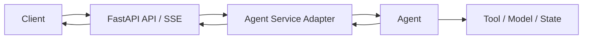

# 16｜AI Service Patterns：Chat、RAG、Ingestion 与 Agent Run API

这是 FastAPI 模块的综合章。

目标不是再背四个 Endpoint，而是证明你能把前面所有 Web/API 能力组合成一个真实 AI Service。

它也是 `FASTAPI-005` 的核心答案：

> **只会 GET / POST 为什么不足以构建 Claude Code 类 Agent Service？**

---

## 1. 一个成熟 AI Service 至少有四类 API

```text
1. Synchronous Query API
2. Streaming Response API
3. Long-running Task API
4. Stateful Run / Session API
```

不同 API 有不同生命周期。

---

# Part A｜LLM Chat API

## 2. 普通 `/chat`

最小：

```python
@app.post("/chat", response_model=ChatResponse)
async def chat(req: ChatRequest, user: CurrentUser):
    return await chat_service.complete(req, user)
```

适合：

- 短请求；
- 结构化一次性返回；
- 不需要中间事件。

---

## 3. Streaming `/chat/stream`

```text
POST /chat/stream
→ validate request
→ load context
→ call model
→ SSE content_delta
→ usage
→ message_end
```

事件协议要稳定：

```text
message_start
content_delta
error
message_end
```

客户端不应该解析“[DONE]”之外的各种随意字符串猜状态。

---

# Part B｜RAG Query API

## 4. RAG Query 的 API Boundary

Request：

```json
{
  "knowledge_base_id": "kb_1",
  "query": "退款政策是什么？",
  "top_k": 10
}
```

FastAPI 层先完成：

```text
Authentication
→ Tenant / KB Authorization
→ Input Validation
```

然后交给 RAG Service：

```text
Query Planning
→ Retrieval
→ Rerank
→ Evidence
→ Generation
```

不要把 Retrieval Pipeline 写在 Router。

---

## 5. RAG Response 要不要返回 Evidence

生产 API 经常需要：

```json
{
  "answer": "...",
  "citations": [...],
  "request_id": "..."
}
```

因为：

- 前端显示 Citation；
- Debug Bad Case；
- Audit；
- Eval。

但 Evidence 内部字段要做权限和脱敏。

---

# Part C｜Knowledge Ingestion API

## 6. Ingestion 为什么要 Long-running

```text
Upload
→ Parse / OCR
→ Chunk
→ Embedding
→ Index
```

API 推荐：

```text
POST /knowledge/{kb_id}/files
→ 202 Accepted
→ task_id
```

状态：

```text
GET /tasks/{task_id}
```

进度：

```text
GET /tasks/{task_id}/events
```

FastAPI 只承接 API Lifecycle；Durable Worker/Queue 在 Backend Engineering。

---

## 7. Ingestion 的幂等入口

用户重复上传或客户端重试时，要有：

```text
file_id / content_hash / idempotency_key
```

防止重复创建同一批索引任务。

完整幂等语义属于 Backend 模块，但 API 必须留下 Contract。

---

# Part D｜Agent Run API

## 8. Agent Run 为什么不是普通 Chat

普通 Chat 常见：

```text
request
→ model
→ response
```

Agent Run：

```text
create run
→ model
→ tool
→ state update
→ model
→ approval
→ tool
→ checkpoint
→ ...
→ terminal state
```

生命周期明显更长、更复杂。

---

## 9. Run API 应该显式化 Run State

例如：

```text
POST /agent/runs
→ create run_id

GET /agent/runs/{run_id}
→ current state

GET /agent/runs/{run_id}/events
→ SSE events

POST /agent/runs/{run_id}/cancel
→ business cancellation

POST /agent/runs/{run_id}/approvals/{approval_id}
→ approve / reject
```

这比单个 `/chat` Endpoint 更接近真实 Agent Service。

---

## 10. Session 和 Run 不要混为一谈

```text
Session
= 一段长期用户交互上下文

Run
= 一次具体 Agent 执行实例
```

一个 Session 可以包含多个 Run。

如果把两者都叫 `chat_id`，后面 Checkpoint / Retry / Resume 会越来越难设计。

---

## 11. FastAPI 负责 Transport，Agent Harness 负责 Runtime

清晰边界：



FastAPI 不应该自己决定：

- Compaction；
- Tool Retry；
- Memory；
- Checkpoint；
- Permission Policy。

它只负责把这些 Runtime 能力暴露成 API。

---

## 12. FASTAPI-005 的真正含义

“只会 GET/POST 不够”不是说还要背更多装饰器。

而是必须掌握：

```text
Request Lifecycle
Dependency / Identity
Resource Lifecycle
Async / Blocking
Streaming
Event Protocol
Cancellation
Long-running Task Boundary
Session / Run API Contract
Testing / Observability
Deployment
```

这才是“会构建 AI Service”。

---

## 13. 一个 Production Agent API 的事件模型

```text
run_created
step_started
model_started
content_delta
tool_call_started
tool_call_completed
approval_required
state_updated
checkpoint_saved
error
run_completed
run_cancelled
```

FastAPI SSE/WebSocket 只是 Transport。

这些事件语义来自 Agent Runtime。

---

## 14. Multi-tenant Agent Service

每条请求和 Run 都必须显式绑定：

```text
tenant_id
user_id
session_id
run_id
```

后续：

```text
DB State
Redis
Vector Filter
Tool Permission
Trace
```

都使用可信 Context。

---

## 15. Failure Timeline：Agent Tool 超时

```text
Client starts run
→ SSE connected
→ Agent calls tool
→ Tool timeout
→ Runtime classifies failure
→ event: tool_failed
→ Runtime retries / replans / stops
→ FastAPI only streams resulting events
```

不要在 SSE Endpoint 里自己写 Tool Retry Algorithm。

---

## 16. 🎯 面试怎么回答 FASTAPI-005

> 只会 GET/POST 只解决了路由语法，做不了真正的 Agent Service。FastAPI 层还要承接 typed request/response、Dependency/Auth、Application/Request Resource Lifecycle、async/blocking boundary、SSE/WebSocket streaming、disconnect/cancellation、Long-running Task API、Session/Run Contract、Observability 和 Deployment。但 Agent Loop、Tool、Context、Memory、Checkpoint 等执行语义仍然属于独立 Agent Harness。正确设计是 FastAPI 做 Transport/API Adapter，Runtime 做 durable execution。

---

## 17. 本章自测

<details>
<summary>1. 为什么 Agent Run API 不能只有一个 `/chat`？</summary>

因为 Agent Run 可能持续更久、需要 Tool/Approval/Checkpoint/Cancel/Reconnect；显式 run_id 和状态/事件接口更能表达生命周期。

</details>

<details>
<summary>2. 为什么 Session 和 Run 应区分？</summary>

Session 表示长期交互上下文；Run 表示一次具体执行。一个 Session 可以有多次 Run，Run 还需要独立状态、重试、取消和 Trace。

</details>

<details>
<summary>3. FastAPI 和 Agent Harness 的边界是什么？</summary>

FastAPI 负责 HTTP/SSE/WebSocket/API Contract 和请求生命周期；Agent Harness 负责 Loop、Tool、Context、Memory、State、Checkpoint、Permission 等执行语义。

</details>
