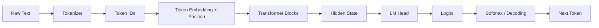
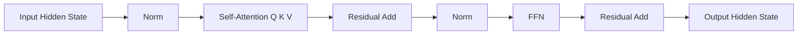
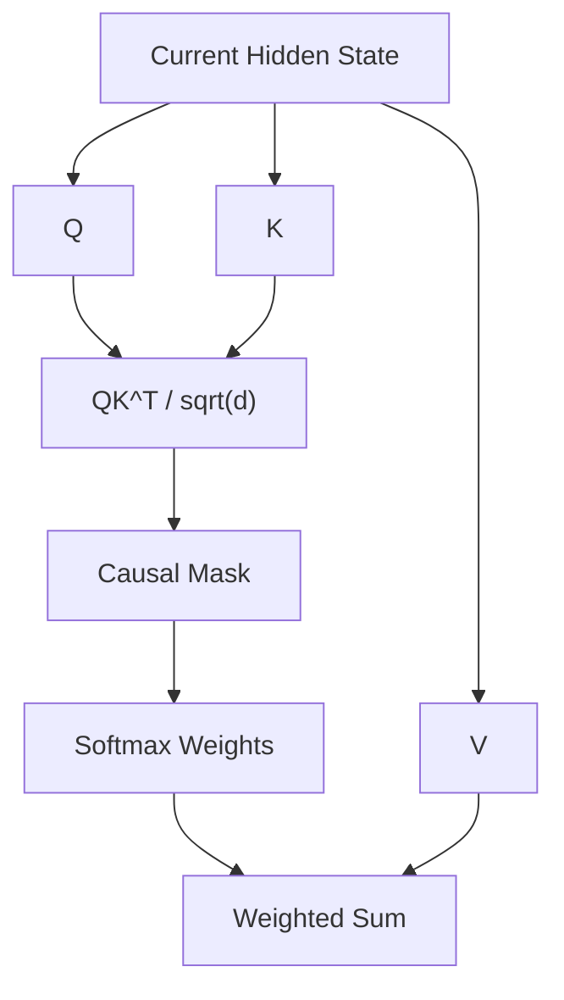
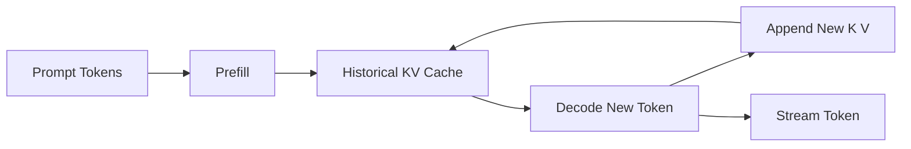
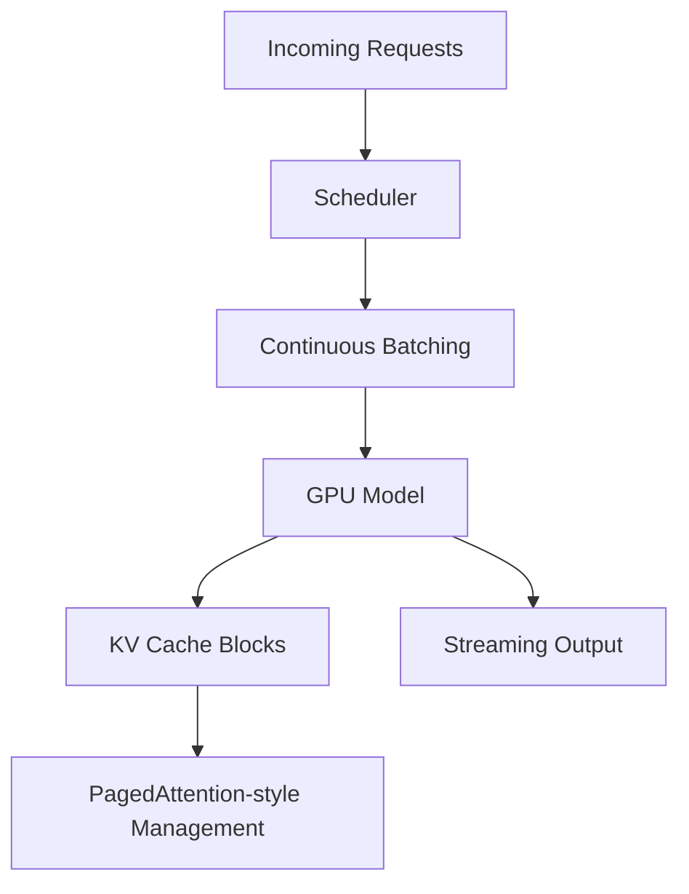
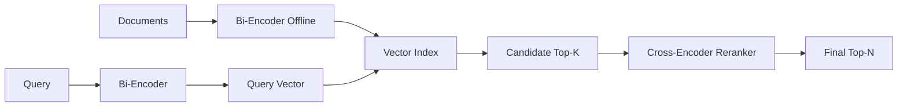
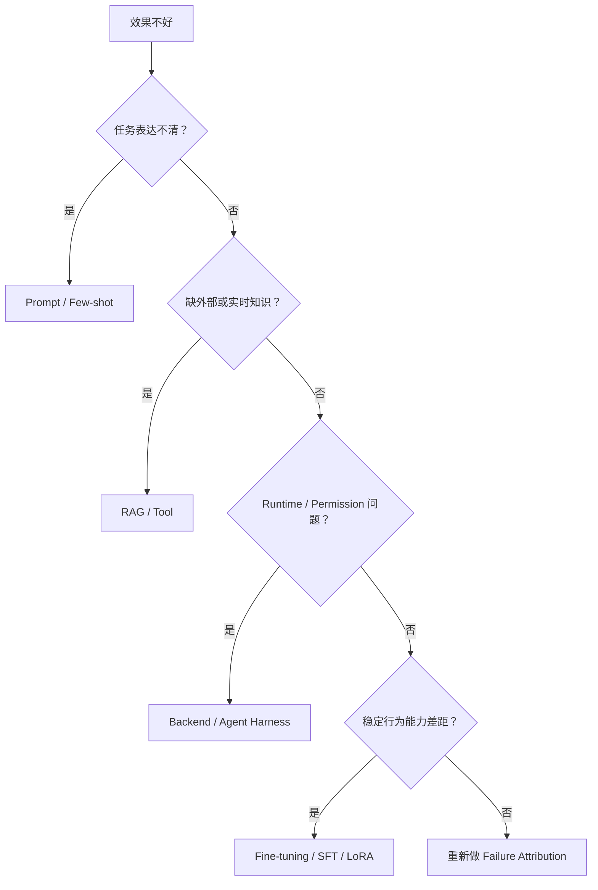

# LLM Foundation｜图解复习与综合自测

> 第一遍按 `docs/01 → 29` 建体系；这里用于第二遍把 29 章压缩成几张因果图，再用问题检查你是否真的理解。

---

## 图 1｜从文本到下一个 Token



必须能解释：

```text
为什么字符数 != Token 数
为什么模型最后输出 logits 而不是文字
为什么生成一个 Token 后要继续循环
```

---

## 图 2｜一个 Transformer Block



不同模型的 Pre/Post Norm 和具体结构会变化，这张图只表达稳定概念。

你必须能区分：

```text
Attention：跨 Token 聚合
FFN：位置内非线性变换
Residual：保留并叠加信息
Norm：稳定激活尺度
RoPE：让位置进入 Attention
```

---

## 图 3｜Q / K / V 与 Causal Attention



核心追问：

- 为什么除 `sqrt(d)`？
- 为什么未来 Token 要 Mask？
- 为什么 KV Cache 缓存 K/V？
- MHA / MQA / GQA 对 KV Cache 有什么影响？

---

## 图 4｜Prefill / Decode / KV Cache



记住：

```text
Input Length → Prefill / TTFT
Output Length → Decode Steps / TPOT
Context × Concurrency → KV Cache Memory
```

---

## 图 5｜Serving Engine



重点不是背 vLLM API，而是理解：

```text
Batch
KV Cache
Memory Fragmentation
Request Scheduling
TTFT / TPOT / Throughput
```

---

## 图 6｜Embedding → Retrieval → Rerank



必须能说清：

```text
Bi-Encoder 为什么快
Cross-Encoder 为什么准但贵
Retriever 没召回时为什么 Reranker 无能为力
```

---

## 图 7｜Prompt / RAG / Fine-tuning Decision



---

# 综合自测

<details>
<summary>1. Token 和字符有什么区别？</summary>

Token 是具体 Tokenizer 词表中的离散单元；字符只是文本表面单位。不同语言、代码和 Tokenizer 下，一个字符可能对应不同数量 Token。

</details>

<details>
<summary>2. Context Window 大为什么不等于 Memory？</summary>

Context Window 是单次推理输入容量；Memory 是应用跨轮次保存、筛选并重新注入状态的系统能力。

</details>

<details>
<summary>3. Lost in the Middle 告诉我们什么？</summary>

信息能被放进 Context 不等于模型会稳定利用；位置、噪声和上下文长度会影响利用率，因此 Long Context 不能替代 Retrieval / Context Engineering。

</details>

<details>
<summary>4. Self-Attention 的 Q/K/V 分别可以怎样直观理解？</summary>

Q 表示当前位置要查什么；K 表示每个位置可被匹配的特征；V 是匹配后真正聚合的内容。

</details>

<details>
<summary>5. 为什么 Decoder-only LLM 需要 Causal Mask？</summary>

为了保证位置 i 只能看到自己和过去 Token，不能在训练时偷看未来答案，使训练目标与真实自回归生成一致。

</details>

<details>
<summary>6. Attention 和 FFN 分别负责什么？</summary>

Attention 主要负责跨 Token 信息交互；FFN 对每个位置的表示做非线性变换。

</details>

<details>
<summary>7. RoPE 为什么和 Long Context 有关系？</summary>

RoPE 把位置关系注入 Q/K；模型训练时的位置分布和推理时外推长度会影响长上下文稳定性，因此 Context 扩展不是简单修改最大长度。

</details>

<details>
<summary>8. Logits 和 Probability 有什么区别？</summary>

Logits 是未归一化分数；Softmax 后才得到下一 Token 的概率分布。

</details>

<details>
<summary>9. Temperature=0 为什么仍不能保证事实正确？</summary>

它只减少 Decoding 随机性；如果最高概率续写本身是错误事实，模型仍会稳定生成错误。

</details>

<details>
<summary>10. KV Cache 缓存什么？为什么能加速？</summary>

缓存历史 Token 在每层 Attention 中的 K/V，后续 Decode 不必重复计算整个前缀的 K/V。

</details>

<details>
<summary>11. KV Cache 的主要代价是什么？</summary>

显存与内存带宽。Context 越长、并发越高，KV Cache 越大。

</details>

<details>
<summary>12. Prefill 和 Decode 最大区别是什么？</summary>

Prefill 一次处理已有输入并建立 KV Cache，偏并行计算；Decode 每次生成一个新 Token，串行依赖更强并持续读取历史 KV。

</details>

<details>
<summary>13. Continuous Batching 为什么比 Static Batch 更适合 LLM？</summary>

不同请求输出长度差异很大；Continuous Batching 可以让完成请求动态退出、新请求进入，减少空槽等待并提高 GPU 利用率。

</details>

<details>
<summary>14. PagedAttention 主要解决什么？</summary>

解决动态增长 KV Cache 的连续显存预留与碎片问题，通过固定 Block 和逻辑到物理映射提高内存利用率。

</details>

<details>
<summary>15. TTFT 和 TPOT 分别反映什么？</summary>

TTFT 反映第一个 Token 等待，常受 Queue / Prefill 影响；TPOT 反映 Decode 每个输出 Token 的速度。

</details>

<details>
<summary>16. Quantization 为什么不一定更快？</summary>

速度收益取决于硬件低精度 Kernel、反量化成本和 workload；显存更小不自动意味着端到端延迟更低。

</details>

<details>
<summary>17. Bi-Encoder 和 Cross-Encoder 为什么经常组合？</summary>

Bi-Encoder 可预计算文档向量做大规模高效召回；Cross-Encoder 对少量候选联合编码，相关性更精细但成本高。

</details>

<details>
<summary>18. Prompt 优化为什么必须有 Evaluation Set？</summary>

因为 Prompt 修改可能修复某些 Case 又让旧 Case 回归。没有固定数据集和指标无法证明净提升。

</details>

<details>
<summary>19. RAG 能否完全消灭 Hallucination？</summary>

不能。RAG 也会召回失败、Context 冲突，模型也可能不遵循证据；高风险系统仍需要 Grounding 与 Verification。

</details>

<details>
<summary>20. Prompt、RAG、Fine-tuning 如何区分？</summary>

Prompt 主要解决任务表达和行为约束；RAG / Tool 主要解决外部、实时和私有知识；Fine-tuning 主要解决稳定重复的模型行为能力差距。

</details>

<details>
<summary>21. SFT 和 DPO 的训练信号有什么核心区别？</summary>

SFT 学习目标示范答案；DPO 利用 chosen / rejected Pair 学习偏好关系。

</details>

<details>
<summary>22. LoRA 为什么参数高效？</summary>

冻结 Base Weight，只学习低秩增量矩阵 BA，使可训练参数远少于完整权重矩阵。

</details>

---

# 第二遍复习标准

你应该能够不看文档独立画出：

```text
Text → Token → Transformer → Logits → Decode
QKV Attention
Prefill / KV Cache / Decode
Continuous Batching / Paged KV
Embedding → ANN → Rerank
Prompt / RAG / Fine-tuning Decision Tree
```

如果只能背定义而画不出因果链，就回到对应正文继续学。
