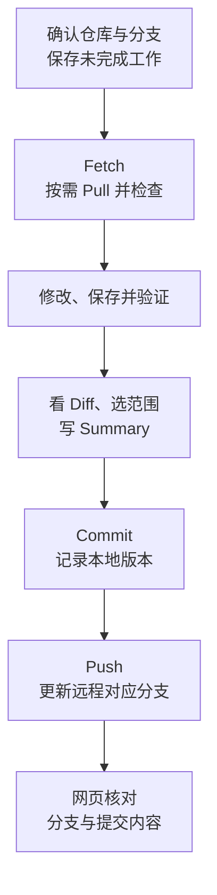
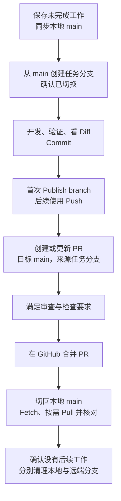
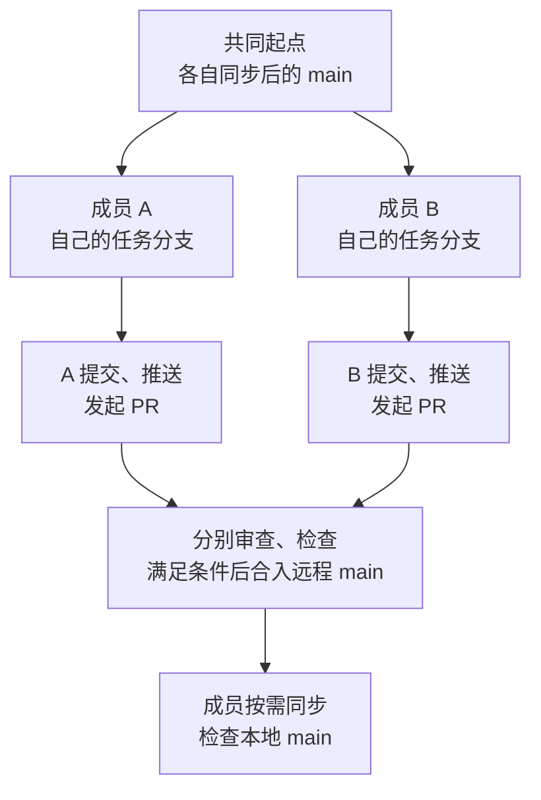
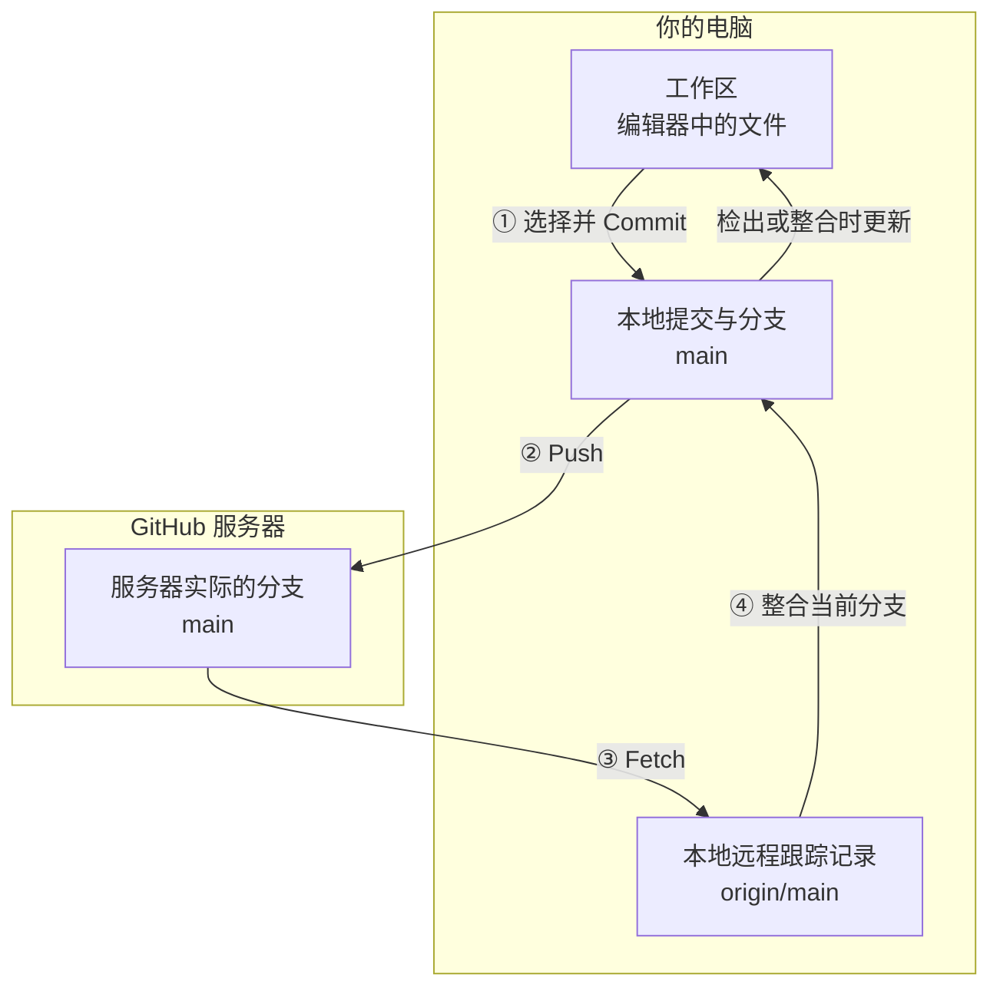

# Git + GitHub Desktop｜从第一次提交到安全协作

[← Handbook 总目录](../../README.md) · [Coding 实践](../coding/README.md) · 正式学习路线

改好一段代码，按下保存，然后发现改错了。你想找回上午的版本，却只剩下“最终版”“最终版2”和“真的最终版”几个文件夹。换到另一台电脑后，又不确定哪份才是最新的。

Git 解决的不是“怎样编辑文件”，而是**怎样记录一组有意义的修改，并在需要时比较、协作或恢复**。GitHub Desktop 把常用操作做成了图形界面，但按钮只有和文件、提交、分支的状态对应起来，才不会越点越乱。

这份指南用一个名为 `git-workflow-lab` 的练习仓库贯穿。里面只有几份说明文件，不需要先会开发一个应用。你会亲眼观察：保存后什么变了，Commit 后什么没变，Push 后网页为什么才更新，以及出错时该撤销哪一层。

> **适用环境：** Windows、GitHub Desktop、VS Code 和 GitHub.com。主线使用图形界面，少量命令行诊断单独标注。
>
> **操作依据：** 2026-09-24 核对的 Git、GitHub Desktop 与 VS Code 官方文档。菜单名称保留英文，旁边解释用途。按钮可能随版本、分支状态或仓库规则变化；本文不把某个屏幕位置当作所有版本的保证。

> ⚠️ **练习仓库不等于真实项目。** 冲突、丢弃修改和撤销提交都在练习仓库中做。不要在正在工作的项目里跟着制造故障，也不要放入真实密钥或个人数据。

## 阅读路线

| 你要完成的事情 | 从哪里进入 |
|---|---|
| 第一次使用，不知道各个工具是什么 | [1. 工具与版本](#tools) |
| 已经有文件或仓库，需要接入 Desktop | 先读[安全准备](#prepare)，再选[接入路径](#start) |
| 想走通一次修改与上传 | [4. 第一次提交](#first-commit) |
| 本地和网页不一致 | [5. Fetch 与 Pull](#sync) |
| 要协作、解决冲突或撤销错误 | [6. 分支](#branch)、[8. 冲突](#conflict)、[9. 撤销](#undo) |
| 已经学过，需要检查或选择操作 | [11. 检查清单](#checklist)、[12. 状态与排障](#diagnose)、[图标操作速查](#action-reference) |
| 想把整篇内容连成一张图 | [13. 工作流总览](#workflow-overview)、[14. 心智地图](#mental-map) |
| 开工前快速回顾 | [15. 图标习惯清单](#habits)、[文末速记卡](#quick-card) |

第一次学习按正文顺序即可，不需要同时记住所有入口。

<a id="tools"></a>
## 1. 四个工具，三种不同的“保存”

### 1.1 你在哪个工具里做什么

| 工具 | 主要职责 | 本文中的动作 |
|---|---|---|
| Git | 本地版本管理 | 记录提交、维护分支、比较和整合历史 |
| GitHub Desktop | 操作 Git 的图形客户端 | 看改动、选提交内容、同步、切换分支 |
| VS Code | 编辑器 | 写文件、检查内容、运行程序、编辑冲突结果 |
| GitHub.com | 远程托管与协作平台 | 查看已上传提交、提出修改请求、审查和合并 |

你在 VS Code 改文件，Desktop 读取同一个文件夹中的变化。**不需要把代码复制到 Desktop 里，也不是换个工具就多出一份项目。**

Git 本身可以离线记录版本；与 GitHub 交换数据才需要相应的网络和身份认证。[官方入门][desktop-first]

### 1.2 保存文件、Commit、Push 不是同一件事

假设你把一行说明从“练习 Git”改成“练习 Git 和 GitHub Desktop”：

1. **保存文件**：编辑器把文字写入电脑上的文件。Git 还没有为这次修改创建提交。
2. **Commit（提交）**：把选定修改记录进本地历史，形成一个可以辨认、比较的版本。
3. **Push（推送）**：把需要上传的提交及相关数据送到远程，并请求更新对应分支。

提交可以理解成一次项目快照。它还记录作者、说明和历史关系，并有一个提交标识，通常称为 SHA；内容相同不代表提交标识必然相同。

```text
你编辑的项目文件                 本地 Git 历史                  GitHub 仓库
工作区中的修改  ──选择并 Commit──→  新提交  ───────Push──────→  对应远程分支更新
```

这张图先帮助区分职责，并不是说每次提交会把所有文件重新复制一遍。Git 如何保存快照与历史，见 [Git 官方概念说明][git-model]。

> ⚠️ **Changes 为空，不等于已经上传。** 它可以表示修改已经进入本地提交，但这个提交还没 Push。反过来，Push 也不会替你上传尚未 Commit 的编辑内容。

<details>
<summary>可选理解：命令行教程为什么还会提到“暂存区”？</summary>

Git 在工作区和提交之间，还有暂存区，也叫索引，用来组织下一次提交的内容。命令行通常用 `git add` 选择内容，再用 `git commit` 记录。

Desktop 把常用的选择过程放在文件复选框和差异选择中。先理解“本次提交包含哪些修改”即可；不要把某个复选框永远等同于命令行暂存区里的一个固定状态，也不要同时在两个界面里反复暂存、提交，却不核对最终内容。

</details>

<a id="prepare"></a>
## 2. 开始前：准备环境，保护不该进入历史的文件

### 2.1 先完成最少的环境设置

1. 安装 GitHub Desktop，并在其中登录自己的 GitHub 账号。
2. 检查用于提交的姓名和邮箱。它们是提交元数据；登录账号与提交作者配置是两回事。需要保护邮箱时，使用 GitHub 提供的隐私邮箱。
3. 安装 VS Code，并在 Desktop 的编辑器设置中选择它。后面可以通过 `Repository` 菜单中的 `Open in Visual Studio Code` 打开当前项目。

**主线不要求你先安装命令行 Git。** 只有执行本文标注的可选 Git 命令时，才需要另外安装 Git，并确认终端能识别 `git`。Desktop 能提交，不代表 PowerShell 已经能运行同名命令。[设置依据][desktop-setup]

软件安装位置和项目位置也不必相同。可以把练习目录放在 `D:\Projects`；电脑没有 D 盘，就选一个自己能找到的位置。目录名只是例子，不是 Git 的要求。

### 2.2 哪些文件应当进历史

先问：“另一位开发者拿到这个项目，需要这些文件来理解或重建它吗？”

- 源代码、说明、必要的配置模板和依赖清单，通常应该记录。
- 缓存、日志、虚拟环境和构建产物，通常可以重新生成。
- 密钥、令牌、私钥和真实用户数据，不应因为“在项目目录里”就一起提交。

这些是判断方向，不是一张可以不看内容就照抄的名单。测试用的小数据库可能是必要样本，某些编辑器配置可能是团队约定，依赖锁定文件也不应和缓存混为一谈。

### 2.3 用 `.gitignore` 排除不该跟踪的文件

在项目根目录创建名为 `.gitignore` 的纯文本文件。例如：

```gitignore
# 本机配置；保留不含真实凭证的示例文件
.env
.env.*
!.env.example

# Python 虚拟环境与缓存
.venv/
venv/
__pycache__/
*.py[cod]

# 运行日志
logs/
*.log
```

可以按三条规则读它：

1. 普通模式匹配应忽略的文件，例如 `.env`。
2. `*` 可以匹配一段名称，例如 `*.log` 匹配日志文件名。
3. `!` 表示重新包含这里匹配的例外，例如允许跟踪 `.env.example`。

`.gitignore` 自己应当提交，团队才能共享这些规则。Windows 下确认文件实际不叫 `.gitignore.txt`。

**`.gitignore` 主要影响尚未跟踪的文件，不会让已经跟踪的文件自动退出历史。** 它也不会检查 `.env.example` 是否真的没有密码；示例文件仍需人工检查。[规则依据][gitignore]

> ⚠️ **第一次初始化也可能生成提交。** 本文的新手练习从空目录开始，因此初始内容可控。接入已有普通文件夹时，先备份、清理敏感文件、设置忽略规则，再创建仓库。不要以为“还没点 Push”就可以随意把秘密放进本地历史。

<a id="start"></a>
## 3. 先判断起点，再选择接入方式

### 3.1 你属于哪一种情况

| 你手里有什么 | 应做的事 | 不要混淆 |
|---|---|---|
| 没有项目，准备做练习 | 创建一个新的本地仓库 | 创建本地仓库不等于发布到 GitHub |
| GitHub 上有仓库，本地没有 | Clone，克隆到本地 | 下载 ZIP 通常没有 Git 历史，不能当作同一次克隆 |
| 本地已是 Git 仓库 | Add local repository，添加到 Desktop | 添加只是让 Desktop 管理它，不会自动上传 |
| 本地只是普通文件夹 | 完成安全检查后，在这里创建 Git 仓库 | 有代码文件不代表已经有 Git 历史 |

常规本地仓库的根目录中有 `.git`，保存 Git 元数据，Windows 可能隐藏它。它有时也可以是一个指向元数据的文件。**不知道自己处于哪种状态时，先让 Desktop 检查所选目录，不要删除 `.git` 来“重新来过”。**

### 3.2 本文主线：新建 `git-workflow-lab`

在 Desktop 中选择 `File` → `New repository`。首次欢迎页也有创建本地仓库的入口。

填写：

- `Name`：`git-workflow-lab`。
- `Local path`：例如 `D:\Projects`。这里选的是父目录，最终项目位于 `D:\Projects\git-workflow-lab`。
- 勾选初始化 `README`。它是项目说明文件；这会让练习仓库有一个初始提交。

不需要为了练习随便选择许可证或语言模板。点击 `Create repository`，再从 `Repository` 菜单打开编辑器或文件夹，核对实际路径。查看 `History`，应能看到初始提交。确认顶部 `Current branch` 是 `main`；已有项目使用其他默认分支名时，不要为照抄例子随意重命名。[创建依据][desktop-first]

**先不点击 `Publish repository`。** 下一节要观察：本地有提交时，GitHub 还可以没有这份仓库。

### 3.3 已经有本地 Git 仓库：添加，不必重复克隆

选择 `File` → `Add local repository`，通过 `Choose` 选择仓库根目录，然后 `Add repository`。

完成后检查 `History` 是否出现原有提交，以及编辑器打开的是否是你原先工作的那个文件夹。已有的远程地址也应核对；“添加到 Desktop”既不会创建第二份历史，也不会把现有远程换成另一个仓库。[添加依据][desktop-add]

若它还没有远程仓库，后续可以发布；若已经有远程，沿用现有配置。**不要为了让 Publish 按钮出现，就删除一个自己还没弄明白的 `origin`。**

### 3.4 只有普通文件夹：在原处初始化

先完成第 2 节的安全准备。然后尝试 `File` → `Add local repository`，选择项目根目录。Desktop 检测到它不是 Git 仓库时，会显示相应提示，并提供 `create a repository here` 的创建入口。

进入创建窗口后，核对最终目录仍是这个项目，而不是误建成 `项目\项目`。完成创建后查看 `History` 中的初始提交，检查实际纳入了哪些文件，再决定是否发布。

这个入口来自 [Desktop 的目录检测实现][desktop-create-source]。如果界面提示该目录已经属于另一个仓库，先弄清楚外层项目，不能为了消除提示就在里面继续建一层仓库。

> ⚠️ 如果这个文件夹其实是某个已有 GitHub 项目的 ZIP 副本，需要继续原来的协作历史，应先正常克隆那个仓库，再有选择地迁入自己改过的文件。不要给 ZIP 副本创建一套无关历史，再强行覆盖原仓库。

### 3.5 GitHub 已有仓库：克隆到本地

选择 `File` → `Clone repository`，从自己的仓库列表选择目标，或在 URL 页签填写仓库地址。核对 `Local path`，选择合适的位置后开始克隆。

完成后，通过 Desktop 打开编辑器，检查文件和 `History`。克隆获得项目及其 Git 历史，但不授予额外写权限；能克隆别人的公开项目，不代表能向它推送。[克隆与权限依据][desktop-clone]

> ⚠️ 克隆失败时先读错误，检查网络、登录和仓库访问权限。不要覆盖已有工作目录，也不要删除已有文件夹后盲目重试。

<a id="first-commit"></a>
## 4. 第一次提交：让状态变化看得见

### 4.1 只认识本次要用的几个区域

| 区域 | 你用它确认什么 |
|---|---|
| `Current repository` | 正在管理哪个仓库，避免改错项目 |
| `Current branch` | 本次提交会落在哪条分支 |
| `Changes` | 已保存、但尚未进入当前分支提交的变化，包括未忽略的新文件 |
| `History` | 当前分支已经记录的提交 |
| 文件右侧的 `Diff` | 一次具体改动中，什么内容被移除、什么内容被加入 |

顶部的同步按钮会随状态显示 `Publish repository`、`Publish branch`、`Push origin`、`Fetch origin` 或 `Pull origin`。**它们不是必须依次点一遍的按钮。** 先判断想改变哪一层状态，再使用对应动作。[界面依据][desktop-first]

### 4.2 第一步：编辑并保存，先不要提交

在练习仓库中新建 `notes.md`，填入以下文字并保存：

```markdown
# Git 练习记录

- 保存文件后，先检查 Changes。
```

再创建第 2 节示例中的 `.gitignore`。此时回到 Desktop：

- `Changes` 应出现 `notes.md` 和 `.gitignore`。
- `History` 还没有这次笔记修改的提交。
- GitHub 上还没有发布这个练习仓库。

没有看到文件时，先检查编辑器是否保存、文件是否放在当前仓库中，以及它是否被忽略。不要先怀疑 Commit 或网络出了问题。

### 4.3 第二步：看 Diff，再决定提交范围

点击 `notes.md`。新文件中的文字通常都显示为新增内容。以后修改已有文件时，会看到类似：

```diff
- 保存文件后，直接上传。
+ 保存文件后，先检查 Changes。
```

这里的 `-` 和 `+` 是差异标记，不是需要复制进文件的字符。它们分别表示旧内容被移除、新内容被加入。

文件复选框决定哪些修改进入本次提交。本次勾选 `notes.md` 和 `.gitignore`。**取消勾选只表示这次不提交，文件和修改仍留在工作区。** Desktop 也支持更细的行级选择，但第一次先保持一组完整、相关的文件修改。[选择与差异依据][desktop-commit]

> ⚠️ 编辑器测试的是工作区里的文件，未必正好等于你勾选的提交范围。只提交一部分时，要确认它不依赖被留下的另一部分修改，否则“本地运行过”仍不能证明这次提交独立可用。

### 4.4 第三步：检查内容并写清提交说明

练习只有文档，检查标题、文字和文件名即可。真实项目应使用它自己的测试说明，不要把任意命令都当成验收。

例如，项目确实使用 pytest 且已装好依赖时，才运行 `pytest`；前端项目的 `npm test` 是否存在，以项目配置为准。**`npm run dev` 通常是启动开发服务，不自动等于测试通过。**

在 `Summary` 写一句具体的话，例如：

```text
docs: 添加 Git 练习笔记和忽略规则
```

先掌握两个要求：说明做了什么，一次提交尽量聚焦一件相关的事。英文前缀是约定，不是 Git 的强制语法；项目有自己的规则时遵循项目规则。[提交信息依据][desktop-commit]

<details>
<summary>可选：常见提交类型怎么选？</summary>

`feat` 表示新功能，`fix` 表示修复，`docs` 表示文档。其他常用约定包括：`refactor` 重构，`test` 测试，`perf` 性能，`style` 不改变含义的格式调整，`build` 构建，`ci` 自动化流程，`chore` 其他维护。

可以写 `type: 说明`，也可以写 `type(scope): 说明`。这些前缀帮助团队筛选历史，不会替你判断代码正确性。[Conventional Commits 规范][conventional]

</details>

### 4.5 第四步：Commit 后停一下，观察本地历史

确认按钮写的是 `Commit to main`，点击提交。若按钮显示其他分支，先弄清原因，不要继续照点。

本次选中的变化会进入新提交。去 `History` 找刚才的说明，再点开提交核对文件。若没有其他未提交变化，`Changes` 会变为空。

**到这里仍然没有上传。** 这次停顿很重要：以后看到“没有本地改动”，你会知道还需要检查有没有未推送的提交。

### 4.6 第五步：首次发布，以后推送

本地练习仓库尚未发布，所以点击 `Publish repository`：

1. 核对仓库名称和归属账号，避免发布到错误组织。
2. 保持 `Keep this code private`，让练习仓库先以私有形式发布。
3. 确认发布，然后通过 `Repository` → `View on GitHub` 打开网页。

在网页选择 `main`，检查文件内容，并在提交历史中找到刚才的说明和提交标识。这才是本次“本地版本已送达远端”的核验。[发布依据][desktop-first]

已经存在远程仓库和对应分支时，后续 Commit 通常使用 `Push origin`。未提交内容不会随之上传，其他未发布分支也不会因为你推送当前分支就自动全部发布。

| 做完这个动作 | 工作文件 | 本地历史 | 网页上的对应分支 |
|---|---|---|---|
| 编辑并保存 | 已改变 | 还没有本次提交 | 未改变 |
| Commit | 保留修改后的内容 | 新增提交 | 未改变 |
| Publish 或 Push 成功 | 不会替你提交剩余改动 | 已有提交保留 | 获得本次上传的提交 |

> ⚠️ “私有仓库”不是存放明文密钥的理由。授权用户、集成服务、误共享和后续可见性变更仍可能扩大暴露范围。敏感内容应在进入历史前排除。

<a id="sync"></a>
## 5. 网页更新了，本地为什么还没变？

### 5.1 先区分 `origin`、`main` 和 `origin/main`

`origin` 是远程地址的一个本地名称，通常在克隆或发布时配置。它不是 GitHub 网站的别名，也不是一条分支。

以主线叫 `main` 的普通仓库为例，有三项容易混淆：

| 名称 | 在哪里 | 代表什么 |
|---|---|---|
| 本地 `main` | 你的电脑 | 你可以切换到并继续提交的主线 |
| 本地 `origin/main` | 你的电脑 | Git 最近获知的远程 `main` 位置，称为远程跟踪引用 |
| GitHub 上的 `main` | 远程服务器 | 服务器实际保存的主线位置 |

**`origin/main` 是本地记录，不是屏幕上通往服务器的实时窗口。** 它可能落后于服务器。Fetch 会获取远程数据并刷新相应的跟踪记录，但不会因此改写你正在编辑的文件。[远程跟踪引用][git-remote-branches] · [Fetch 语义][git-fetch]

### 5.2 做一次“网页修改，本地观察”实验

前提：练习仓库已经发布，本地在 `main`，没有未提交变化或未推送提交。

1. 在 GitHub 网页打开 `notes.md`，编辑并新增一行：`- 这行是在 GitHub 网页增加的。` 保存为对练习仓库 `main` 的一次提交。网页编辑器可能要求先点击 `Commit changes` 再确认；核对目标分支。
2. 回到本地编辑器观察：新增的一行通常还没出现。网页操作没有远程操控你的电脑文件。
3. 回 Desktop，点击 `Fetch origin`。若有新提交，接着会提供拉取操作。**此时检查本地文件，Fetch 本身没有加入那一行。**
4. 点击 `Pull origin`。在这个只有远端前进、没有本地分歧的实验里，本地分支会前进到远端版本；文件中应出现新增行，`History` 也能看到网页那次提交。

Desktop 可能已经自动 Fetch 过，因此不必要求按钮严格重复某个画面。判断依据是本地文件和提交历史是否已整合，而不是“我刚刚手动点过几个按钮”。网页编辑见 [GitHub 文件编辑][edit-files]，拉取操作见 [Desktop 同步][desktop-sync]。

用 A、B 代表先后两次提交，实验中的状态是：

| 时刻 | 本地 `main` | 本地 `origin/main` | GitHub 的 `main` |
|---|---|---|---|
| 网页刚产生 B，本地尚未刷新 | A | A | B |
| Fetch 后 | A | B | B |
| Pull 成功后 | B | B | B |

这解释了两句话：**Fetch 获取信息和数据，Pull 进一步把相应远程提交整合进当前本地分支。** Pull 的整合方式可以涉及合并或变基，不是无条件用远程文件覆盖本地。[Git 拉取说明][git-pull]

### 5.3 不是所有状态都能直接 Pull

| 你看到的状态 | 先做什么 |
|---|---|
| 有远程更新，本地没有未完成工作 | 确认分支后 Pull，检查结果 |
| 本地还有未提交修改 | 先检查并提交到合适分支，或暂存为 stash；不要用 Discard 假装保存 |
| 本地和远程各有新提交 | 先 Fetch、看两边历史，再整合；不能把它当作单纯下载 |
| Push 因远端有新提交而被拒绝 | 保留本地提交，获取并整合远端更新，验证后再推送 |

> ⚠️ 当本地与远端已经分歧时，反复点 Push 或改用强制推送不会自动解决协作问题。先读报错、看两边各增加了什么。涉及团队分支时按团队流程处理，不删除别人提交来消除提示。

<a id="branch"></a>
## 6. 创建分支：让一个改动有自己的推进路线

你想给笔记增加一份提交前清单，但暂时不想让主线出现半成品。这时可以从 `main` 创建一条分支。

**分支是指向提交的一条可推进的历史路线，不是要求你复制整个项目文件夹。** 在普通单工作区中，切换分支会让跟踪文件呈现该分支对应的状态；它们仍在原来的目录里。[Git 分支模型][git-branches]

### 6.1 创建并确认位置

1. 在 Desktop 切到 `main`，Fetch；确有更新且本地工作已妥善保存时再 Pull。
2. 点击 `Current branch`，选择 `New branch`。
3. 名称填 `docs/add-checklist`。创建窗口提供基于哪条分支的选择时，确认从 `main` 出发。
4. 创建后再次看顶部：应显示 `docs/add-checklist`。不要只凭“刚才点过创建”判断位置。

`docs/` 只是命名约定。新功能可以叫 `feature/...`，修复可以叫 `fix/...`，重构或实验也可以有相应前缀；真正重要的是目标清楚且符合仓库规则。[Desktop 分支操作][desktop-branches]

### 6.2 在新分支提交，再切回去比较

新建 `checklist.md`：

```markdown
# 提交前检查

- 确认当前仓库和分支。
- 检查本次修改的 Diff。
- 确认没有密钥和临时文件。
```

保存，在 `Changes` 核对，提交说明写 `docs: 添加提交前检查清单`。确认此次提交落在 `docs/add-checklist`。

提交后，在没有未提交变化的前提下切回 `main`，观察 `checklist.md`：主线还没有包含这次提交，因此这里不会出现这份已在新分支跟踪的文件。再切回 `docs/add-checklist`，它应重新出现。

```text
A ── B                 main
      \
       C               docs/add-checklist
```

B 是共同起点，C 是清单提交。**你在新分支提交，不会自动让 `main` 也前进到 C。**

### 6.3 未提交修改不会自动成为“某个分支的私有文件”

前面的实验特意先提交，再切分支。带着尚未提交的修改切换时，Desktop 可能让你选择留在原分支，或带到新分支；它也可能阻止会覆盖现有工作的切换。[切换行为][desktop-branches]

不准备提交但需要暂时让开工作区，可以使用 **stash（暂存未完成改动）**：

1. 先保存编辑器中的文件，在 Desktop 的 `Changes` 检查修改。
2. 右键变化文件列表的标题，选择 `Stash All Changes`。
3. 检查工作区不再呈现这组未提交修改，然后再进行必要的同步或切换。
4. 回到对应分支，在 `Stashed Changes` 中选择 `Restore`，恢复后继续检查文件。

Stash 不是 Commit，也不会随普通 Push 成为 GitHub 备份。Desktop 对可管理的 stash 有自己的限制，不要把它当作无限容量的草稿档案。[stash 操作][desktop-stash]

> ⚠️ “留在原分支”与“带到新分支”都不是删除修改。看到提示先读清目标；没有保存到磁盘的编辑内容也不能指望 Git 自动帮你保存。

<a id="pr"></a>
## 7. 从发布分支到合并 PR，再同步回本地

### 7.1 发布分支不等于合并进主线

切回 `docs/add-checklist`，确认提交已记录。首次把这条分支送到 GitHub 时，点击 `Publish branch`；以后再提交的新变化使用 `Push origin`。[分支发布][desktop-branches]

此时 GitHub 上也有这条分支，但远程 `main` 不会因此自动获得清单文件。

| 动作 | 解决的问题 |
|---|---|
| `Publish repository` | 把尚未发布的本地仓库发布到 GitHub |
| `Publish branch` | 让这条本地分支在远端也有对应分支 |
| `Push origin` | 上传本地提交并更新相应远程分支 |
| 创建 PR | 提议把一条分支的修改整合进另一条 |
| Merge | 按规则执行合并 |

### 7.2 创建 PR，把“改了什么”交给审查

**Pull Request（PR，拉取请求）是一个讨论、检查和合并修改的协作入口。** 它可以在工作完成前以草稿形式发起，并不是只有“全部做完”才能创建。

在 Desktop 使用 `Preview Pull Request` 检查差异，再选择 `Create Pull Request` 打开 GitHub。核对两个方向：

```text
base: main                    接收修改的目标分支
compare: docs/add-checklist    提供修改的来源分支
```

标题可以写“添加提交前检查清单”。说明至少回答：改了什么，为什么改，以及怎样检查过。本次是文档修改，可以写“已检查 Markdown 显示和三项清单含义”，不要虚构跑过测试。[PR 操作与草稿][desktop-pr]

### 7.3 在合并前检查，而不是看到绿色就直接点

在 PR 页面查看：

- `Files changed`：是不是本次要提交的文件，有没有意外变化。
- `Commits`：提交是否属于这个任务。
- 检查与审查：自动化结果、审查意见以及冲突状态。

练习仓库没有配置自动化检查时，页面上没有失败，不等于已经有测试替你验证了内容。真实仓库可能要求审批、通过检查或进入合并队列；遵守这些要求，不把改分支或强推当成绕过方式。[合并与仓库约束][github-merge]

本练习使用仓库允许的合并方式。允许 `Merge pull request` 时，可直接用它完成演示；只有 Squash 或 Rebase 可用时，遵循现有设置，不为练习擅自改变规则。几种方式怎样组织历史，在[可选说明](#merge-methods)中对照。

### 7.4 网页合并后，把结果带回电脑

网页显示 PR 已合并，只说明远程发生了变化。收尾按这个顺序：

1. 确认功能分支没有另外未提交或未推送的工作。
2. 在 Desktop 切回 `main`，Fetch，再在需要时 Pull。
3. 打开本地 `checklist.md`，确认主线已经包含清单；同时核对 History 或 PR 对应的合并结果。
4. 确认任务结束后，再清理分支。

删除远程分支和删除本地分支是两件事。网页 PR 合并后的 `Delete branch` 清理远端。删除本地分支时，先确认没有未完成工作，在 Desktop 的 `Current branch` 选择已完成的 `docs/add-checklist`，再用 `Branch` → `Delete`。核对确认窗口中的分支名，以及是否同时选择了远程删除；结束后回到 `main`。**不要在没有核对目标时删除当前分支。** 本地列表还显示一个名字，也不能单独证明网页删除失败。[删除分支][desktop-branches]

> ⚠️ 已进入 `main` 的内容，不会因删除功能分支这个名字而从 `main` 消失。但删除前要检查有没有合并之后才追加的提交。Squash 合并时，主线提交标识可能不同，更应结合 PR 和最终内容确认，不只比较分支名称。

<a id="conflict"></a>
## 8. 解决冲突：先还原两边的意图，再形成最终文件

### 8.1 冲突表示什么

**冲突表示 Git 无法自动决定怎样整合某些变化，需要你判断最终结果。** 同一行被两边改成不同文字是一种情况；一边修改文件、另一边删除文件，也可能冲突。

“没有冲突”同样不等于业务正确。Git 能合并文本，不表示两段逻辑组合后一定合理。[冲突定义][github-conflicts]

### 8.2 在练习仓库中制造一个可解释的冲突

不要直接在真实项目里改两次同一行。按下面的独立实验操作，全程保留未提交区为空：

1. 在练习仓库 `main` 新建 `schedule.txt`，内容只有 `练习时间：周六`，提交并 Push 这份基础文件。
2. 从这一状态创建 `practice/saturday`。把该行改为 `练习时间：周六上午`，提交。
3. 切回 `main`，应看到原来的“周六”。从这里创建 `practice/sunday`，改为 `练习时间：周日上午`，提交。
4. 留在 `practice/sunday`。从 `Current branch` 选择 `Choose a branch to merge into ...`，来源选择 `practice/saturday`。开始合并后，应报告同一行的冲突。

两条练习分支在同一个起点之后，各自修改了同一行。它们还没有进入 `main`；这次实验也不要求上传这两条分支。[Desktop 合并另一条分支][desktop-sync]

现在补充业务决定：**两位参与者已经确认周日上午都有空，最终只保留周日上午。** 有了这个条件，我们才有依据选择结果；没有条件时，正确做法是先沟通，而不是猜哪一边更“新”。

### 8.3 读懂标记，不把“当前一侧”当作永远正确

打开文件，可能看到：

<!-- conflict-example:start -->
```text
<<<<<<< HEAD
练习时间：周日上午
=======
练习时间：周六上午
>>>>>>> practice/saturday
```
<!-- conflict-example:end -->

在这次普通 Merge 中：

- `<<<<<<< HEAD` 后面是当前检出的 `practice/sunday` 一侧。
- `=======` 分隔两个版本。
- `>>>>>>> ...` 前面是正要合并进来的 `practice/saturday` 一侧。

`HEAD` 在这里可理解为当前检出的提交位置。标签的具体文字可能不同；先看内容，确认正在做什么操作。[VS Code 冲突标记][vscode-conflicts]

| VS Code 操作 | 在本例中的含义 |
|---|---|
| `Accept Current Change` | 采用周日上午这一侧 |
| `Accept Incoming Change` | 采用周六上午这一侧 |
| `Accept Both Changes` | 把两段文字都保留下来，不替你做业务判断 |

本例需求只允许一个时间，所以最终文件应当只有：

```text
练习时间：周日上午
```

> ⚠️ Current 不是“永远代表我写的”，Incoming 也不是“永远代表 GitHub”。尤其在 Rebase 中，两侧的含义会变化。不要形成见到按钮就固定选某一侧的习惯。[操作差异][vscode-conflicts]

### 8.4 编辑完成后，还要完成合并

1. 保存最终文件，确认冲突标记已经移除，内容满足业务决定。
2. 检查是否还有其他冲突文件。本例只有一个，真实任务不能只修第一处。
3. 回 Desktop，根据当前冲突对话框标记或确认解决，继续完成这次合并。
4. 检查 `History` 和 `schedule.txt`。本次合并的目标是 `practice/sunday`，不是 `main`。

如果是代码冲突，还要运行相关测试；只有标记消失，不能算功能验证完成。操作尚未完成又不确定结果时，使用当前合并流程提供的中止操作，先核对自己保存的工作，不要随手换成 `reset --hard`。

完成实验后可以保留两条练习分支供回看。确定不再需要时再删除；它们没有合入主线，删除是放弃这些练习历史，不要把这种情况误套成“所有分支都能随便删”。

<a id="undo"></a>
## 9. 撤销之前，先判断你要撤销哪一层

“我刚才改错了”还不足以决定用哪个按钮。先回答：文件是否已经 Commit？提交是否已经 Push？修改还要不要保留？

| 所处状态与目的 | 合适的起点 | 结果 |
|---|---|---|
| 未提交，只是不参加这次 Commit | 取消文件勾选 | 修改保留 |
| 未提交，而且确实不要这些修改 | Discard Changes | 选中的未提交修改从工作文件中移除 |
| 最近一次提交尚未 Push，需要重新整理 | Undo | 分支退回上次提交，修改回到工作区 |
| 已发布的提交需要抵消 | Revert | 新增反向提交，原提交仍在历史中 |

这张表区分典型使用场景，不是说 Revert 只能用于已推送提交；它的关键特点是新增历史，而不是重写旧历史。[Undo][desktop-undo] · [Revert][desktop-revert]

### 9.1 Discard：丢掉选定的未提交变化

在 `Changes` 选中相关文件，右键使用 `Discard Changes` 或对应的丢弃选中变化操作。确认窗口会列出影响范围，**先核对文件和变化，再确认**。[丢弃操作][desktop-commit]

做这个实验时，先回到没有未完成工作的练习仓库 `main`，创建 `practice/discard` 分支。给已跟踪的 `notes.md` 末尾加“这是一行准备丢弃的文字”，保存但不提交。只丢弃这个文件的本次变化，观察新增行消失，而已有历史仍在。

> ⚠️ 这是主动放弃工作，不是暂存。对于已跟踪文件，整文件丢弃会恢复相应已提交状态；对新文件的丢弃还可能移除本地文件。Desktop 对丢弃内容有回收站处理，但不要依赖回收站充当备份，更不能把其他 Git 命令的行为等同于 Desktop。[恢复边界][desktop-commit]

### 9.2 Undo：退回提交，但保留改动

从干净的 `main` 创建 `practice/undo`，给 `notes.md` 增加一行并提交，**先不要 Push**。在 `Changes` 页签底部使用最近提交的 `Undo`：

- 当前分支不再以刚才那次提交作为最新位置。
- 刚才的文字仍在本地文件里。
- `Changes` 再次显示这些修改，你可以修正后重新提交。

这就是“撤销提交”与“删除代码”的区别。整理后重新提交，或者明确决定丢弃，再离开此分支。多次提交的整理属于更进一步的历史管理，不用不明白的 Reset 命令代替本节步骤。[Undo 的入口与范围][desktop-undo]

### 9.3 Revert：让已发布的错误有一条修正记录

先回到没有未完成工作的练习仓库 `main`，新建 `practice/revert`。在 `notes.md` 末尾追加“这是一行待撤销的练习文字”，提交并发布该分支。然后：

1. 打开 `History`，找到这次练习提交，而不是随便选一个旧版本。
2. 右键选择 `Revert Changes in Commit`。
3. 检查新增的反向提交及文件内容。原提交仍在历史中，练习文字应被抵消。
4. Push 新提交，再到网页上核对这条练习分支。

```text
A ── B ── C
     错误   新的反向提交
```

这里不是把整个项目强行退回 A，而是针对 B 的变化进行抵消。后续代码若已经依赖 B，Revert 也可能冲突，或需要额外调整；仍然要检查实际结果。[Revert 操作][desktop-revert]

> ⚠️ 共享项目一般优先用新增修正提交或 Revert 处理已发布错误。`git reset --hard` 可能丢弃本地工作，`git push --force` 可能改写远程历史；它们不是网络失败、Push 被拒绝或冲突提示的通用修复按钮。

<a id="sensitive"></a>
## 10. 已经跟踪了不该跟踪的文件，怎么办？

### 10.1 普通日志：停止跟踪，不必删除本机文件

假设 `debug.log` 已经提交过。即使后来添加 `*.log`，Git 仍会记录它的变化，因为它已经被跟踪。先确定日志可以从项目版本中移除，且它的内容没有其他待保留改动。

以下是**可选命令行操作**，在这个仓库根目录执行，命令行 Git 需已安装：

```bash
git rm --cached -- debug.log
```

它从暂存区移除这个路径，让下一次提交记录“版本中不再包含此文件”，同时保留操作者的本地文件。接着回 Desktop，看 Diff，应出现日志的删除记录；把 `.gitignore` 的相关规则一起提交，并检查结果。[Git 官方：`rm --cached`][git-rm]

> ⚠️ 不要漏掉 `--cached`，也不要遇到拒绝就加 `-f`。目录需要递归处理时，还会扩大影响范围，必须先逐项检查。别人的工作区在拉取这个删除提交时，已跟踪的副本可能被移除；“保留本机文件”并不代表整个团队的副本都会保留。

这不会清除旧提交中的日志内容。旧文件有敏感内容时，应按下一小节处理，而不是把停止跟踪当成抹除历史。

### 10.2 凭证泄露：先让旧凭证失效

如果密钥、令牌或密码已经进入别人可能访问的历史：

1. **立即吊销或轮换旧凭证。** 先控制继续被使用的风险。
2. 核查暴露范围，并按服务方和团队要求处理访问记录、通知和后续配置。
3. 再按官方敏感数据处理流程清理受影响历史，协调分支、克隆、副本和其他引用。

不要只删除当前文件，再声称“GitHub 上已经没有秘密”。普通删除提交和 Revert 都保留历史，不能使泄露凭证失效。历史清理也不保证所有外部副本随之消失。[GitHub 敏感数据处理][secrets]

<a id="checklist"></a>
## 11. 日常检查清单：开工、提交与收尾

本次练习允许在自己的 `main` 上做初始笔记提交。真实项目能否直接改主线，要先看保护规则和协作约定。个人小修改可以按允许的流程处理；多人协作、重要功能、较大重构或不确定方案，优先使用独立分支和 PR。

### 🔄 开工前

- [ ] 仓库、目录和分支正确。
- [ ] 上次未完成的修改已确认去向，不靠 Discard 清空现场。
- [ ] Fetch 了解远端；需要整合更新时，在妥善保存工作后处理。

### 🔍 Commit 前

- [ ] 已保存文件，逐个查看本次提交涉及的 Diff。
- [ ] 没有秘密、临时产物或无关改动。
- [ ] 选择的提交范围完整，能独立解释和验证。
- [ ] 已做与修改相匹配的检查，Summary 说明具体目的。

### ✅ Push 与 PR 收尾

- [ ] 推送目标和来源分支正确；报错时先读原因，不强行覆盖。
- [ ] 网页分支和提交内容已核对。
- [ ] PR 的目标方向、检查结果、审查要求和合并状态已确认。
- [ ] 网页合并后，本地主线已同步，才考虑清理完成的分支。

分支不会自动防止冲突。小而相关的提交、适时同步、减少多人同时改同一片代码，以及及时沟通修改意图，才共同减少整合时的不确定性。

<a id="diagnose"></a>
## 12. 状态不确定时，先找证据

### 12.1 不用命令行也能先查四处

按顺序看：顶部仓库和分支、`Changes`、`History`、GitHub 网页的对应分支。需要诊断失败时，保存错误信息，但不要把凭证或私有数据贴进公开讨论。

| 现象 | 先核对什么 | 不要立刻做什么 |
|---|---|---|
| 文件改了，Changes 没出现 | 是否保存、是否在当前目录、是否被忽略、是否打开了另一份克隆 | 删除仓库重建 |
| Commit 后网页没变 | 是否已 Push，网页是否选对分支 | 反复新建同样的提交 |
| Fetch 之后文件没变 | 是否只是刷新记录，尚未 Pull | 把 Fetch 当成覆盖文件的操作 |
| 切分支时出现提示 | 哪些修改未提交，要留在哪里 | 不读提示就丢弃 |
| Push 被拒绝 | 网络、登录、写权限、分支规则，或远端是否前进 | 直接 Force push |
| 合并按钮不可用 | 审查、检查、冲突或仓库规则中的具体要求 | 为了按钮可点而绕过规则 |

### 12.2 可选：用几条只读命令确认状态

在当前仓库根目录打开 PowerShell 或 Git Bash。先用 `git --version` 确认命令可用，再执行：

```bash
git status
git remote -v
git log -5 --oneline
git branch -vv
```

它们分别检查工作区与分支状态、远程地址、最近五条提交，以及分支和跟踪关系。`git remote -v` 中同名的 fetch 和 push 行通常表示两个用途的地址，不代表存在两个 `origin` 仓库。[远程配置][git-remotes]

例如：

```text
On branch main
Your branch is ahead of 'origin/main' by 1 commit.

nothing to commit, working tree clean
```

分三步读：

1. 当前检出的是本地 `main`。
2. 与本地记录的 `origin/main` 比较，`main` 多一条提交。
3. 工作区和暂存区没有待提交的变化，但那条本地提交仍可能尚未推送。

`git status` 和 `git branch -vv` 不会自动联网核查服务器。需要更新远端认识时，先在 Desktop Fetch，再看状态；被忽略的文件仍可能存在，`clean` 不表示目录中没有这些文件。[状态说明][git-status] · [跟踪状态的新鲜度][git-remote-branches]

<a id="action-reference"></a>
### 12.3 🧭 遇到问题时，应该想到哪个操作

先在左边找到自己的问题，再看中间的操作。最后一列提醒你检查前提；不确定含义时，可以点回正文，而不是凭图标直接操作。

| 你现在的问题 | 优先想到 | 操作前后要确认什么 |
|---|---|---|
| GitHub 上有没有新提交？ | 🔄 [Fetch](#sync) | 刷新本地掌握的远端信息，不会自动改写工作区。 |
| 要把远端的新提交整合到当前本地分支 | ⬇️ [Pull](#sync) | 先保存未完成工作，确认分支；完成后检查文件和历史。 |
| 想看本地哪些文件变了 | 📝 [Changes](#first-commit) | 先保存编辑器里的文件，并确认当前仓库目录。 |
| 想看具体哪几行变了 | 🔍 [Diff](#first-commit) | 看内容是否符合任务，不只看文件名或红绿颜色。 |
| 某个文件这次先不提交 | ☑️ [取消勾选](#first-commit) | 修改仍在工作区；它既没有被撤销，也没有自动保存为提交。 |
| 要保存一组相关修改的本地版本 | 💾 [Commit](#first-commit) | 核对选定范围、验证结果和 Summary；提交后查看 History。 |
| 要把已有本地提交送到 GitHub | ⬆️ [Push](#first-commit) | 核对来源和目标分支；它不上传尚未 Commit 的编辑内容。 |
| 本地仓库还没有发布到 GitHub | 📦 [Publish repository](#first-commit) | 确认账号、仓库名、可见性和内容；已有远端时先核对关系。 |
| 新任务需要独立推进 | 🌿 [New branch](#branch) | 从正确的起点创建，并确认已经切到目标分支。 |
| 新分支第一次上传 | 🌐 [Publish branch](#pr) | 发布的是这条分支，不是把它自动合并进 `main`。 |
| 准备让主线接收这组修改 | 🔀 [Pull Request](#pr) | `base` 是接收修改的目标，`compare` 是提供修改的来源。 |
| PR 已满足合并要求 | ✅ [Merge](#pr) | 核对审查、检查和冲突状态；网页合并后仍要同步本地主线。 |
| 未完成的修改要暂时收起来 | 🧳 [Stash](#branch) | 保存文件后再暂存；它不是 Commit，也不是远程备份。 |
| 指定的未提交修改确实不要了 | 🗑️ [Discard Changes](#undo) | 看清选定范围，再确认放弃；不要把它当成“这次不提交”。 |
| 最近未 Push 的提交想重新整理，但代码要保留 | ↩️ [Undo](#undo) | 确认适用的是哪条本地提交，撤回后检查 Changes。 |
| 已发布的修改需要抵消 | ⏪ [Revert](#undo) | 新增反向提交，不删除原历史；验证结果后仍需按流程推送。 |
| Git 无法自动合并两边的变化 | ⚠️ [Resolve Conflict](#conflict) | 先理解两边意图，编辑最终结果，验证后再完成合并。 |
| 文件以后不应纳入跟踪 | 🙈 [.gitignore](#prepare) | 已跟踪文件不会因此自动停止跟踪；这种情况看[停止跟踪](#sensitive)。 |
| 任务已合并，准备清理分支 | 🧹 [Delete branch](#pr) | 确认没有后续工作；本地和远端分支分别检查。 |
| 仍不确定自己处于哪种状态 | 🩺 [状态检查](#diagnose) | 查看仓库、分支、Changes 和 History；命令行可辅助用 `git status`。 |

> ⚠️ **速查表不是跳过前提的快捷方式。** Discard 会放弃修改，Undo 和 Revert 处理的对象不同；不确定当前状态时，先停在检查步骤，不用强制推送或破坏性重置清除提示。

<a id="workflow-overview"></a>
## 13. 🗺️ 工作流总览：下一步做什么

这部分把正文中的操作连起来。流程图用来找顺序，[检查清单](#checklist)用来验收每一步，两者配合使用。

### 13.1 个人项目的小修改

适用于**仓库规则允许直接提交到当前目标分支**的情况；不满足这个前提，就走下一张分支与 PR 流程图。开始前先确认未完成修改的去向，需要时提交或 stash，不能为了同步而直接丢弃。



**回顾时只抓三个检查点：** 开工前确认状态，提交前核对内容，推送后核对远端。文件很小也不能省略敏感信息和目标分支检查。

### 13.2 新功能、重要修改或需要审查的任务

这里的主线以 `main` 为例。多人协作、较大重构和试验性方案，也可以用这条路线推进。



审查要求补充修改时，回到**任务分支**继续开发、验证、提交和推送；更新会进入同一个尚未合并的 PR，不需要每改一次就另开一个请求。工作未完成也可以先开草稿 PR。[PR 操作][desktop-pr]

> ⚠️ **Publish、Push、Merge、同步本地主线，是不同的完成点。** 分支已上传不等于进入主线；网页已合并也不等于电脑上的 `main` 已更新。

### 13.3 多人协作：各自推进，统一汇入主线

每位成员都有自己的本地工作区和任务分支。下面画的是协作关系，不是让多人共用一个正在编辑的项目文件夹。



**分支隔离开发，不会自动消除冲突。** 一份 PR 合并后，另一份 PR 仍需检查与最新主线能否正确整合。减少多人同时修改同一片内容、及时沟通意图，比单纯增加分支数量更有帮助。

<a id="mental-map"></a>
## 14. 🧠 心智地图：文件、历史和远端在哪里

流程图回答“先做什么”，这张地图回答“这一步影响哪里”。下图以当前检出本地 `main`，并与 `origin` 的 `main` 协作为例。



顺着编号回顾：

1. **① Commit**：选定修改进入本地提交。未选中的修改仍可留在工作区。
2. **② Push**：上传需要的提交和相关数据，请求更新远端对应分支；不替你提交工作区。
3. **③ Fetch**：把缺少的远端数据取回本地，并刷新相应跟踪记录；不会因此改写工作区。
4. **④ 整合**：在获取数据的基础上更新当前本地分支和相应文件。Pull 包含获取与整合，而不只是图中的 Fetch。[Fetch][git-fetch] · [Pull][git-pull]

图中省略了对象存储和暂存区的细节，以突出三个位置的关系。箭头不是“每点一次就把全部文件复制过去”：先前未提交的修改、未跟踪文件和冲突，都需要按正文中的前提处理。

> ⚠️ **`origin/main` 在电脑上，服务器上的分支名是 `main`。** `origin/main` 是本地最近获知的远端位置，不是实时镜像；Fetch、Push 等与远端交互的操作可能更新这份记录。图中突出 Fetch 的作用，并不表示它是唯一更新途径。[远程跟踪引用][git-remote-branches]

<a id="habits"></a>
## 15. 📌 值得形成的十个习惯

图标帮助你快速找到检查主题，每条后面的说明提醒你该检查什么。

1. 🔄 **开工先核对状态。** 确认仓库、分支和未完成工作，再 Fetch；需要时安全地整合更新。
2. 🔍 **提交前看 Diff。** 文件名只能说明哪里变了，具体内容才说明改得是否正确。
3. 🧩 **一个 Commit 聚焦一组相关修改。** 它应当能独立解释和验证，不是机械地“一文件一提交”。
4. ✍️ **Summary 写清目的。** “修复空输入的处理”比“update”更能帮助以后理解历史。
5. 🌿 **需要隔离或审查的任务走分支。** 主线能否直改，以仓库规则为准，不以修改行数代替判断。
6. 🔐 **秘密不要进入历史。** `.gitignore` 不能隐藏已经跟踪的秘密；泄露后先吊销或轮换凭证。
7. ⚠️ **冲突先理解，后选择。** 最终内容由任务要求决定，不机械地保留“我的”“对方的”或“两边都要”。
8. 🧨 **撤销先判断所处阶段。** 不理解后果时，不使用 `reset --hard`、强制推送或 Discard 清空提示。
9. 🩺 **不确定就检查证据。** 仓库、分支、Changes、History 和实际错误信息，比反复点按钮可靠；`clean` 不等于已经 Push。
10. ✅ **远端合并后做本地收尾。** 同步并核对 `main`，确认任务分支没有后续工作，再分别清理本地与远端分支。

<a id="merge-methods"></a>
## 16. 可选：Merge、Squash、Rebase 怎样组织历史

先学会正确提交和审查，再理解合并方式。下面 A、B、C 是主线已有提交，D、E 是功能分支提交：

```text
A ── B ── C               main
      \
       D ── E             feature
```

| GitHub PR 合并方式 | 主线得到什么 | 主要取舍 |
|---|---|---|
| Merge commit | 保留原分支提交，并新增连接两边历史的合并提交 | 分叉关系可见，历史图可能更复杂 |
| Squash and merge | 用一个新提交承载 PR 的合并结果 | 主线更简洁，中间小步不逐条进入主线 |
| Rebase and merge | 在目标分支上逐个重放功能分支提交，不新增合并提交 | 历史更线性，提交标识会改变 |

普通 Merge 示意：

```text
A ── B ── C ── M
      \       /
       D ── E
```

Squash 后主线可表示为 `A → B → C → S`；Rebase and merge 后可表示为 `A → B → C → D' → E'`。GitHub 的 Rebase and merge 会创建新提交标识，不要把它和所有情况下的本地 `git rebase` 实现细节混为一谈。[GitHub 合并方式][github-merge]

> ⚠️ PR 的合并选项、Desktop 中主动变基、为共享分支强制推送，是相关但不同的操作。知道“三种方式叫什么”不等于应该为每次小修改重写历史。以仓库约定为准；Squash 后继续同一任务时，通常从更新后的主线建立新分支，避免旧提交关系干扰下一次 PR。

<a id="self-test"></a>
## 17. 自测：不用背按钮，能否判断状态？

### 本文小结

Git 记录的是可比较的历史，而不仅是当前文件。编辑、提交、上传分别改变不同状态；同步和分支操作也应先看当前工作在哪里。恢复错误时，先区分要丢弃的是未提交修改、最近本地提交，还是已经发布的效果。

### 口述练习：用自己的话解释一次修改怎样进入主线

> 我先确认仓库、分支和未完成工作，再同步需要的更新。在合适分支修改并验证文件，检查 Diff 后提交到本地。随后发布或推送分支，通过 PR 审查和合并。网页主线更新后，我还要同步本地主线，并确认没有遗漏工作再删除完成的分支。

这是一条可以按任务调整的工作流，不是要求所有个人错字修正都开 PR；关键是理解每一步改变什么，以及仓库是否允许它。

<details>
<summary>1. Changes 已经空了，网页还没有新文字。最先查什么？</summary>

先看 History 是否有本次提交，再看是否已经 Push、网页是否选对仓库和分支。不要仅因 Changes 为空就认定同步完成，也不要重复提交同一份内容。

</details>

<details>
<summary>2. 取消文件复选框后切换分支，为什么仍然遇到未提交修改提示？</summary>

取消勾选只改变本次提交范围，没有丢弃、提交或暂存为 stash。修改仍在工作区，需要决定保留在何处。

</details>

<details>
<summary>3. 已 Fetch，origin/main 前进了，本地 main 没前进。这是错误吗？</summary>

不是。Fetch 已经获取远程数据并刷新跟踪记录，但不会自动整合进当前工作分支。应先检查本地工作，再按需要 Pull 或执行合并。

</details>

<details>
<summary>4. PR 已合并，能否立即删除所有同名前缀的分支？</summary>

不能。应逐条确认对应任务、合并状态和是否存在后续工作。网页和本地分支也要分别确认。已合并的内容不会因删除分支名而消失，但未合并的提交可能因此失去方便的访问入口。

</details>

<details>
<summary>5. 最近一次提交没 Push，只想重新分组而不丢代码，用 Discard 还是 Undo？</summary>

使用适用的 Undo，把提交中的修改还原为未提交变化，再整理。Discard 的用途是放弃指定未提交修改，不是重新整理已提交版本。

</details>

<details>
<summary>6. 密钥已经提交并上传，Revert 能彻底解决泄露吗？</summary>

不能。原提交仍保留，密钥也不会因此失效。先吊销或轮换，再按暴露情况处理历史、副本和后续配置。

</details>

**学习出口：** 在练习仓库里完成一次提交与发布、一次远端修改后的拉取、一次分支 PR、一次可解释的冲突处理，以及三类恢复实验。每次都能说明操作前后哪些内容或历史改变，才算真正掌握；不需要用真实项目冒险证明自己会点按钮。

<a id="references"></a>
## 18. 官方资料与知识回看

正文已经给出完成主线所需的操作。下面的入口用于核查具体规则或按需深入，不要求全部读完才开始练习。

| 遇到的疑问 | 有针对性的资料 |
|---|---|
| 保存、快照、暂存区和提交是什么关系 | [Git：What is Git?][git-model] |
| 怎样安装、登录并配置作者和编辑器 | [Desktop 设置][desktop-setup] |
| 创建、添加和克隆分别怎么操作 | [创建仓库][desktop-first]、[添加本地仓库][desktop-add]、[克隆仓库][desktop-clone] |
| 怎么选择提交内容、看差异、丢弃改动 | [Desktop 提交与差异][desktop-commit] |
| origin/main 为什么不等于服务器实时状态 | [Git 远程分支][git-remote-branches]、[Desktop 同步][desktop-sync] |
| 分支切换、stash 和 PR 怎么操作 | [分支管理][desktop-branches]、[stash][desktop-stash]、[PR][desktop-pr] |
| 不同冲突按钮到底保留什么 | [VS Code 冲突处理][vscode-conflicts] |
| 撤回最近本地提交和新增反向提交差在哪 | [Undo][desktop-undo]、[Revert][desktop-revert] |
| 忽略规则为什么不影响已有跟踪 | [gitignore][gitignore]、[rm --cached][git-rm] |
| 历史里已经有凭证，应该怎样处置 | [GitHub 敏感数据处理][secrets] |
| 合并方式或提交信息需要统一 | [GitHub 合并方式][github-merge]、[Conventional Commits][conventional] |

仓库内可以回看 [Coding：错误定位与程序执行](../coding/docs/01-programming-fundamentals.md)，练习把失败信息还原成具体状态；学习 [Coding：AI 协作与交付](../coding/docs/09-ai-coding.md) 时，用本篇的 Diff、提交范围和验证习惯审查生成的修改。它们关注的是如何读懂、改对代码，本篇负责把这些改动安全地记录和协作。

<a id="quick-card"></a>
## 速记卡

**文件与版本**

```text
保存文件          把编辑内容写入磁盘，还没有形成新提交。
Changes           看哪些文件有未提交变化。
Diff              看具体哪几行发生了变化。
取消勾选          这次先不提交，修改仍保留。
Commit            把选定修改记录成本地版本。
Push              上传已有提交，更新对应远程分支。
```

**同步与协作**

```text
Fetch             获取远端数据，刷新本地跟踪记录；不改工作区。
Pull              获取并整合远端提交到当前本地分支。
New branch        从选定起点建立任务的开发路线。
Publish repository 首次发布本地仓库，先确认目标与可见性。
Publish branch    首次上传这条分支，不自动合并到 main。
PR                提议并审查修改：来源 compare，目标 base。
Merge             满足要求后执行合并；网页与本地仍要分别确认。
```

**暂存、撤销与清理**

```text
Stash             暂存未完成修改，不是远程备份。
Discard           丢弃选定的未提交变化。
Undo              撤回适用的最近未推送提交，保留修改。
Revert            新增反向提交，不抹除原历史。
.gitignore        忽略符合规则的未跟踪文件，不取消已有跟踪。
Delete branch     删除分支名之前，先核对合并结果和后续工作。
```

> **保存 ≠ Commit，Commit ≠ Push；Fetch ≠ Pull；网页合并 ≠ 本地已同步。**
>
> 开工看状态，提交看内容，推送看目标，合并后做收尾。不确定时回到[操作速查](#action-reference)或[心智地图](#mental-map)，先判断自己在哪一步，再选择操作。

[desktop-first]: https://docs.github.com/en/desktop/overview/creating-your-first-repository-using-github-desktop
[desktop-setup]: https://docs.github.com/en/desktop/installing-and-authenticating-to-github-desktop/setting-up-github-desktop
[desktop-add]: https://docs.github.com/en/desktop/adding-and-cloning-repositories/adding-a-repository-from-your-local-computer-to-github-desktop
[desktop-clone]: https://docs.github.com/en/desktop/adding-and-cloning-repositories/cloning-and-forking-repositories-from-github-desktop
[desktop-create-source]: https://github.com/desktop/desktop/blob/24e06842b8b4ead3602672b420b45ef12c860f74/app/src/ui/add-repository/add-existing-repository.tsx#L182-L203
[desktop-commit]: https://docs.github.com/en/desktop/making-changes-in-a-branch/committing-and-reviewing-changes-to-your-project-in-github-desktop
[desktop-sync]: https://docs.github.com/en/desktop/working-with-your-remote-repository-on-github-or-github-enterprise/syncing-your-branch-in-github-desktop
[desktop-branches]: https://docs.github.com/en/desktop/making-changes-in-a-branch/managing-branches-in-github-desktop
[desktop-stash]: https://docs.github.com/en/desktop/making-changes-in-a-branch/stashing-changes-in-github-desktop
[desktop-pr]: https://docs.github.com/en/desktop/working-with-your-remote-repository-on-github-or-github-enterprise/creating-an-issue-or-pull-request-from-github-desktop
[desktop-undo]: https://docs.github.com/en/desktop/managing-commits/undoing-a-commit-in-github-desktop
[desktop-revert]: https://docs.github.com/en/desktop/managing-commits/reverting-a-commit-in-github-desktop
[git-model]: https://git-scm.com/book/en/v2/Getting-Started-What-is-Git%3F
[git-remote-branches]: https://git-scm.com/book/en/v2/Git-Branching-Remote-Branches
[git-fetch]: https://git-scm.com/docs/git-fetch
[git-pull]: https://git-scm.com/docs/git-pull
[git-branches]: https://git-scm.com/book/en/v2/Git-Branching-Branches-in-a-Nutshell
[gitignore]: https://git-scm.com/docs/gitignore
[git-rm]: https://git-scm.com/docs/git-rm
[git-remotes]: https://git-scm.com/book/en/v2/Git-Basics-Working-with-Remotes
[git-status]: https://git-scm.com/docs/git-status
[github-conflicts]: https://docs.github.com/en/pull-requests/reference/merge-conflicts
[github-merge]: https://docs.github.com/en/repositories/configuring-branches-and-merges-in-your-repository/configuring-pull-request-merges/about-merge-methods-on-github
[edit-files]: https://docs.github.com/en/repositories/working-with-files/managing-files/editing-files
[secrets]: https://docs.github.com/en/authentication/keeping-your-account-and-data-secure/removing-sensitive-data-from-a-repository
[vscode-conflicts]: https://code.visualstudio.com/docs/sourcecontrol/merge-conflicts
[conventional]: https://www.conventionalcommits.org/en/v1.0.0/
