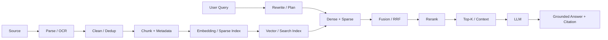
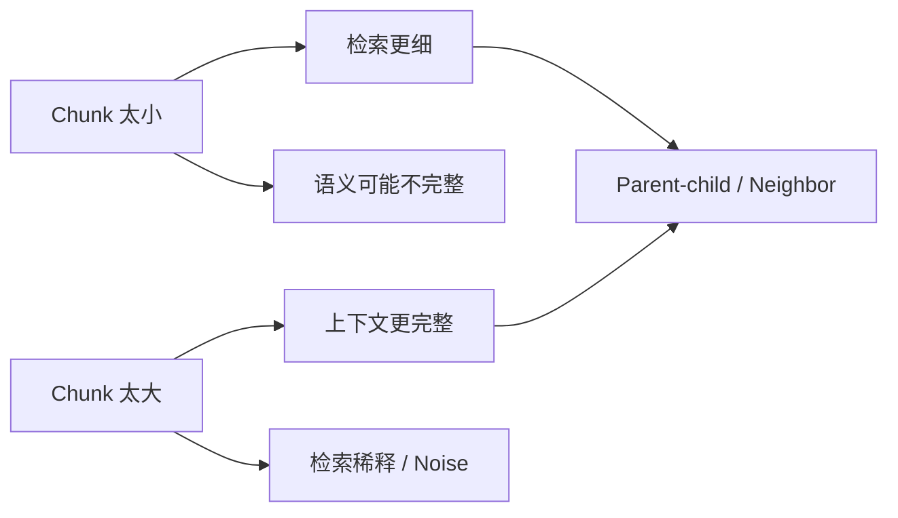
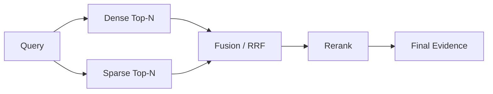
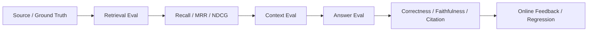
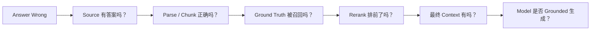

# RAG Review｜图解总览与综合自测

> 本页用于学完 `docs/01–34` 后做第二遍复习。不要把它当成第一次学习的替代品。

## 1. 总图一：完整 Production RAG



一句话复述：

> RAG 先把真实知识变成可追溯 Retrieval Unit，再把用户 Query 变成检索计划，经多路召回、融合、精排和 Context Construction，最后让模型基于 Evidence 生成并引用答案。

---

## 2. 总图二：Chunking 的核心矛盾



要记住：

```text
Retrieval Granularity
≠
Generation Context Granularity
```

小块可以负责“找”，大块 / Parent 可以负责“给模型看”。

---

## 3. 总图三：Retrieval Funnel



理解每层目标：

```text
Candidate Generation：Recall
Fusion：合并异构信号
Rerank：Precision
Final Context：Evidence Quality + Token Budget
```

---

## 4. 总图四：Evaluation 分层



不要说：

> “Recall 上升，所以 RAG 变好了。”

正确说法是：

> Retrieval、Context、Generation 要分层测，最后再看 End-to-end。

---

## 5. 总图五：Bad Case Attribution



这张图是面试中非常重要的 Troubleshooting 主线。

---

## 6. 总图六：Production Governance

```text
Document Identity / Lineage
        ↓
Version / Snapshot
        ↓
Incremental Update
        ↓
Freshness
        ↓
Permission / Tenant
        ↓
Trace / Observability
        ↓
Evaluation / Regression
        ↓
Rollback
```

Production RAG 和 Demo RAG 最大差异之一就在这里。

---

# 7. 20 个综合自测

### 1. 为什么 RAG 不是 Vector DB 的同义词？
<details><summary>查看参考答案</summary>
Vector DB 负责向量存储与 ANN；RAG 还包括 Corpus、Parsing、Chunk、Query、Dense/Sparse、Fusion、Rerank、Context、Grounding、Evaluation、Freshness 和 Permission 等完整证据工程。
</details>

### 2. 为什么 Cleaning / Dedup 会影响 Retrieval？
<details><summary>查看参考答案</summary>
重复和 Boilerplate 会制造重复 Chunk、稀释候选 Coverage、增加 Context Noise，并污染 Embedding 和 Citation。
</details>

### 3. Chunk 太大和太小分别有什么问题？
<details><summary>查看参考答案</summary>
太大导致语义稀释、噪声和 Token Cost；太小会切断逻辑并增加索引规模。
</details>

### 4. Parent-child 为什么有用？
<details><summary>查看参考答案</summary>
小 Child 负责精准召回，命中后回较完整 Parent，分离 Retrieval 和 Generation 的粒度需求。
</details>

### 5. Semantic Boundary Failure 是什么？
<details><summary>查看参考答案</summary>
Chunk 把必须一起理解的条件、结论、例外、表头等关系切断，导致虽然召回相关文本但 Evidence 不完整。
</details>

### 6. Rewrite、Multi-query、Decomposition、HyDE 的区别？
<details><summary>查看参考答案</summary>
Rewrite 改表达；Multi-query 用多表达扩大同一意图召回；Decomposition 拆复杂子问题；HyDE 生成假想文档帮助映射到文档语义空间。
</details>

### 7. No-hit 为什么不能只看一个 Cosine 阈值？
<details><summary>查看参考答案</summary>
相似度不是正确概率，还要结合 Coverage、Version、Permission、Query Type 和 Rerank 等信息。
</details>

### 8. Dense 和 BM25 各擅长什么？
<details><summary>查看参考答案</summary>
Dense 擅长语义泛化；BM25/Sparse 擅长错误码、编号、专有名词和精确词项。
</details>

### 9. 为什么 Dense Score 和 BM25 Score 不能直接相加？
<details><summary>查看参考答案</summary>
二者数值含义、尺度和分布不同，通常需 RRF、归一化或 Reranker 做融合。
</details>

### 10. RRF 为什么常用于 Hybrid？
<details><summary>查看参考答案</summary>
它基于相对排名而非原始异构分数，简单、稳定、无需训练。
</details>

### 11. Rerank 加了以后为什么可能变差？
<details><summary>查看参考答案</summary>
正确候选没召回、Domain Mismatch、输入截断、Query Drift、排序配置错误或 Candidate Diversity 下降。
</details>

### 12. Top-K 为什么要分层？
<details><summary>查看参考答案</summary>
Retrieval 偏 Recall，Rerank 和最终 Context 逐层缩小，以控制 Precision、Latency、Noise 和 Token Cost。
</details>

### 13. Context Construction 为什么不是字符串拼接？
<details><summary>查看参考答案</summary>
还需去重、Source Diversity、Parent Expansion、Version/Permission 检查、排序和 Token Budget。
</details>

### 14. Correctness 和 Faithfulness 有什么区别？
<details><summary>查看参考答案</summary>
Correctness 看事实是否正确；Faithfulness 看答案是否由给定 Evidence 支持。两者可能不一致。
</details>

### 15. Recall@K 与 MRR 分别回答什么？
<details><summary>查看参考答案</summary>
Recall@K 看相关 Evidence 是否进入前 K；MRR 看第一个相关结果排得多靠前。
</details>

### 16. 为什么 Evaluation Dataset 必须包含 No-hit？
<details><summary>查看参考答案</summary>
否则系统只被训练成“尽量回答”，无法评估 Should-refuse 能力和 Unsafe Answer。
</details>

### 17. Bad Case 第一层应该先查什么？
<details><summary>查看参考答案</summary>
先确认 Source of Truth 是否真的有答案，再往 Parsing / Chunk / Retrieval / Generation 排查。
</details>

### 18. Embedding Model 升级为什么需要 Version / Blue-Green？
<details><summary>查看参考答案</summary>
新旧向量空间可能不兼容，Blue-Green 可以离线构建、评测后切换并保留回滚路径。
</details>

### 19. 企业 RAG 为什么必须在 Retrieval 阶段做权限？
<details><summary>查看参考答案</summary>
避免无权内容进入候选和 LLM Context，减少信息泄露和 Post-filter 候选不足风险。
</details>

### 20. Agentic RAG 什么时候不值得？
<details><summary>查看参考答案</summary>
当一次固定 Retrieval 已能稳定解决简单问题时，Agent Loop 只会增加延迟、成本和评估难度。
</details>

---

## 8. 面试前最后一条主线

请能够不看材料完整说出：

```text
Source
→ Parse / Clean
→ Chunk / Lineage
→ Query Transform
→ Dense + Sparse
→ RRF / Fusion
→ Rerank
→ Top-K / Context
→ Ground / Citation
→ Retrieval Eval
→ End-to-end Eval
→ Bad Case
→ Freshness / Permission / Scale
```

如果这条主线能解释清楚，再进入 `interview/`。
