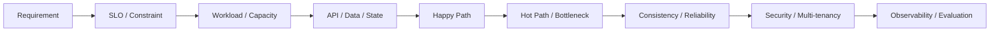
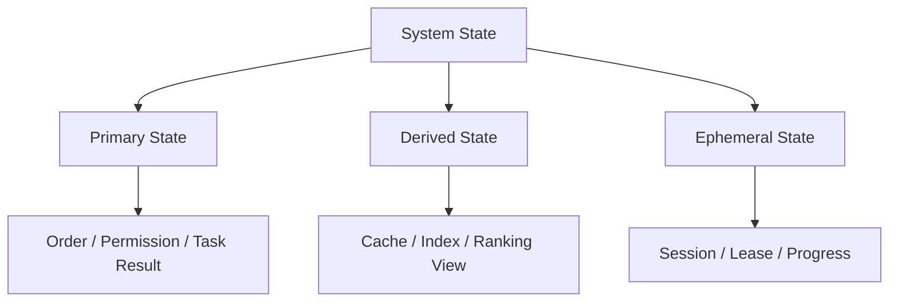
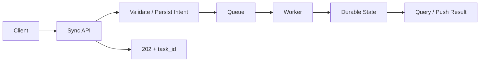
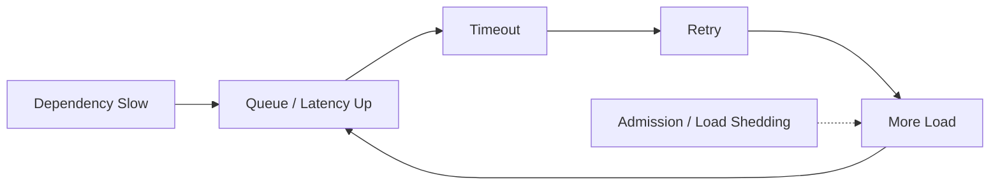
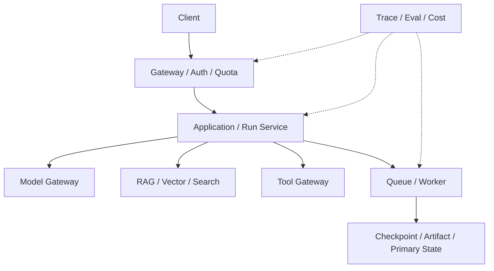

# System Design｜图解复习与综合自测

> 第一遍按 `docs/01 → 19` 学完整主线；这里不按文件重复，而是把 System Design 压缩成几张必须能从空白纸画出来的图。

---

## 图 1｜一题 System Design 的完整思考路径

如果面试中卡住，回到这条链，不要继续堆组件。

---

## 图 2｜State 先分三类

你应该能立刻说出每类 State 的 Durability、Consistency 和 Recovery 要求为什么不同。

---

## 图 3｜同步与异步边界

核心追问：为什么不是整条任务都挂在 HTTP Connection 上？

---

## 图 4｜正确性闭环

System Design 的正确性不只是“用了事务”。

---

## 图 5｜过载到级联故障

你应该能解释为什么 Retry 本身会成为故障放大器。

---

## 图 6｜AI-native Production Architecture

---

# 综合自测

1. 为什么 System Design 第一件事不是选数据库？

因为存储选择依赖数据模型、访问模式、一致性、规模和生命周期。先选产品会把需求硬塞进组件。

2. “强一致”为什么仍然是模糊需求？

应该继续定义业务 invariant、read-your-write、允许的 Freshness、哪些写不能重复等具体语义。

3. 平均 QPS 很低，系统为什么仍可能被打爆？

流量可能集中在 HotKey、Hot Tenant 或短时 Burst，平均值掩盖局部峰值。

4. Derived State 为什么应该可重建？

Cache/Search/Vector Index 等通常为了性能存在，能够从 Source of Truth 重建会显著降低迁移和故障恢复复杂度。

5. 为什么 Async 不是自动更快？

它只是把等待和执行解耦，真实工作量仍然存在，并新增 Queue、Retry、Duplicate、Task State 等复杂度。

6. Queue 为什么不能解决长期处理能力不足？

如果 arrival rate 长期高于 service rate，Queue 只会持续增长，最终仍需要扩容、限流或降载。

7. 为什么 Retry 必须建立在 Idempotency 之上？

Timeout 时调用方不知道服务端是否已经成功，直接重试可能重复产生副作用。

8. Compensation 为什么不是 Rollback？

外部动作已经真实发生，补偿只是执行新的反向业务动作，不能保证世界完全恢复原状。

9. 为什么 Failover 还要讨论 RPO？

副本可能有复制延迟，切换后可能丢最近写，RPO描述可接受的数据损失范围。

10. Cache 故障为什么可能打崩 DB？

平时由 Cache 吸收的大量请求会同时回源，形成流量放大，因此需要并发限制和降级。

11. hash(id) 很均匀为什么不一定是好 Shard Key？

如果查询无法按 id 路由，就可能每次 Fan-out 全部分片，查询成本很高。

12. 为什么 Multi-tenant 不只是 tenant_id Filter？

还要处理计算资源、Queue、Cache、Trace、Credential、Quota 和 Noisy Neighbor。

13. 为什么 AI API 返回 200 也可能算失败？

模型可能给出错误、无依据答案或 Tool 逻辑失败，需要质量与任务成功指标。

14. 为什么 LLM Gateway 不能只做 Provider Proxy？

真正的工程价值在 Routing、Quota、Streaming、Cost、Failover、Trace 和能力兼容。

15. Enterprise RAG 为什么需要 Index Generation？

支持离线构建、验证、灰度切换和回滚，避免在线原地升级形成半更新状态。

16. AgentRun 为什么必须 Durable？

执行可能跨长时间、连接断开、Worker Crash 和部署，不能只依赖进程内状态或 HTTP Connection。

17. Long-running Agent 最危险的重复副作用窗口是什么？

Tool 已成功但 Checkpoint 未保存就崩溃，Resume 后可能再次执行同一副作用。

18. 为什么 Vertical Agent 必须定义 Authoritative State？

LLM 不能成为订单、财务数字、游戏状态等业务事实的最终拥有者，真实事实必须来自确定性 Source/Tool。

19. 架构为什么要记录 Version？

Model、Prompt、Index、Service 和 Schema 版本决定行为，没有版本就无法复现 Bad Case 和安全回滚。

20. 一道陌生 System Design 题最可靠的恢复框架是什么？

Clarify → Quantify → Model State → Draw Happy Path → Find Bottleneck → Add Correctness/Reliability/Security → Break It → Verify It。

