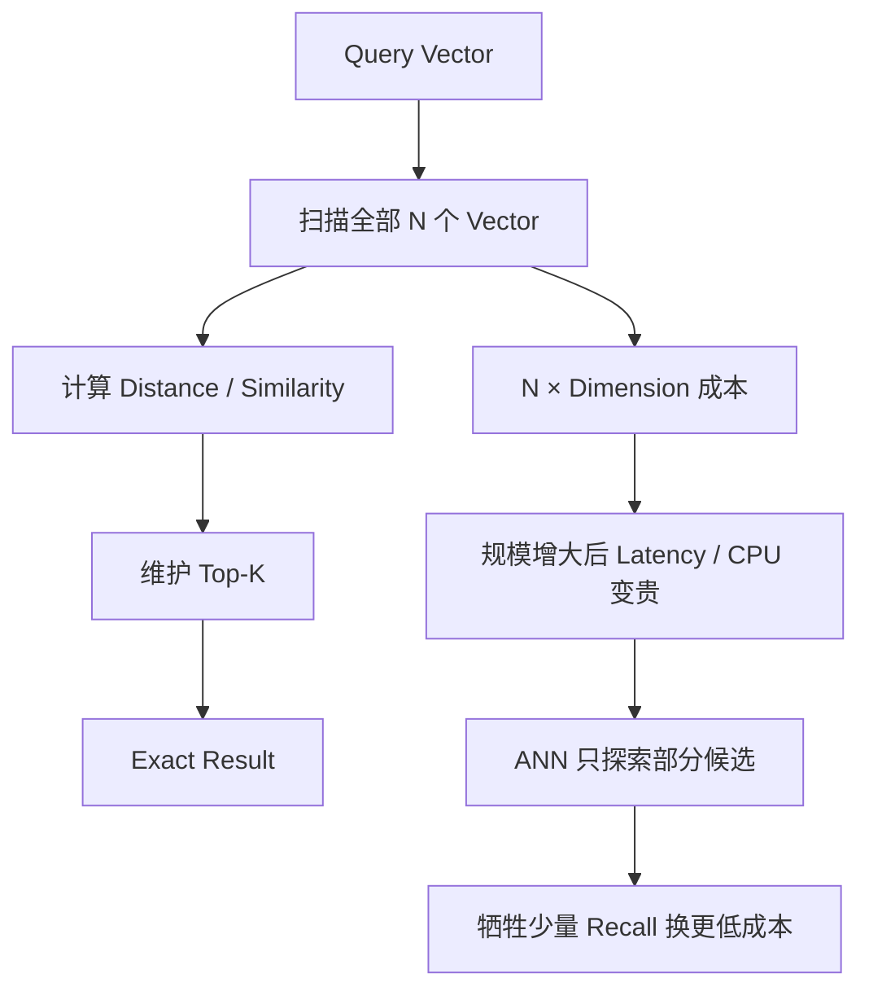
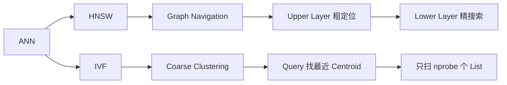
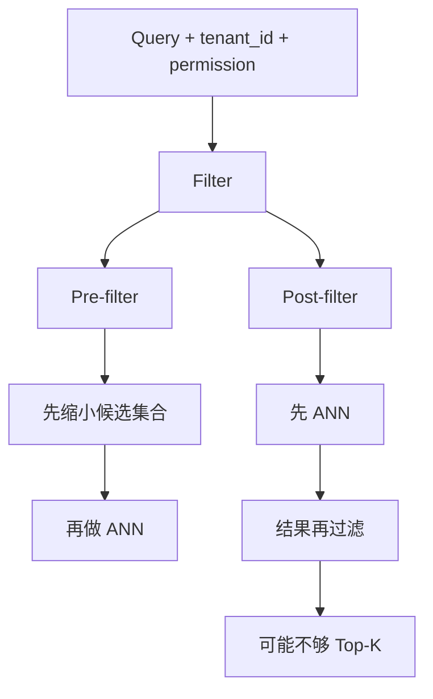
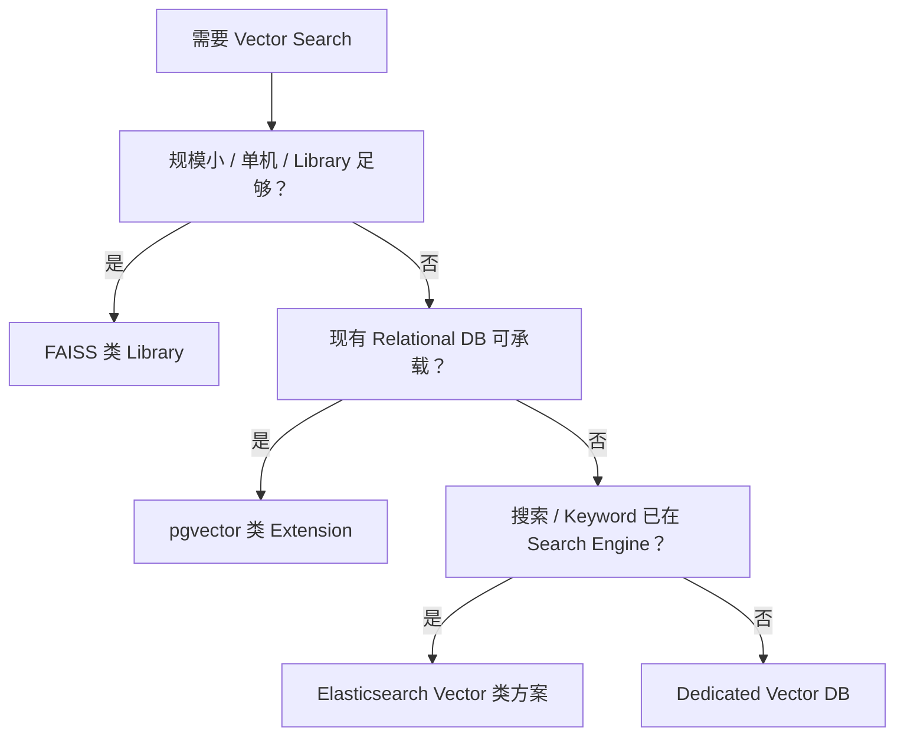

# Vector Database｜图解复习与自测

> 这一层不是重新讲一遍正文，而是把 23 章压缩成几条可以在脑中反复推演的执行路径。
>
> 推荐顺序：**先看图回忆 → 自己口述 → 再展开答案检查。**

---

# 1. 总图：从 Vector 到 Production Vector DB

```mermaid
flowchart LR
    A["语义对象"] --> B["Embedding Vector"]
    B --> C["Dimension / Normalization"]
    C --> D["Cosine / Dot / L2"]
    D --> E["Exact Top-K"]
    E --> F["Scale Problem"]
    F --> G["ANN"]
    G --> H["HNSW / IVF / Quantization"]
    H --> I["Schema / Metadata / Filter"]
    I --> J["Update / Delete / Compaction"]
    J --> K["Shard / Replica"]
    K --> L["Product / Architecture Selection"]
```



这张图是整个模块的主干。

如果某个知识点解释不出来，优先问自己：

> **它是在解决哪一步的瓶颈？**

---

# 2. Exact Search 为什么演化到 ANN



记住：

```text
ANN 不是“另一种距离函数”
ANN 是“怎样少看一部分候选仍尽量找到近邻”
```

---

# 3. HNSW 与 IVF 的核心直觉



### HNSW 主要记什么

```text
M
→ 图连接度 / Memory / Build

efConstruction
→ Build 时搜索宽度 / Build Quality / Cost

efSearch
→ Query 时搜索宽度 / Recall / Latency
```

### IVF 主要记什么

```text
nlist
→ 分多少个桶

nprobe
→ Query 时扫多少个桶
```

参数不是口诀，本质都在控制：

> **搜索候选范围有多大。**

---

# 4. Metadata Filter 为什么会改变 ANN



这张图要和“多租户安全”联系起来。

如果权限条件只是应用层最后再过滤，很容易出现：

```text
ANN 先召回了无权限数据
→ Post-filter 删除
→ Top-K 不够
```

甚至更严重：

```text
权限边界设计不当
→ 数据泄漏
```

---

# 5. Vector Index Lifecycle

```mermaid
flowchart LR
    A["Source Document"] --> B["Chunk / Metadata"]
    B --> C["Embedding Model v1"]
    C --> D["Vector Index v1"]
    D --> E["Model / Schema Change"]
    E --> F["Re-embedding"]
    F --> G["Vector Index v2"]
    G --> H["Validation"]
    H --> I["Traffic Switch"]
    I --> J["Retire v1"]
```



生产环境不要把：

```text
Embedding Model 升级
```

理解成：

```text
改一个配置然后继续往旧 Index 写
```

它往往是一次数据迁移 / 索引版本升级。

---

# 6. Product Selection 心智模型



真正的选型维度还包括：

```text
Scale
Update Rate
Filter
Recall / Latency
Memory
HA
Multi-tenancy
Operational Complexity
Existing Stack
```

不要把这张图当绝对规则，它只是决策入口。

---

# 7. 五组综合自测

## A. Vector / Similarity

<details>
<summary>1. Cosine、Dot Product、L2 分别在比较什么？</summary>

Cosine 更关注方向夹角；Dot Product 同时受方向和模长影响；L2 衡量欧氏距离。归一化后，Cosine 与 Dot Product 的排序关系会更接近。具体选择必须与 Embedding Model 和索引配置一致。

</details>

<details>
<summary>2. 为什么 Dimension 增大会带来系统成本？</summary>

单条向量占用更多内存或磁盘，距离计算需要更多运算，网络传输、Index Build 和 Cache 工作集也会扩大。因此 Dimension 不只是模型参数，也是基础设施容量参数。

</details>

<details>
<summary>3. Exact Search 的优势和问题分别是什么？</summary>

优势是结果精确、逻辑简单，适合小数据集和 Ground Truth；问题是通常需要扫描大量候选，成本随数据规模和维度增长，因此大规模低延迟场景常需要 ANN。

</details>

<details>
<summary>4. ANN 为什么不等于“结果随机”？</summary>

ANN 使用结构化索引和启发式搜索缩小候选范围，目标仍然是尽可能找到真实近邻，只是为了效率允许一定 Recall 损失。

</details>

---

## B. HNSW / IVF / Quantization

<details>
<summary>5. HNSW 为什么要分层？</summary>

高层图提供稀疏、长距离导航，帮助快速接近目标区域；低层图更密集，用于局部精细搜索，从而兼顾搜索速度和近邻质量。

</details>

<details>
<summary>6. efSearch 增大通常会发生什么？</summary>

Query 探索更多候选，Recall 往往提高，但 Latency 和 CPU 成本也会上升。它是典型 Query-time Recall / Latency knob。

</details>

<details>
<summary>7. IVF 的 nprobe 为什么是重要参数？</summary>

它控制 Query 搜索多少个 inverted lists。nprobe 增大通常扩大候选范围、提高 Recall，但查询成本也增加。

</details>

<details>
<summary>8. PQ 解决什么问题？代价是什么？</summary>

PQ 用子空间量化和 Codebook 将高维 float 向量压缩成短编码，显著降低 Memory / Storage，并可加速距离估算；代价是 Quantization Error，可能降低 Recall 或排序精度。

</details>

<details>
<summary>9. HNSW 一定比 IVF 好吗？</summary>

不是。要结合规模、Memory、Build Cost、Update Pattern、Latency、Recall、过滤能力和产品实现。选 Index 是多维 Trade-off，不是算法排名。

</details>

---

## C. Data Model / Filter

<details>
<summary>10. Vector DB 为什么还需要 Primary Key 和 Metadata？</summary>

Vector 解决相似性搜索，但业务仍需要稳定 ID、文档来源、Tenant、权限、版本、时间等字段来定位、过滤、更新和追踪数据。

</details>

<details>
<summary>11. Pre-filter 和 Post-filter 的风险分别是什么？</summary>

Pre-filter 如果候选过少或与 Index 结合不好，可能降低 ANN 效率；Post-filter 可能在 ANN 返回后删掉大量结果，造成有效 Top-K 不足，也可能让权限边界设计更危险。

</details>

<details>
<summary>12. Tenant Isolation 为什么不能只靠 metadata 字段“记得过滤”？</summary>

因为忘记过滤就是安全事故。生产系统应通过统一 Query Layer、Namespace / Partition、权限验证、测试和审计等机制把隔离变成系统约束，而不是开发者习惯。

</details>

---

## D. Lifecycle / Production

<details>
<summary>13. Delete 为什么可能不是“立刻从 Index 里物理消失”？</summary>

很多索引和存储系统会先做逻辑删除或 Tombstone，再在后台 Compaction / Rebuild 时清理。必须理解产品的可见性和回收语义。

</details>

<details>
<summary>14. Embedding Model 升级为什么常需要新 Index？</summary>

不同模型甚至不同版本可能产生不同向量空间。新旧向量混在同一个语义空间中未必可比较，因此通常需要 Version、Re-embedding、新 Index、验证和切流。

</details>

<details>
<summary>15. Replica 和 Shard 分别解决什么？</summary>

Shard 主要把数据水平拆分来扩容量和并行处理；Replica 保存副本，主要服务高可用和读扩展。二者不是同一个概念。

</details>

<details>
<summary>16. Vector Search 变慢时先检查哪些方向？</summary>

先拆 Query Path：Filter Selectivity、ANN 参数、候选规模、Shard Fan-out、Segment 数量、Cache / Memory、CPU、Disk / Network、并发和 Index 状态，而不是第一时间盲调 efSearch。

</details>

<details>
<summary>17. Recall 掉了为什么不能直接怪 HNSW 参数？</summary>

还可能是 Embedding Model、Normalization、Metric 不匹配、数据版本、Filter、Index Build、Delete / Update、Ground Truth 定义等问题。需要分层定位。

</details>

---

## E. Architecture / Boundary

<details>
<summary>18. FAISS 和专用 Vector DB 的本质边界是什么？</summary>

FAISS 首先是向量相似性搜索 Library；专用 Vector DB 除 ANN 外还通常提供持久化、Schema / Metadata、Filter、更新、分片、副本、多租户和运维能力。是否需要 DB 取决于系统需求。

</details>

<details>
<summary>19. Graph DB 和 Vector DB 最核心的区别是什么？</summary>

Vector DB 优化语义空间中的近邻搜索；Graph DB 优化显式 Node / Edge 关系和图遍历。相似性不等于显式关系。

</details>

<details>
<summary>20. Vector DB 在 RAG 里应该负责到哪里？</summary>

负责 Vector Storage、Distance、ANN、Filter、Lifecycle 和 Scale；Query Rewrite、Dense/Sparse 组合、Hybrid、RRF、Rerank、Top-K Strategy 与 Retrieval Evaluation 属于 RAG Retrieval System。

</details>

---

# 8. 一页复习顺序

第一次复习：

```text
Vector
→ Similarity
→ Exact
→ ANN
→ HNSW / IVF
```

第二次复习：

```text
Index Selection
→ Filter
→ Data Model
→ Update / Delete
→ Lifecycle
```

第三次复习：

```text
Shard / Replica
→ Capacity
→ Troubleshooting
→ Product Selection
→ Graph / RAG Boundary
```

真正准备面试时，不要只背：

```text
M = 16
nprobe = 10
```

而应该能解释：

> **如果 Recall 不够、Latency 太高、Memory 爆了、Filter 很重、Embedding Model 要升级，我会怎样定位并做 Trade-off。**
